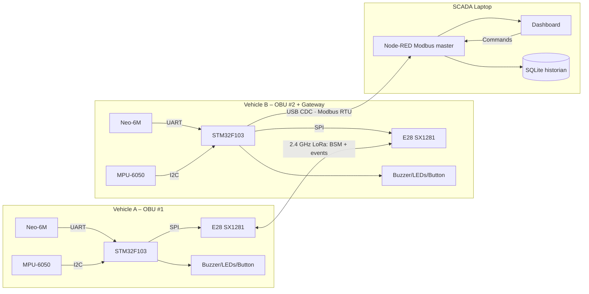
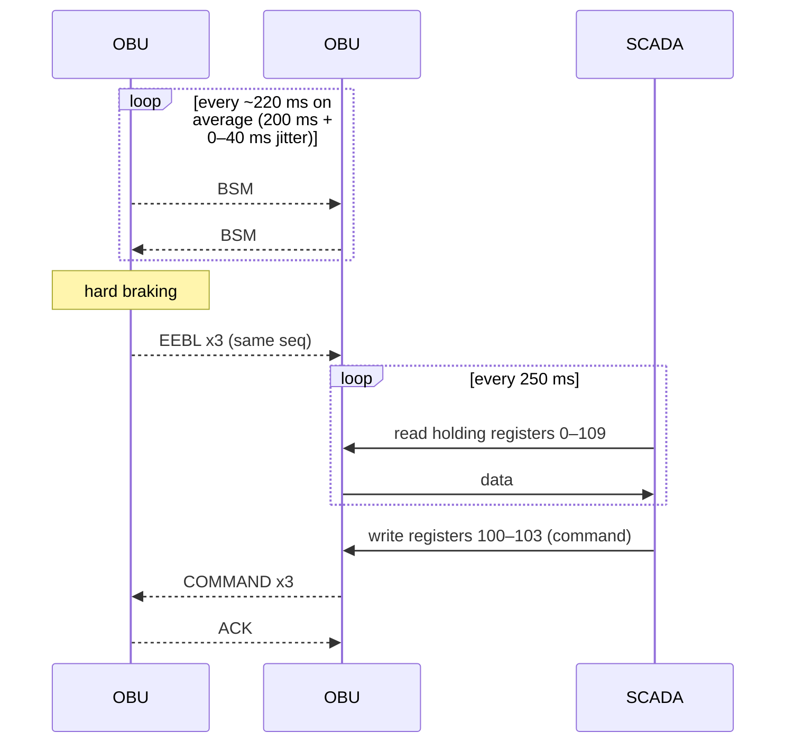

# V2V Communication using SCADA

A low-cost vehicle-to-vehicle (V2V) safety prototype. Two On-Board Units (OBUs), one per vehicle,
exchange status messages over a 2.4 GHz LoRa radio (Semtech SX1281) at 5 Hz nominal. Each OBU computes
collision risk and detects driving events (hard braking, crash, rollover, pothole) from its GPS and IMU,
then warns its driver and the other vehicle. OBU #2 also acts as a **SCADA gateway**: it exposes its data
as a Modbus RTU slave over USB, and a Node-RED operator station shows a live map, telemetry, alarms,
history, and sends commands back to the vehicles.

> **Status (2026-11-25):** all software phases are written and the software checks below pass.
> **No field test has been run and no hardware has been powered.** Every measured result is still
> a placeholder (see [Test results](#test-results)). Numbers quoted as "target" come from the design
> specification and are not measurements.

> **Safety disclaimer.** This is an educational prototype for a final-year project. It is **not** a
> certified safety device, must not be relied on for driving decisions or emergency response, and must
> not be used on public roads as a safety system. Warnings can be late, missed, or false.

Source of truth: [`docs/V2V_BUILD_GUIDE.md`](docs/V2V_BUILD_GUIDE.md) (Part A = build phases, Part B = specification S1–S17).
Project rules for the coding assistant: [`CLAUDE.md`](CLAUDE.md). Hardware answers recorded so far: [`docs/verified.md`](docs/verified.md).

---

## 1. What it does

| Feature | Behaviour | Level |
|---|---|---|
| F0 Packet exchange | BSM status packets, 32-byte frame, CRC-16/CCITT, sequence numbers, freshness check | Must |
| F1 Forward collision warning (FCW) | TTC and headway to a neighbour ahead; Caution at TTC ≤ 4 s, Critical at TTC ≤ 2 s; buzzer and LEDs | Must |
| F2 Emergency brake light (EEBL) | Hard braking (a_long < −3.9 m/s² for 200 ms) is broadcast three times; receiving vehicles alert | Must |
| F3 Crash → SOS | Total acceleration > 4 g followed by a stop within 3 s; SOS with GPS position to SCADA | Must |
| F4 Rollover | Roll or pitch > 60° held for 1 s | Should |
| F5 Pothole / hazard | High-passed vertical acceleration above 1.5 g while moving faster than 3 m/s with GPS; hazard broadcast with GPS position | Should |
| F6 SCADA | Live map, telemetry, link quality, alarms with acknowledge, SQLite historian | Must |
| F7 SCADA → vehicle commands | Hazard alert, speed advisory, clear SOS, buzzer test, ping (Modbus writes) | Should |
| F8 Simulation mode | Indoor demo: simulated GPS for each OBU, and a Python gateway simulator without any hardware | Must |
| F9 Historian | One telemetry row per vehicle per second; alarm log; CSV export | Should |
| F10 Battery monitoring | 18650 voltage on PA0, percentage, low-battery flag, radio cut-off at 3.2 V | Should |

Not implemented (Level 3, spec S9.8 / S7.4): dead reckoning, SX1281 time-of-flight ranging, OLED display, encryption.

---

## 2. Architecture

### 2.1 Block diagram (ASCII)

```
 ┌──────────── VEHICLE A (OBU #1) ────────────┐                ┌──────── VEHICLE B (OBU #2 + GATEWAY) ────────┐
 │ [Neo-6M]--UART-->┌──────────┐              │    2.4 GHz     │              ┌──────────┐<--UART--[Neo-6M] │
 │                  │ STM32F103│--SPI-->[E28]~~~~~~ LoRa ~~~~~~~~[E28]<--SPI---│ STM32F103│                  │
 │ [MPU-6050]-I2C-->│  (RTU)   │              │   V2V link     │              │(RTU+GW)  │<--I2C--[MPU-6050]│
 │                  └────┬─────┘              │                │              └────┬─────┘                  │
 │ [Buzzer][LEDs][Button]┘                    │                │   [Buzzer][LEDs][Button]┤                  │
 │ [18650→TP4056→MT3608→AMS1117] power        │                │                         │ USB (COM port)   │
 └────────────────────────────────────────────┘                └─────────────────────────┼──────────────────┘
                                                                                         │ Modbus RTU 115200 8N1
                                                     ┌──────────── SCADA LAPTOP ─────────▼──────────────┐
                                                     │ Node-RED: Modbus master (250 ms) → decode →        │
                                                     │ dashboard (map, telemetry, alarms, control)        │
                                                     │ → alarm logic → SQLite historian                   │
                                                     │ ← operator commands (write registers 100–103)      │
                                                     └────────────────────────────────────────────────────┘
```

### 2.2 Block diagram (Mermaid)



### 2.3 Message flow



### 2.4 SCADA layers

| Level | Name | In this project |
|---|---|---|
| 0 | Field devices | GPS, IMU, buzzer, LEDs, button, battery sensing |
| 1 | Control (RTU) | STM32 OBUs + V2V radio network |
| 2 | Communication / server | Modbus RTU over USB; Node-RED Modbus master |
| 3 | Supervisory / HMI | Node-RED dashboard, alarms, SQLite historian |

---

## 3. Hardware

### 3.1 Per vehicle (two vehicles, OBU #1 and OBU #2)

| Part | Job | Interface | Notes |
|---|---|---|---|
| STM32F103C8T6 "Blue Pill" | All firmware; gateway Modbus over USB (OBU #2) | — | 72 MHz Cortex-M3, 3.3 V logic. Flash size to be verified (see §6 and §11) |
| Ebyte E28-2G4M20SX (Semtech SX1281) | V2V radio, 2445.0 MHz LoRa, SF7, 812.5 kHz, CR 4/5 | SPI + BUSY, DIO1, NRESET, TXEN, RXEN | **3.3 V only. Never transmit without an antenna** |
| u-blox Neo-6M | Position, speed, heading, UTC | UART (PA3 RX, PA2 TX) | Configured to 5 Hz and 38400 baud at boot |
| MPU-6050 | Acceleration and rotation | I2C 0x68 (PB6 SCL, PB7 SDA) | Calibrated at each boot (keep still 2 s) |
| 18650 Li-ion 3.7 V 2000 mAh | Energy | — | 3.0–4.2 V per cell |
| TP4056 (USB-C charger) | 1 A CC/CV charging | USB-C | Protection pads: to verify (see `docs/verified.md`) |
| MT3608 boost module | Raises battery to 7.0 V | — | Adjust trimmer to 7.0 V before connecting the boards |
| AMS1117-5.0 module | Clean 5.0 V for GPS and the rest | — | Needs input ≥ about 6.5 V |
| Active buzzer 5 V + BC547 driver | Warnings | PB8 | |
| 3 LEDs (red PB14, yellow PB15, green PA8) | Warnings and status | — | 330 Ω each |
| Push button | Local SOS cancel (hold 3 s) | PB9, active low | |
| Battery divider (2 × 100 kΩ) | Battery voltage | PA0 | Ratio 2.0 in `config.h` |

Radio and microcontroller pin map: `firmware/v2v_obu/config.h` (section "Pins").

### 3.2 Bill of materials (spec §S5)

Ordered parts (approximate prices as recorded in the spec):

| Supplier | Item | Qty | Amount (₹) |
|---|---|---|---|
| Hubtronics (#129029) | Ebyte E28-2G4M20SX SX1281 2.4 GHz LoRa module | 2 | 1,296.61 (1,605.00 with shipping and tax) |
| Robocraze (#392296) | 18650 holder, MT3608, AMS1117-5 V, 18650 2000 mAh, TP4056 Type-C, MPU-6050, Neo-6M with EEPROM, STM32F103C8T6 | 2 each | 1,712.00 |

Combined ₹3,317 (about ₹1,658 per vehicle). These are the spec estimates; check current prices before buying.

Still to buy (spec §S5.3, approximate): ST-Link V2 clone (SWD programming), 2.4 GHz antennas matching the
E28 connector (two, essential), 5 V active buzzers, LEDs, resistors (330 Ω ×6, 1 kΩ ×2, 100 kΩ ×4), BC547 ×2,
tactile buttons ×2, 470 µF and 100 nF decoupling capacitors, perfboard, headers, slide switches,
micro-USB data cable, USB-TTL adapter (CP2102 or CH340) for the debug UART, optional AMS1117-3.3 modules.

---

## 4. Repository layout

```
.
├── CLAUDE.md                     project rules for the coding assistant
├── README.md                     this file
├── docs/
│   ├── V2V_BUILD_GUIDE.md        build guide and specification (source of truth)
│   ├── V2V_SCADA_Project_Plan.md older draft (the build guide wins)
│   ├── verified.md               answers to hardware VERIFY items
│   ├── test_plan.md              field test plan A1–A14, tuning T1–T2, results table
│   ├── report_material.md        text for the project report
│   ├── demo_script.md            10-minute viva demo, outdoor and indoor versions
│   ├── viva_questions.md         likely examiner questions and answers
│   └── results/                  field-test outputs (sample/ = SYNTHETIC data only)
├── firmware/
│   ├── v2v_obu/                  OBU firmware (Arduino / STM32duino, C++)
│   │   ├── v2v_obu.ino           main sketch: scheduler, states, receive path, logging
│   │   ├── config.h              all constants (pins, radio, thresholds, Modbus map)
│   │   ├── v2v_packet.*          packet layout, CRC-16/CCITT, receive validation (portable)
│   │   ├── geo.*, neighbors.*, safety.*   portable geometry, neighbour table, FCW/EEBL/crash/rollover/pothole (portable)
│   │   ├── radio.*, gps.*, imu.*, power.*, alerts.*, button.*   hardware drivers
│   │   ├── gateway.*, modbus_rtu.*        Modbus RTU slave (gateway build only; modbus_rtu is portable)
│   │   └── sim.*                 SIM_MODE simulated GPS
│   ├── bringup/                  t1–t7 bring-up sketches (Phase 2)
│   └── drivertest/               driver test sketch (Phase 4)
├── tools/
│   ├── flash.py                  compile and upload one OBU build (vehicle, gateway, sim, log)
│   ├── fqbn.txt                  board name used by arduino-cli
│   ├── serial_log.py             timestamped serial logger (--list shows ports)
│   ├── modbus_probe.py           read and decode the gateway registers; send commands
│   ├── gateway_sim.py            Modbus TCP gateway simulator (no hardware)
│   ├── v2v_modbus.py             shared register map (Python side)
│   ├── log_analyzer.py           field-test analysis: PNG plots and summary.md
│   ├── make_sample_data.py       writes SYNTHETIC sample inputs
│   ├── requirements.txt          Python packages (pinned)
│   └── versions.txt              exact toolchain versions used
├── tests/host/                   PC unit tests (C++ with g++, Python with unittest)
│   └── run_tests.py              runs both
├── scada/
│   ├── start_scada.bat           start Node-RED (Windows)
│   ├── start_scada.sh            start Node-RED (Git Bash)
│   ├── README.md                 SCADA details, endpoints, alarm rules
│   ├── historian/                SQLite schema; v2v.db is local (git-ignored)
│   └── node-red/                 Node-RED project: build_flows.js generates flows.json
└── data/
    ├── sample/                   SYNTHETIC inputs for the analyzer (not measurements)
    └── (field data goes here, see docs/test_plan.md §2.4)
```

---

## 5. Setup (Windows, Git Bash or PowerShell)

Exact versions are listed in `tools/versions.txt`. Commands marked *installed* below were checked on this
machine on 2026-11-25; the install commands themselves were not re-run.

1. **Arduino CLI 1.6.0** (installed). `flash.py` looks for `arduino-cli` on PATH, then at
   `C:/Program Files/Arduino CLI/arduino-cli.exe`.
   ```bash
   "/c/Program Files/Arduino CLI/arduino-cli.exe" version
   ```
2. **STM32duino core 3.1.0** (installed) and **RadioLib 8.0.0**, **TinyGPSPlus 1.0.3** (installed):
   ```bash
   "/c/Program Files/Arduino CLI/arduino-cli.exe" core install STMicroelectronics:stm32@3.1.0
   "/c/Program Files/Arduino CLI/arduino-cli.exe" lib install RadioLib@8.0.0 TinyGPSPlus@1.0.3
   "/c/Program Files/Arduino CLI/arduino-cli.exe" core list
   "/c/Program Files/Arduino CLI/arduino-cli.exe" lib list
   ```
   The four `Modbus*` libraries listed in `tools/versions.txt` are not used by the firmware (the gateway
   uses the project's own `modbus_rtu.*`).
3. **Uploads** need **STM32CubeProgrammer** (ST account required) because the board is set to the
   `swdMethod` upload method. An ST-Link V2 clone is needed for SWD. The core's OpenOCD-based STLink
   upload method is an alternative. Not installed yet.
4. **Python 3.12** with the project venv (installed):
   ```bash
   tools/.venv/Scripts/python.exe --version     # 3.12.x
   tools/.venv/Scripts/python.exe -m pip list   # matplotlib 3.11.2, numpy 2.5.5, pymodbus 3.16.2, pyserial 3.5
   ```
   To recreate it: `python -m venv tools/.venv` then `tools/.venv/Scripts/python.exe -m pip install -r tools/requirements.txt`.
5. **g++ for host tests** (WinLibs MinGW-w64 UCRT, installed): `winget install BrechtSanders.WinLibs.POSIX.UCRT`.
   `tests/host/run_tests.py` finds it on PATH, through `$GXX`, or in the WinGet package folder.
6. **Node.js 24.x and npm 12** and the SCADA packages (installed in `scada/node-red/node_modules`):
   ```bash
   cd scada/node-red && npm install && npm ls --depth=0
   ```
   Pinned: `node-red` 5.0.10, `@flowfuse/node-red-dashboard` 1.37.0, `node-red-contrib-web-worldmap` 5.9.2,
   `node-red-node-sqlite` 2.0.1, `modbus-serial` 8.0.25.

---

## 6. Build and flash the boards

All builds are run from the repository root. Build output goes to `build/obu<ID>/` (git-ignored).
`--compile-only` builds without uploading. Without it, the board is uploaded over SWD (ST-Link).

| Board | Command | Used for |
|---|---|---|
| OBU #1 (vehicle) | `tools/.venv/Scripts/python.exe tools/flash.py --id 1` | Normal use |
| OBU #1 with CSV logging | `tools/.venv/Scripts/python.exe tools/flash.py --id 1 --log` | Field tests A6–A9, A12, threshold tuning |
| OBU #2 (vehicle + SCADA gateway) | `tools/.venv/Scripts/python.exe tools/flash.py --id 2 --gateway` | Normal use with SCADA |
| OBU #2 gateway with CSV logging | `tools/.venv/Scripts/python.exe tools/flash.py --id 2 --gateway --log` | A6 |
| Indoor demo, vehicle | `tools/.venv/Scripts/python.exe tools/flash.py --id 1 --sim` | SIM_MODE (simulated GPS) |
| Indoor demo, gateway | `tools/.venv/Scripts/python.exe tools/flash.py --id 2 --gateway --sim` | SIM_MODE gateway |

Compile only (no board needed), for example before a demo:
```bash
tools/.venv/Scripts/python.exe tools/flash.py --id 1 --compile-only
tools/.venv/Scripts/python.exe tools/flash.py --id 2 --gateway --compile-only
```

Upload to a specific port (optional, passed to arduino-cli):
```bash
tools/.venv/Scripts/python.exe tools/flash.py --id 2 --gateway --port COM5
```

Notes:
- The board type is set in `tools/fqbn.txt`: `BLUEPILL_F103CB` (128 KB flash). The firmware is about 85–87 KB,
  so a 64 KB Blue Pill cannot run it. The flash size of your boards is an open VERIFY item (`docs/verified.md`, item 6).
- `--log`: the 1 Hz debug text is turned off, and a 20 Hz CSV is printed on Serial1 (and on USB in OBU builds).
  In gateway builds USB belongs to Modbus, so the CSV goes out on Serial1 only (through a USB-UART adapter).
  Which pins carry Serial1 is not yet confirmed (see the test plan, §0 and §1).
- `--sim`: simulated GPS. Replace the placeholder coordinates first (`SIM_LAT0_PLACEHOLDER_E7` / `SIM_LON0_PLACEHOLDER_E7`
  in `firmware/v2v_obu/config.h`, currently 17.385 N, 78.4867 E, which are placeholders for the college site).
- Bring-up sketches (Phase 2) use a different command: see `firmware/bringup/README.md`.
- Last compile check on this machine (2026-11-25): OBU #1 normal build 84,964 bytes (64 % of program
  storage) with no compiler warnings; OBU #2 gateway build 87,012 bytes (66 %). The gateway build shows one
  `-Wimplicit-fallthrough` warning inside the third-party TinyGPSPlus library (`TinyGPS++.cpp`, line 63), which
  is outside this repository.

---

## 7. Host unit tests

The portable logic (packet, geometry, neighbour table, safety rules, Modbus RTU slave) is compiled with g++
on the PC. The Python tools have unit tests too.

```bash
tools/.venv/Scripts/python.exe tests/host/run_tests.py
```

Last run on 2026-11-25: 66 C++ tests (290 checks) passed, 26 Python tests passed (`ALL HOST TESTS PASSED`).

Run this (and a compile) after every code change, as CLAUDE.md requires.

---

## 8. Simulator, Modbus probe and SCADA (no hardware)

### 8.1 Gateway simulator

The simulator is a Modbus TCP server with the same register map as the OBU #2 gateway (unit 1, `127.0.0.1:5020`).
It runs a scripted scenario: vehicle 2 approaches vehicle 1 at 8 m/s, brakes to a stop 3 m behind it, and repeats.
It also produces a hard-brake event, a hazard every 90 s, a crash on vehicle 1 every 120 s (auto-cleared
after 30 s) and a short link loss every 180 s. Coordinates are placeholders.

```bash
tools/.venv/Scripts/python.exe tools/gateway_sim.py --speedup 10
```
Stop it with Ctrl+C. Use `--seconds N` to exit automatically after N seconds.

### 8.2 Modbus probe

With the simulator running (or the real gateway on a COM port):

```bash
tools/.venv/Scripts/python.exe tools/modbus_probe.py --tcp 127.0.0.1:5020 --count 2
tools/.venv/Scripts/python.exe tools/modbus_probe.py --serial COM5 --count 300 > data/a1_probe.txt
tools/.venv/Scripts/python.exe tools/modbus_probe.py --tcp 127.0.0.1:5020 --command 4 0 1
```
The last command sends a buzzer test (code 4) to vehicle 1 and exits. Stop the SCADA first when probing the
real COM port, because only one program can use it.

### 8.3 Start the SCADA

Node-RED starts on port 1880. The default source is the simulator (`V2V_SOURCE=SIM`, Modbus TCP 127.0.0.1:5020).

Windows (cmd or PowerShell, from the repository root), with the simulator already running:
```bat
scada\start_scada.bat
```
Git Bash:
```bash
scada/start_scada.sh
```
Real gateway (OBU #2 on USB), set the source and COM port first. Replace COM5 with your port:
```bat
set V2V_SOURCE=GATEWAY
set V2V_PORT=COM5
scada\start_scada.bat
```

Pages, once the banner says the server is running (the first start takes about 20–30 s to load the palette):

| URL | Content |
|---|---|
| http://localhost:1880/dashboard/map | Live map, vehicle markers, red SOS, yellow hazards |
| http://localhost:1880/dashboard/telemetry | Per-vehicle gauges, chart, values |
| http://localhost:1880/dashboard/link | Distance, TTC, warning level, latency, counters, gateway status |
| http://localhost:1880/dashboard/alarms | Active alarms, acknowledge, history, CSV links |
| http://localhost:1880/dashboard/control | Hazard alert, clear SOS, buzzer test, ping, speed advisory |
| http://localhost:1880/worldmap | Stand-alone map |
| http://localhost:1880/v2v/status | JSON: source, gateway status, latest decoded frame, active alarms |
| http://localhost:1880/v2v/command?code=4&param=0&target=1 | Send a command (code 1–5, target 0 = all) |
| http://localhost:1880/v2v/export.csv?table=telemetry | Telemetry CSV (also `table=alarms`) |
| http://localhost:1880/ | Node-RED editor |

Rebuild the flow after editing `scada/node-red/build_flows.js` (do not hand-edit `flows.json`):
```bash
node scada/node-red/build_flows.js
```

The SCADA writes its historian to `scada/historian/v2v.db`. Simulator and SCADA runs add rows to it. Move it aside
before a field test (see `docs/test_plan.md`, §0).

---

## 9. Test results

**No field test has been run yet.** The results below are placeholders. Fill them in only from real measurements.
Procedures, pass criteria and data file names are in [`docs/test_plan.md`](docs/test_plan.md).
The numbers in the "Design target" column come from the specification (S14) and are targets, not results.

| ID | Test | Design target (spec S14) | Measured |
|---|---|---|---|
| A1 | Packet exchange, 5 min | ~5 packets/s per neighbour; CRC errors < 1 % | **[TO FILL after field test A1: rx count ___ in 300 s, CRC error ___ %]** |
| A2 | Range, 50 m steps | PDR ≥ 90 % at ≥ 200 m line of sight | **[TO FILL after field test A2: largest distance with PDR ≥ 90 % = ___ m]** |
| A3 | Latency, 100 PINGs | mean RTT/2 < 50 ms; max < 100 ms | **[TO FILL after field test A3: mean ___ ms, max ___ ms]** |
| A4 | PDR at 50 m, 1000 BSMs | ≥ 95 % | **[TO FILL after field test A4: PDR ___ %]** |
| A5 | Distance vs tape | error ≤ 5 m at 10/25/50/100 m | **[TO FILL after field test A5: max error ___ m]** |
| A6 | FCW approach | Caution at TTC 4 ± 0.5 s; Critical at 2 ± 0.5 s | **[TO FILL after field test A6: Caution TTC ___ s, Critical TTC ___ s over 5 runs]** |
| A7 | EEBL follower alert | < 200 ms | **[TO FILL after field test A7: ___ ms (video frame count)]** |
| A8 | Crash on foam, SOS | SOS on SCADA < 2 s with position | **[TO FILL after field test A8: delay ___ s, position valid yes/no]** |
| A9 | Rollover | alarm on each run | **[TO FILL after field test A9: ___ / 3 runs]** |
| A10 | Each SCADA command | reacts < 1 s; ACK counter rises | **[TO FILL after field test A10: ___ ]** |
| A11 | Link lost on switch-off | alarm < 2.5 s | **[TO FILL after field test A11: ___ s]** |
| A12 | 30 min normal use | 0 crash/rollover false alarms | **[TO FILL after field test A12: false alarms ___ ]** |
| A13 | Battery life | ≥ 5 h | **[TO FILL after field test A13: runtime ___ h]** |
| A14 | SIM indoor demo | DoD items 2–6 work | **[TO FILL after field test A14: checklist ___ ]** |
| T1–T2 | IMU threshold tuning (§S13.3) | normal-use maxima < 60 % of thresholds | **[TO FILL after tuning drives: ___ ]** |

Analysis with `tools/log_analyzer.py` writes PNG plots and `summary.md` to `docs/results/` by default
(`--out-dir` changes the folder). Example, run on the **SYNTHETIC** sample data into a scratch folder:
```bash
tools/.venv/Scripts/python.exe tools/log_analyzer.py --db data/sample/sample_v2v.db --rtt data/sample/sample_rtt.csv --distance-error data/sample/sample_distance_tape.csv --imu-log data/sample/sample_imu_normal_drive.csv --out-dir "$TEMP/v2v_analysis_sample"
```
Field-data example (after the tests): `tools/.venv/Scripts/python.exe tools/log_analyzer.py --imu-log data/a6_fcw_run1.csv`.
The files in `docs/results/sample/` and `data/sample/` are **SYNTHETIC** and must not be quoted. They only show that the analyzer works.

---

## 10. Status by phase

| Phase | Content | Software | Hardware |
|---|---|---|---|
| 0 | Project setup, toolchain, serial logger | Done | — |
| 1 | Hardware assembly (hands-on) | — | **Pending (not started on this machine)** |
| 2 | Bring-up sketches T1–T7 | Compiled | **Not run on hardware** |
| 3 | Portable logic and host unit tests | Done, tests pass | — |
| 4 | Hardware drivers | Done, compiles in the OBU build | **Not run on hardware** |
| 5 | OBU firmware (BSM, FCW, EEBL, crash, rollover, pothole, commands, SIM) | Done, compiles | **Not run on hardware** |
| 6 | Modbus gateway, simulator, probe | Done, host tests pass, simulator and probe checked | **Not run with OBU #2** |
| 7 | SCADA (Node-RED) | Done, checked against the simulator | **Not run with the real gateway** |
| 8 | Logging build, test plan, analyzer | Done (analyzer checked on synthetic data) | **Field tests A1–A14, T1–T2 not run** |
| 9 | Documentation and demo preparation | This README and `docs/` | **Demo rehearsal (indoor, outdoor) not done** |
| — | Git tag `v1.0` | Not created | Created after the real demo rehearsal |

Open hardware VERIFY items (details in `docs/verified.md`): E28 pin order and TXEN/RXEN, maximum chip output,
antenna connector, TP4056 protection pads, Blue Pill flash size and clone status, Neo-6M 5 V tolerance.

---

## 11. Known limitations and deviations

- **Not a safety system.** See the disclaimer above. Warnings depend on GPS fixes and on the radio link.
  GPS accuracy must be confirmed from the Neo-6M datasheet (the spec's planning figure is ±2.5–10 m; not yet verified).
- **BSM rate.** The nominal period is 200 ms plus a random 0–40 ms jitter (spec S7.2, `BSM_PERIOD_MS` and
  `BSM_JITTER_MS`). The mean rate is therefore about **4.5 packets/s** (mean interval 220 ms), not exactly
  5 Hz as the spec text says. The A1 and A4 pass figures were written for 5 Hz (see `docs/test_plan.md`).
- **No encryption or authentication.** Packets are CRC-checked, sequence-checked and freshness-checked, but
  anyone with a matching radio can send valid packets. Encryption is future work.
- **Crash detection needs a stop.** SOS fires only if the vehicle is still (GPS speed < 1 m/s, or no GPS)
  within 3 s of a > 4 g impact. A crash where the vehicle keeps moving does not raise SOS.
- **GPS-dependent logic.** The FCW, EEBL and hazard filters need GPS on both sides (EEBL alerts anyway when
  there is no GPS). Heading is held at speeds below 1 m/s.
- **Gateway Modbus slave is custom.** `firmware/v2v_obu/modbus_rtu.*` is a small portable implementation of
  FC03, FC06 and FC16. It is tested on the PC only, not against a commercial Modbus master in the field.
- **SCADA Modbus library.** The spec asks for `node-red-contrib-modbus`. Its dependency is only available from a
  third-party tarball host, which npm 12 blocks. The poller and command writer use `modbus-serial` in
  function nodes instead (`scada/node-red/lib/v2v_modbus.js`), with the same register map and timings.
- **GPS serial object.** STM32duino core 3.1.0 has no `HardwareSerial(rx, tx)` constructor, so the GPS uses
  `Uart GPSSerial(PA3, PA2);` in `gps.cpp`.
- **Placeholder simulation coordinates.** 17.385 N, 78.4867 E are placeholders for the simulator and SIM_MODE.
  Replace them with the college coordinates (`config.h`, `gateway_sim.py --lat0/--lon0`).
- **Flash size.** The chosen board type (128 KB) is an assumption until the Blue Pill's flash size is confirmed.
- **Third-party warning.** One `-Wimplicit-fallthrough` warning comes from TinyGPSPlus (see §6).
- **Stale help text.** `tools/flash.py --help` still describes `--log` as "reserved for Phase 8, no other effect".
  The logging build is implemented (`LOG_MODE == 1` in `v2v_obu.ino`), and this README describes it correctly.
- **No radio ranging, no dead reckoning, no OLED** (Level 3, not built).

---

## 12. References

Literature and standards are cited in [`docs/report_material.md`](docs/report_material.md). Citations are marked
`[CITATION NEEDED]` until the student adds the references.

---

## 13. Licence

No licence has been chosen yet. Add one before publishing the repository.
