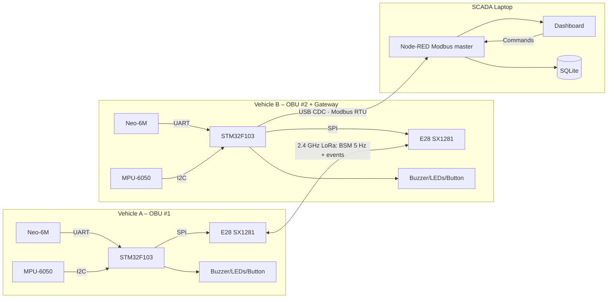
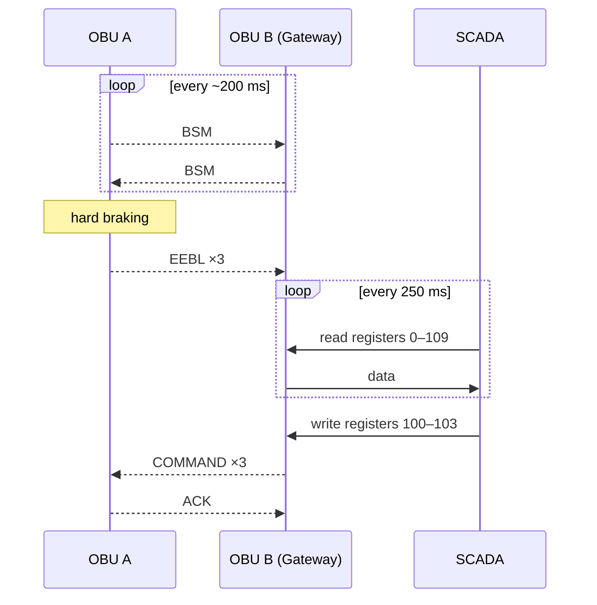

# V2V Communication with SCADA — Phase-by-Phase Build Guide for Claude Code

**Final Year Project · Built with Claude Code (Opus 5.5)**

This file has two parts:

- **Part A — Build Phases:** what to do in each phase, the **exact prompt to paste into Claude Code**, what you test with your hands, and when the phase is finished.
- **Part B — Specification:** the technical source of truth (pins, packet format, algorithms, Modbus map, SCADA design). The prompts in Part A point Claude Code to sections of Part B (§S1, §S2 …).

> Put this file in your project as `docs/V2V_BUILD_GUIDE.md`. Claude Code reads it from there in every phase.

---

## Contents

**Part A — Build Phases**
- [A0. How to work with Claude Code on this project](#a0-how-to-work-with-claude-code-on-this-project)
- [Phase 0 — Project setup & toolchain](#phase-0--project-setup--toolchain)
- [Phase 1 — Hardware assembly (hands-on, no prompt)](#phase-1--hardware-assembly-hands-on-no-prompt)
- [Phase 2 — Bring-up test sketches](#phase-2--bring-up-test-sketches)
- [Phase 3 — Core logic library + host unit tests](#phase-3--core-logic-library--host-unit-tests)
- [Phase 4 — Hardware drivers](#phase-4--hardware-drivers)
- [Phase 5 — OBU firmware integration](#phase-5--obu-firmware-integration)
- [Phase 6 — Modbus gateway + gateway simulator](#phase-6--modbus-gateway--gateway-simulator)
- [Phase 7 — SCADA dashboard (Node-RED)](#phase-7--scada-dashboard-node-red)
- [Phase 8 — Field testing, tuning & analysis](#phase-8--field-testing-tuning--analysis)
- [Phase 9 — Documentation & demo preparation](#phase-9--documentation--demo-preparation)
- [Fix-it prompts (use any time)](#fix-it-prompts-use-any-time)

**Part B — Specification**
- [S1 Project summary](#s1-project-summary) · [S2 Problem statements](#s2-problem-statements--solutions) · [S3 Feature levels](#s3-feature-levels--definition-of-done) · [S4 Architecture](#s4-architecture) · [S5 Components & BOM](#s5-components--bom) · [S6 Hardware & wiring](#s6-hardware--wiring) · [S7 Radio](#s7-radio-specification) · [S8 Packet](#s8-v2v-packet-specification) · [S9 Algorithms](#s9-safety-algorithms) · [S10 Firmware](#s10-firmware-specification) · [S11 Modbus](#s11-modbus-gateway-specification) · [S12 SCADA](#s12-scada-specification) · [S13 Calibration](#s13-calibration) · [S14 Acceptance tests](#s14-acceptance-tests) · [S15 Troubleshooting](#s15-troubleshooting) · [S16 Glossary](#s16-glossary) · [S17 Items to verify](#s17-items-to-verify-before-building)

---

# PART A — BUILD PHASES

## A0. How to work with Claude Code on this project

### A0.1 Roles
| Who | Does what |
|---|---|
| **You** | Buy and assemble the hardware. Plug boards in. Press buttons, walk around, read multimeters. Paste results back. Decide when a phase is done. |
| **Claude Code** | Writes all code. Installs and runs tools on your laptop (compiler, uploader, Node-RED, Python scripts). Compiles, runs unit tests, uploads firmware, reads serial output through scripts, fixes errors. |

**Claude Code cannot see or touch the hardware.** Whenever a physical test is needed, it must stop and tell you exactly what to do and what to paste back.

### A0.2 Working rules (follow them in every phase)
1. **One phase per session.** Start each phase with a fresh Claude Code session (or `/clear`) and paste that phase's prompt.
2. **Plan first for big phases.** In Phases 3–7, switch Claude Code into **plan mode** (Shift+Tab) before pasting the prompt, read its plan, then approve it.
3. **Never skip the "Verify" steps.** A phase is finished only when its exit criteria pass.
4. **Commit after every phase** (`git commit`). If a phase goes badly, you can return to the last good commit.
5. **Paste real output.** When something fails, paste the exact error or serial output. Do not describe it from memory.
6. **Answer the ⚠️ VERIFY items** (§S17) by reading the datasheets and module labels. Claude Code must not guess them.

### A0.3 Phase map

| Phase | What gets built | Needs hardware? | Approx. time |
|---|---|---|---|
| 0 | Repo, `CLAUDE.md`, toolchain, helper scripts | No | 1 day |
| 1 | Two assembled OBUs (power, wiring) | **Yes — you** | 1–2 weeks |
| 2 | 7 bring-up test sketches | Yes | 2–3 days |
| 3 | Portable logic (packet, CRC, geometry, FCW, detectors) + unit tests | No | 3–4 days |
| 4 | Drivers: radio, GPS, IMU, power, alerts | Yes | 1 week |
| 5 | Full OBU firmware + simulation mode | Yes | 1–2 weeks |
| 6 | Modbus gateway + Python gateway simulator | Partly | 3–4 days |
| 7 | Node-RED SCADA (map, telemetry, alarms, historian, commands) | No (uses simulator), then yes | 1 week |
| 8 | Field tests, tuning, log analysis + graphs | Yes | 1–2 weeks |
| 9 | README, report material, demo checklist | No | 3–4 days |

Phases 3, 6 (simulator) and 7 do not need hardware, so you can run them **while you assemble the hardware in Phase 1**.

---

## Phase 0 — Project setup & toolchain

**Goal:** a project folder with this guide, a `CLAUDE.md` rules file, and every tool installed and working.

### You do first
1. Install **Git**, **Python 3.10+**, **Node.js LTS**, and **VS Code** (optional).
2. Install **STM32CubeProgrammer** from st.com (needs a free ST account). Claude Code cannot download it for you.
3. Install the **ST-Link V2 USB driver** (Windows: included with STM32CubeProgrammer, or "STSW-LINK009").
4. Create an empty folder `v2v-scada`, put this file in it as `docs/V2V_BUILD_GUIDE.md`, open a terminal there and start Claude Code. Select the Opus 5.5 model.

### Prompt to paste
```text
You are helping me build my final-year project "V2V Communication using SCADA".
The complete build guide and specification is docs/V2V_BUILD_GUIDE.md. Read all of it first.
We are doing PHASE 0 only (Part A, "Phase 0 — Project setup & toolchain").

Do the following:
1. Detect my operating system and shell. Tell me what you found.
2. Create the repository structure exactly as in §S10.6 (empty placeholder files are fine; firmware sources come in later phases).
3. Create CLAUDE.md in the repository root using the text in Part A, "Phase 0 → CLAUDE.md content", unchanged.
4. Create .gitignore suitable for Arduino builds, Python, Node and SQLite files. Run `git init` and make the first commit.
5. Install arduino-cli (if missing) and set it up for the STM32duino core:
   - add the board manager URL from §S10.1, update the index, install the "STMicroelectronics:stm32" core;
   - run `arduino-cli board details -b STMicroelectronics:stm32:GenF1` and find the exact option IDs for:
     board part = BluePill F103C8, USB support = CDC (generic 'Serial' supersede U(S)ART), upload method = STM32CubeProgrammer (SWD);
   - write the resulting full FQBN (with options) to tools/fqbn.txt.
6. Install the Arduino libraries listed in §S10.1 (RadioLib, TinyGPSPlus, and the Modbus slave library). Write the installed versions to tools/versions.txt.
7. Check that STM32CubeProgrammer's command-line tool (STM32_Programmer_CLI) is on PATH. If not, find it and tell me how to add it; do not continue to upload steps without it.
8. Create a Python virtual environment in tools/.venv and install pyserial and pymodbus. Pin the versions in tools/requirements.txt.
9. Write tools/serial_log.py: usage `python tools/serial_log.py <PORT> <SECONDS> [BAUD]`. It opens the port, prints every line with a timestamp for the given number of seconds, then exits. Also `--list` to list serial ports. This is how you will read board output in later phases.
10. Make sure a host C++ compiler (g++) is available for unit tests. On Windows, if none is installed, tell me the simplest option (MSYS2/MinGW or WSL) and wait for me.
11. Compile an empty test sketch with the FQBN to prove the toolchain works.

At the end, print a checklist of every tool with its version and PASS/FAIL. Do not start Phase 1 or later work.
```

### CLAUDE.md content
Claude Code loads `CLAUDE.md` automatically at the start of every session, so these rules apply to every later phase.

```markdown
# V2V Communication with SCADA — project rules for Claude Code

## Source of truth
- docs/V2V_BUILD_GUIDE.md. Part A = build phases. Part B = specification (§S1–§S17).
- Never change pins, the packet layout, the Modbus register map or thresholds unless I ask.
  If the spec looks wrong or contradictory, STOP and ask me.
- Items marked ⚠️ VERIFY: ask me. Never guess datasheet facts.
- Answers I give to VERIFY items are recorded in docs/verified.md. Read it at the start of each session.

## Hardware (you cannot see it)
- 2 × STM32F103C8T6 Blue Pill, E28-2G4M20SX (SX1281), Neo-6M GPS, MPU-6050, 18650 power chain.
- OBU #1 = vehicle only. OBU #2 = vehicle + SCADA gateway (USB CDC, Modbus RTU slave ID 1).
- When a step needs a physical action, STOP and tell me exactly what to do and what output to paste back.

## Build & test commands
- FQBN: tools/fqbn.txt
- Compile firmware: arduino-cli compile --fqbn "$(cat tools/fqbn.txt)" firmware/v2v_obu
- Upload (SWD via ST-Link): arduino-cli upload --fqbn "$(cat tools/fqbn.txt)" firmware/v2v_obu
- Read board output: tools/.venv python tools/serial_log.py <PORT> <SECONDS>
- Host unit tests: python tests/host/run_tests.py
- After every code change: compile the firmware AND run the host unit tests. Fix all errors and warnings.

## Code rules
- Portable logic files (v2v_packet, geo, neighbors, safety) must NOT include Arduino.h.
  They take time as a `uint32_t now_ms` parameter so they can be unit-tested on the PC.
- Hardware access only in the driver files (radio, gps, imu, power, alerts, gateway, sim).
- All constants live in firmware/v2v_obu/config.h. No magic numbers elsewhere.
- No dynamic memory allocation (no new/malloc/String) in firmware. No blocking delay() in loop(), except during boot.
- Keep function and file names as given in §S10.3.

## Working style
- Work only on the phase I name. At the end of a phase, list what was done, how it was tested,
  anything not finished, and suggest a git commit message.
```

### Verify
- `tools/fqbn.txt` exists and the empty sketch compiled.
- `python tools/serial_log.py --list` runs.
- `STM32_Programmer_CLI --version` works.
- Create an empty `docs/verified.md` file. You will fill it in as you check the §S17 items.

### Exit criteria
All tools PASS. First git commit done.

---

## Phase 1 — Hardware assembly (hands-on, no prompt)

**Goal:** two complete OBUs, wired per §S6, with all supply voltages checked. **Build and test one OBU completely before starting the second.**

### Steps (follow §S6 in detail)
1. **Check the §S17 items** you can answer by looking at the parts: E28 pin labels, TXEN/RXEN pins, antenna connector, TP4056 type, GPS VCC range. Write the answers in `docs/verified.md`.
2. **Battery + TP4056** (§S6.2). Charge the cell fully.
3. **MT3608 boost** → set to **7.0 V with nothing connected to its output** (§S6.3).
4. **AMS1117-5.0** → check **5.0 V** (§S6.4).
5. **Blue Pill** on 5 V → check its 3.3 V pin reads **3.3 V** (§S6.5).
6. Wire **GPS, IMU, buzzer, LEDs, button and battery divider** (§S6.8 wiring table).
7. Wire the **E28 radio LAST** (§S6.7): capacitors at its supply pin, **antenna fitted before power-on**.
8. Connect the **ST-Link** to the Blue Pill's SWD header (SWDIO, SWCLK, GND, 3.3 V).

### Optional helper prompt
If you want a printable checklist:
```text
Read docs/V2V_BUILD_GUIDE.md §S5, §S6 and docs/verified.md. Create docs/assembly_checklist.md:
a printable step-by-step assembly checklist with a tick box for every wire in §S6.8, every voltage
measurement with its expected value and tolerance, and a "measured value" column. Do not change any pin assignment.
```

### Exit criteria
Both OBUs give: MT3608 out 7.0 ± 0.1 V, AMS1117 out 5.0 ± 0.1 V, Blue Pill 3.3 ± 0.1 V. The radio has its antenna fitted. All §S6.8 wires are ticked.

---

## Phase 2 — Bring-up test sketches

**Goal:** prove every part on each board works on its own before writing the real firmware.

### Prompt to paste
```text
We are doing PHASE 2: bring-up test sketches. Read CLAUDE.md, docs/verified.md, and
docs/V2V_BUILD_GUIDE.md sections §S6.8 (wiring), §S10.1 (toolchain), §S10.4 (driver details) and §S10.7 (bring-up tests).

Create seven independent Arduino sketches in firmware/bringup/:
  t1_blink, t2_io, t3_imu, t4_radio, t5_gps, t6_usb, t7_battery
Requirements:
- Use the pins from §S6.8 (define them at the top of each sketch; copy the values from config.h in §S10.2).
- All test output goes to USB CDC `Serial` at 115200, one line per result, starting with "PASS:", "FAIL:" or "INFO:".
- t4_radio takes a node role at the top (#define NODE 1 or 2). Node 1 sends "hello <counter>" every 500 ms;
  node 2 replies "ack <counter>". Both print RSSI and SNR of every received packet. Use the radio settings of §S7.1.
- t5_gps prints raw NMEA for 5 s, then parsed fix, satellites, HDOP, speed and course once per second.
  Do NOT send UBX configuration yet.
- t7_battery prints raw ADC value, Vbat and battery % once per second, using the formula in §S6.6.
- Compile every sketch. Fix all errors.

Then guide me through the tests ONE AT A TIME, starting with board OBU #1:
 - tell me exactly what to connect and do,
 - upload the sketch yourself,
 - read the output yourself with tools/serial_log.py (ask me for the COM port once),
 - compare it with the pass criteria in §S10.7 and tell me PASS or FAIL.
For t4_radio, you need both boards: upload NODE 1 to OBU #1 and NODE 2 to OBU #2.
If a test fails, diagnose using §S15 and propose the fix before moving on.
Finish with a results table for both boards in docs/bringup_results.md.
```

### Your part
Plug in each board when asked. Take the GPS test **outdoors**, with the antenna facing the sky. For the radio test, keep the boards 1–2 m apart.

### Exit criteria
T1–T7 PASS on **both** boards. `docs/bringup_results.md` committed.

---

## Phase 3 — Core logic library + host unit tests

**Goal:** all the "thinking" code (packet format, CRC, geometry, collision warning, event detectors, neighbour table) written as **portable C++** and **proven on the PC** with unit tests. No hardware needed, so you can do this during Phase 1.

### Prompt to paste (use plan mode first)
```text
We are doing PHASE 3: the portable core logic and host unit tests. Read CLAUDE.md and
docs/V2V_BUILD_GUIDE.md sections §S8 (packet), §S9 (algorithms), §S10.2 (config.h) and §S10.3 (files).

Create in firmware/v2v_obu/:
- config.h exactly as in §S10.2.
- v2v_packet.h/.cpp: the packed struct, constants and crc16_ccitt from §S8.4–§S8.5,
  plus pkt_build(...) (fills start byte, seq, CRC) and pkt_validate(...) implementing the receive rules of §S8.6.
- geo.h/.cpp: geo_offset, geo_distance, geo_bearing, angle_diff exactly as in §S9.2.
- neighbors.h/.cpp: the neighbour table and PDR calculation from §S8.7.
  Functions: nb_update(pkt, rssi, snr, now_ms), nb_expire(now_ms), nb_get(i), nb_count().
- safety.h/.cpp:
  * fcw_evaluate(own, nb) → {level, ttc_s, distance_m} per §S9.3, plus the hysteresis rule;
  * detector state machines for hard braking (§S9.4), crash (§S9.5), rollover (§S9.6) and pothole (§S9.7).
    Each detector takes the current sensor values, speed, gps_valid and now_ms, and returns whether an event fired;
  * receive-side filters: should_alert_eebl(), should_alert_hazard() per §S9.4 and §S9.7.
These files must NOT include Arduino.h (rule in CLAUDE.md). Use only <stdint.h>, <stddef.h>, <stdbool.h>, <math.h>, <string.h>.

Create tests/host/:
- a tiny test framework (single header, no external dependency),
- run_tests.py that compiles the test files together with the four portable .cpp files using g++ -Wall -Wextra -Werror and runs them,
- tests covering at least:
  1. sizeof(v2v_packet_t) == 32 and field offsets match the table in §S8.2;
  2. CRC of ASCII "123456789" == 0x29B1; a corrupted byte fails validation;
  3. sequence rules of §S8.6: newer accepted, duplicate dropped, wraparound 255→0 accepted, rebooted sender (>5 s silent) accepted;
  4. freshness check including the midnight wrap;
  5. geometry: known distance between two coordinates ~1 km apart (within 0.5%), bearings of 0/90/180/270°, angle_diff wraparound (350 vs 10 = -20);
  6. the FCW worked example in §S9.3 (8 s SAFE, 3 s CAUTION, 1.8 s CRITICAL), vehicle behind me = SAFE,
     oncoming vehicle = SAFE, own speed below 1 m/s = SAFE, hysteresis (level drops only after 1 s);
  7. each detector: fires on a correct input sequence, does not fire on short spikes, respects its lockout time;
  8. neighbour expiry after 1500 ms and PDR with simulated packet loss.
Run the tests and make them all pass. Then also compile the firmware folder with arduino-cli (a minimal
v2v_obu.ino that only includes the headers is fine for now) to prove the code also builds for the STM32.
Report the test results table.
```

### Verify
`python tests/host/run_tests.py` shows **all tests passing**. Read the test list yourself and check that it covers items 1–8.

### Exit criteria
All host tests pass. Firmware compiles for the STM32. Commit.

---

## Phase 4 — Hardware drivers

**Goal:** working drivers for the radio, GPS, IMU, battery and alerts, each tested on the real board.

### Prompt to paste (use plan mode first)
```text
We are doing PHASE 4: hardware drivers. Read CLAUDE.md, docs/verified.md, docs/bringup_results.md and
docs/V2V_BUILD_GUIDE.md sections §S6, §S7, §S10.1–§S10.5.

Create in firmware/v2v_obu/ (these may use Arduino.h):
- radio.h/.cpp: RadioLib SX1281 wrapper per §S7 and §S10.4. radio_init(), radio_send(pkt) (blocking transmit then back to receive),
  an event TX queue with copies and random gaps per §S7.2, radio_service(now_ms) that sends due copies and
  returns received packets with RSSI/SNR. The DIO1 interrupt only sets a flag.
  Before using RadioLib calls, check the installed RadioLib version's API (begin() argument order, coding-rate
  convention, interrupt-action function name) in its source/headers and adapt. Tell me what you found.
- gps.h/.cpp: boot procedure and UBX configuration of §S10.4 (with the checksum function), NMEA parsing with TinyGPSPlus,
  heading hold below 1 m/s, gps_utc_now_ms() per §S8.6.
- imu.h/.cpp: MPU-6050 register setup of §S10.4, 100 Hz read, calibration of §S13.2, IMU_AXIS_MAP,
  low-pass a_long, complementary filter roll/pitch, az high-pass.
- power.h/.cpp: battery voltage and % per §S6.6.
- alerts.h/.cpp: buzzer/LED patterns and priorities of §S10.5, non-blocking.
- button handling: debounced, reports "held for N ms".

Create firmware/drivertest/drivertest.ino that uses all drivers and prints once per second over USB `Serial`:
GPS (fix, sats, HDOP, lat, lon, speed, heading, utc ms), IMU (ax ay az gx gy gz roll pitch a_long),
battery, button state, and every received radio packet. Typing a digit 1–7 in the serial input plays alert pattern 1–7.
Sending 'p' transmits one test packet.

Compile with no warnings, run the host tests again, then guide me through testing each driver on OBU #1 then OBU #2,
reading the output yourself with tools/serial_log.py. GPS test outdoors. Check the IMU signs: tilt the board nose-down
and confirm pitch goes the expected way, accelerate it forward and confirm a_long > 0. Fix IMU_AXIS_MAP if needed.
After the GPS has been configured once, power-cycle and confirm it comes back at 5 Hz / 38400 baud (EEPROM saved).
```

### Your part
Move, tilt and shake the boards when asked. Take them outdoors for GPS. Listen to each alert pattern.

### Exit criteria
Radio exchanges packets between the boards. GPS runs at 5 Hz after a power cycle. IMU axes are correct. All 7 alert patterns work. Battery reading is within ±0.05 V of a multimeter. Commit.

---

## Phase 5 — OBU firmware integration

**Goal:** the complete vehicle firmware: BSM exchange at 5 Hz, collision warning, events, SOS, commands, and the indoor simulation mode.

### Prompt to paste (use plan mode first)
```text
We are doing PHASE 5: full OBU firmware integration. Read CLAUDE.md, docs/verified.md and
docs/V2V_BUILD_GUIDE.md sections §S3, §S4.5, §S7.2, §S8, §S9, §S10 and §S11.4 (vehicle behaviour on COMMAND).

Write firmware/v2v_obu/v2v_obu.ino and sim.h/.cpp, using the Phase 3 logic and the Phase 4 drivers:
- setup() and loop() exactly following the scheduler in §S10.5 (no RTOS, non-blocking).
- State machine BOOT / NORMAL / WARNING / SOS from §S4.5.
- Periodic BSM every 200 ms + random jitter; events (EEBL, CRASH, HAZARD) as 3 copies with the same sequence number;
  SOS CRASH packet every 1 s; SOS cancel by holding the button 3 s or by CLEAR_SOS.
- On receive: validation (§S8.6) → neighbour table → event handling (§S9.4–§S9.7 receive rules) → COMMAND handling
  and ACK (§S11.4) → PING → reply PONG.
- FCW at 20 Hz for every neighbour, overall level = highest level, flags bits 4/5 set from it.
- Simulation mode (§S10.6) when SIM_MODE = 1. Pick SIM_LAT0/SIM_LON0 as config.h constants and ask me for my
  college coordinates (or use a placeholder I can change).
- Debug log on Serial1 (USART1, 115200): one compact line per second with own state, neighbours, level, TTC.
  On non-gateway builds, ALSO mirror the log to USB `Serial` so you can read it with serial_log.py.
- Independent watchdog 2 s.
- Gateway code is NOT part of this phase: keep IS_GATEWAY = 0 for both boards for now.
- MY_VEHICLE_ID must be easy to set per board: support `--build-property "build.extra_flags=-DMY_VEHICLE_ID=2"`
  with a default in config.h, and write tools/flash.py that compiles and uploads with a given vehicle ID and options
  (e.g. `python tools/flash.py --id 2 --sim`).

Compile with no warnings and run the host tests.
Then test with me in this order:
 1. SIM_MODE=1 on both boards, indoors: confirm vehicle 2 approaches vehicle 1 and vehicle 2's log shows
    SAFE → CAUTION → CRITICAL at the right TTC values, with the right buzzer/LED patterns.
 2. Tap test: I slap OBU #1 sharply on a padded surface while still → OBU #1 goes to SOS, OBU #2 shows SOS_REMOTE.
    Then I hold the button 3 s to cancel.
 3. Rollover: I turn OBU #1 on its side for 2 s.
 4. Outdoors with SIM_MODE=0: we walk the "follow and approach" scenario of acceptance test A6 in §S14.
Read the logs yourself each time and report PASS/FAIL against §S14.
```

### Exit criteria
Simulation demo works indoors. Crash, rollover and SOS cancel work. Outdoor FCW warnings appear at about the right TTC. Acceptance tests A1, A6, A8, A9, A14 pass (without SCADA). Commit.

---

## Phase 6 — Modbus gateway + gateway simulator

**Goal:** OBU #2 serves all data over USB as a Modbus RTU slave. A **Python simulator** that serves the same registers, so the SCADA can be built without hardware.

### Prompt to paste
```text
We are doing PHASE 6: the Modbus gateway and a gateway simulator. Read CLAUDE.md and
docs/V2V_BUILD_GUIDE.md section §S11 completely, plus §S8.3 (flags) and §S12.4 (decoder).

Part 1 — firmware (firmware/v2v_obu/gateway.h/.cpp), compiled only when IS_GATEWAY = 1:
- Modbus RTU slave ID 1 on USB `Serial`, function codes 03, 06, 16, holding registers 0–109 per §S11.2–§S11.4.
  Use the Modbus library installed in Phase 0 if it supports these function codes on a Stream; otherwise write a
  minimal slave yourself (frame parsing by inter-byte timeout, CRC-16/MODBUS, exception responses for bad addresses).
- gw_update_registers() every 100 ms: slot 0 = own vehicle, slots 1–3 = neighbours, empty slots all zero.
  int32 values high word first; signed values as two's complement; 65535 for "none".
- Command execution when register 103 is written to 1 (§S11.4), PING/PONG round-trip time into register 3,
  ACK counting into register 4.
- On the gateway build, the debug log must go ONLY to Serial1 (USB is reserved for Modbus).
- Add `--gateway` to tools/flash.py.

Part 2 — host tools:
- tools/modbus_probe.py: reads registers 0–109 from a serial port once per second and prints them decoded
  (same decoding as §S12.4). Option --command CODE PARAM TARGET writes registers 100–103.
- tools/gateway_sim.py: a Modbus TCP server on 127.0.0.1:5020 (unit ID 1) with the SAME register map.
  It simulates: vehicle 1 stationary, vehicle 2 approaching at 8 m/s, distance/TTC/warning level changing,
  a crash event every 2 minutes, a hazard every 90 s, battery slowly falling, link-loss for 5 s every 3 minutes,
  and it reacts to commands written to 100–103 (sets 103 back to 0 and increments 4).
  Pin the pymodbus version and check its current server API before writing code.
- Unit-test the register encoding/decoding in Python (tests/host/test_modbus_map.py), including negative values,
  int32 coordinates and the 65535 "none" value.

Then test with me:
 1. Run gateway_sim.py and modbus_probe.py against it (TCP mode) — no hardware.
 2. Flash OBU #2 with --gateway, OBU #1 normal. Run modbus_probe.py on the gateway's COM port and check
    both vehicles appear with sensible values. Send each command and confirm OBU #1 reacts and the ACK counter rises.
```

### Exit criteria
Probe reads correct live data from the real gateway. All 5 commands work end to end. The simulator runs. Python tests pass. Commit.

---

## Phase 7 — SCADA dashboard (Node-RED)

**Goal:** the operator station: live map, telemetry, link quality, alarm console, SQLite historian, and command panel. Built first against the simulator, then switched to the real gateway.

### Prompt to paste (use plan mode first)
```text
We are doing PHASE 7: the Node-RED SCADA. Read CLAUDE.md and docs/V2V_BUILD_GUIDE.md section §S12 completely,
plus §S11 (register map) and §S8.3 (flags).

1. Install Node-RED locally inside scada/node-red (a project-local install with its own userDir, started by
   scada/start_scada script for my OS), plus the palettes listed in §S12.1. Pin the versions in package.json.
2. Build the flows and save them to scada/node-red/flows.json:
   - two Modbus client configs: "SIM" (TCP 127.0.0.1:5020) and "GATEWAY" (serial, port from an environment
     variable V2V_PORT, 115200, RTU, unit 1). An environment variable V2V_SOURCE=SIM|GATEWAY selects which one is used.
   - poll FC3 address 0 quantity 110 every 250 ms → decode function exactly as in §S12.4.
   - dashboard pages Map, Telemetry, V2V Link, Alarms, Control as in §S12.5.
   - worldmap markers per §S12.5, hazard markers kept with a report count.
   - alarm logic per §S12.6 with rising-edge detection, acknowledge buttons, and the "gateway offline" alarm.
   - SQLite historian with the schema in §S12.6 (database file scada/historian/v2v.db), telemetry logged at 1 Hz
     per vehicle, alarms logged with ack/clear times, and a CSV export button.
   - Control page sending commands per §S12.5 (FC16 to address 100, 4 registers).
3. Validate flows.json is valid JSON and that every node type used is installed. Start Node-RED, read its log,
   and fix any errors (missing nodes, bad configs).
4. Test against tools/gateway_sim.py: confirm the decoded values, that each alarm type appears and clears,
   that commands reach the simulator, and that rows are written to SQLite (query the database yourself).
5. Write scada/README.md: how to start the simulator, how to start the SCADA, how to switch to the real gateway,
   and the URL of each page.
Then tell me how to open the dashboard so I can check the layout, and adjust it from my feedback.
Finally, switch V2V_SOURCE=GATEWAY and test with the real boards together with me.
```

### Your part
Open the dashboard in a browser and give feedback on the layout ("make the map bigger", "put TTC in large text"). Paste screenshots if something looks wrong.

### Exit criteria
Everything works against the simulator **and** against the real gateway: both vehicles on the map, warnings and alarms shown, commands delivered, history saved. Acceptance tests A10 and A11 pass. Commit.

---

## Phase 8 — Field testing, tuning & analysis

**Goal:** run all acceptance tests (§S14), tune the thresholds with real data, and produce graphs for the report.

### Prompt to paste
```text
We are doing PHASE 8: field testing and analysis. Read CLAUDE.md and docs/V2V_BUILD_GUIDE.md sections
§S13 (calibration) and §S14 (acceptance tests).

1. Create docs/test_plan.md: for each test A1–A14, the exact procedure, what I do in the field, what data is logged
   (SCADA SQLite, gateway probe, or OBU debug log), and the pass criterion. Include a blank results table.
2. Add a "data logging" build option (tools/flash.py --log) that prints a compact CSV line at 20 Hz on the debug
   port with a_long, a_total, az_hp, roll, pitch, speed, level, TTC, so I can record normal driving for threshold
   tuning (§S13.3). Tell me how to record it on my laptop with tools/serial_log.py into a file.
3. Write tools/log_analyzer.py that reads the SQLite database and/or CSV logs and produces (PNG, matplotlib):
   PDR vs distance, RSSI vs distance, latency histogram (from RTT), GPS distance error table (from my tape
   measurements entered in a CSV), TTC at warning moments, and a threshold-tuning plot of a_long / a_total / az_hp
   with the current thresholds drawn as lines. Write a summary to docs/results/summary.md.
4. Then guide me test by test. After each test I will give you the files; you analyse them, record PASS/FAIL
   in docs/test_plan.md, and propose any threshold change in config.h with the evidence. Do not change a
   threshold without showing me the data.
```

### Your part
Do the field tests: walk or ride with the units, measure distances with a tape, brake hard, do the drop test on foam, run the battery to empty. Copy the log files into `data/` in the project.

### Exit criteria
All of A1–A14 recorded, with PASS for the Level-1 features. Graphs generated. Any threshold changes justified with data. Commit.

---

## Phase 9 — Documentation & demo preparation

### Prompt to paste
```text
We are doing PHASE 9: documentation and demo preparation. Read the whole repository, CLAUDE.md,
docs/V2V_BUILD_GUIDE.md, docs/test_plan.md and docs/results/.

1. Write README.md for the repository: overview, architecture diagram (Mermaid + ASCII), hardware list, how to build
   and flash each board (tools/flash.py), how to run the SCADA, how to run the simulator, test results summary.
2. Write docs/report_material.md with ready-to-adapt text for my project report: abstract, introduction,
   problem statements and solutions (§S2), literature context (DSRC, C-V2X, SAE J2735 — concepts only;
   mark where I must add proper citations), system design, implementation of each module, results with the
   graphs in docs/results/, limitations, conclusion and future scope. Use the real measured results, not targets.
3. Write docs/demo_script.md: a 10-minute viva demo, step by step, with a backup indoor version using SIM_MODE
   and the gateway simulator, plus a pre-demo checklist (batteries charged, antennas fitted, firmware versions,
   COM port, Node-RED started).
4. Write docs/viva_questions.md: 30 likely examiner questions about this project with short accurate answers
   based on our design (why LoRa 2.4 GHz, why Modbus, how TTC works, limitations of GPS, etc.).
5. Check that every command in the README actually works by running it (except uploads).
```

### Exit criteria
README, report material, demo script and viva Q&A done. Full demo rehearsed once indoors (simulation) and once outdoors. Final commit and tag `v1.0`.

---

## Fix-it prompts (use any time)

**Something does not compile or a test fails:**
```text
Here is the exact error/output: <paste>. Diagnose the cause using CLAUDE.md and §S15 of the build guide.
Explain the cause in two sentences, then fix it, recompile, and rerun the host tests.
```

**Hardware behaves strangely:**
```text
On OBU #<n>, <what I did> and I expected <expected> but got <what happened>. Here is the serial output: <paste>.
List the three most likely causes (hardware and software), the test to tell them apart, and what I should check
with the multimeter. Do not change code until we know the cause.
```

**Resume after a break:**
```text
Read CLAUDE.md, docs/V2V_BUILD_GUIDE.md and `git log`. Tell me which phase we are in, what is finished,
what is left in this phase, and the next step.
```

**Review before moving on:**
```text
Review all code written in this phase against the specification sections it implements. List every mismatch
with the spec (pins, packet layout, register addresses, thresholds, timing), any blocking calls in loop(),
and any missing error handling. Do not fix yet; show me the list first.
```

---
---

# PART B — SPECIFICATION

> This is the technical source of truth. Values marked **⚠️ VERIFY** depend on the exact module received and must be checked against the datasheet.

## Conventions

| Item | Convention |
|---|---|
| Units | SI (m, m/s, m/s², degrees, ms) unless stated |
| Heading | Degrees clockwise from true North, 0–359.99 |
| Coordinates | WGS-84, stored as integer degrees × 10⁷ |
| Radio packet byte order | **Little-endian**, packed struct, no padding |
| Modbus byte order | Big-endian per Modbus. 32-bit values: **high word first** |
| Modbus addresses | **0-based protocol addresses** (address 0 = "40001") |
| "Vehicle" | One On-Board Unit (OBU): RC car, bicycle or hand-carried box in the demo |

---

## S1. Project Summary

1. **Two On-Board Units (OBUs)**, one per vehicle, each with:
   - **STM32F103C8T6 "Blue Pill"** — runs all the firmware
   - **Ublox Neo-6M GPS** — position, speed, heading, time
   - **MPU-6050 IMU** — acceleration and rotation (braking, crash, rollover, potholes)
   - **Ebyte E28-2G4M20SX** — Semtech SX1281 2.4 GHz LoRa radio for V2V messages
   - **Buzzer, 3 LEDs, 1 push button** — driver warnings
   - **18650 battery** power system
2. Each OBU **broadcasts its state 5 times per second** and listens for the other.
3. Each OBU **computes collision risk** and **detects events** (hard braking, crash, rollover, pothole), then warns its driver and the other vehicles.
4. **OBU #2 is also the SCADA gateway:** a Modbus RTU slave over USB.
5. A **laptop runs Node-RED as SCADA:** live map, telemetry, alarms, history, and operator commands to vehicles.

**Why:** no infrastructure needed (direct radio), low cost (~₹1,650 per vehicle), licence-free 2.4 GHz ISM band (delicensed in India), and the SX1281 offers long range plus optional time-of-flight distance measurement. Commercial V2V uses DSRC or C-V2X at 5.9 GHz and the SAE J2735 Basic Safety Message. This project copies their concepts on low-cost hardware. It is an educational prototype, **not** a certified safety device.

---

## S2. Problem Statements & Solutions

| # | Problem | Solution | Components | Feature |
|---|---|---|---|---|
| P1 | **Rear-end collisions** from late reaction or misjudged gaps | **Forward Collision Warning:** share position/speed/heading, compute distance and **Time-To-Collision**, warn in two levels | GPS, radio, MCU | F1 |
| P2 | **Sudden braking not seen** further back, or in fog/night | **Emergency Electronic Brake Light:** IMU detects deceleration worse than −0.4 g and broadcasts at once | IMU, radio | F2 |
| P3 | **Accidents reported late**, losing the "golden hour" | **Crash & rollover detection:** >4 g impact or >60° tilt → **SOS with GPS location**; SCADA critical alarm on the map | IMU, GPS, radio, SCADA | F3, F4 |
| P4 | **Blind spots, curves, intersections** block line of sight | Radio reaches beyond line of sight, so vehicles are "aware" of each other early | Radio | F1, F2 |
| P5 | **Network dead zones** break cellular/IoT systems | Direct peer-to-peer radio, no network needed | Radio | All |
| P6 | **No central visibility** for fleet operators | **SCADA:** live map, telemetry, alarms, history, operator commands | Gateway, Modbus, Node-RED | F6, F7 |
| P7 | **Road hazards not shared** | **Pothole detection** from vertical acceleration, tagged with GPS, shared with following vehicles and SCADA | IMU, GPS | F5 |
| P8 | **GPS is coarse** (±2.5–10 m, 1 Hz default) | 5 Hz GPS (saved in EEPROM), heading hold at low speed, optional IMU dead-reckoning and radio ranging | GPS, IMU, radio | F1 |
| P9 | **Wireless data corrupted, lost or replayed** | CRC-16, sequence numbers, freshness check | Firmware | All |
| P10 | **Commercial V2V hardware is expensive** | ~₹1,650 per OBU from off-the-shelf modules | All | — |

---

## S3. Feature Levels & Definition of Done

| Level | ID | Feature | Spec |
|---|---|---|---|
| **L1 Must** | F0 | BSM exchange at 5 Hz with CRC validation | S7, S8 |
| | F1 | Forward Collision Warning | S9.3 |
| | F2 | Hard braking (EEBL) | S9.4 |
| | F3 | Crash → SOS | S9.5 |
| | F6 | Gateway + SCADA map and alarms | S11, S12 |
| | F8 | Simulation mode for indoor demo | S10.6 |
| **L2 Should** | F4 | Rollover | S9.6 |
| | F5 | Pothole / hazard | S9.7 |
| | F7 | SCADA → vehicle commands | S11.4 |
| | F9 | SQLite historian | S12.6 |
| | F10 | Battery monitoring | S6.6 |
| **L3 Could** | — | Dead-reckoning, SX1281 ranging, OLED display, encryption | S9.8, S7.4 |

**Definition of Done:**
1. Both OBUs run on batteries; GPS fix outdoors.
2. SCADA map shows both vehicles moving with correct headings, updated at least every 0.5 s.
3. B approaching stationary A → Caution then Critical on B (buzzer + LEDs), also shown on SCADA.
4. Hard brake on A → B beeps within 200 ms (if B is behind A).
5. Simulated crash → SOS alarm with location on SCADA within 2 s.
6. SCADA "Hazard Alert" reaches A within 1 s.
7. All Level-1 acceptance tests in S14 pass.

---

## S4. Architecture

### S4.1 Block diagram

```
 ┌──────────── VEHICLE A (OBU #1) ────────────┐                ┌──────── VEHICLE B (OBU #2 + GATEWAY) ────────┐
 │ [Neo-6M]--UART-->┌──────────┐              │    2.4 GHz     │              ┌──────────┐<--UART--[Neo-6M] │
 │                  │ STM32F103│--SPI-->[E28]~~~~~~ LoRa ~~~~~~~~[E28]<--SPI---│ STM32F103│                  │
 │ [MPU-6050]-I2C-->│  (RTU)   │              │   V2V link     │              │(RTU+GW)  │<--I2C--[MPU-6050]│
 │                  └────┬─────┘              │                │              └────┬─────┘                  │
 │ [Buzzer][LEDs][Button]┘                    │                │   [Buzzer][LEDs][Button]┤                  │
 │ [18650→TP4056→MT3608→AMS1117] power        │                │                         │ USB (COM port)   │
 └────────────────────────────────────────────┘                └─────────────────────────┼──────────────────┘
                                                                                         │ Modbus RTU
                                                     ┌──────────── SCADA LAPTOP ─────────▼──────────────┐
                                                     │ Node-RED: Modbus master (250 ms) → decode →        │
                                                     │ dashboard (map, telemetry, alarms, control)        │
                                                     │ → alarm logic → SQLite historian                   │
                                                     │ ← operator commands (write registers 100–103)      │
                                                     └────────────────────────────────────────────────────┘
```



### S4.2 SCADA layers
| Level | Name | In this project |
|---|---|---|
| 0 | Field devices | GPS, IMU, buzzer, LEDs, button, battery sensing |
| 1 | Control (RTU) | STM32 OBUs + V2V radio network |
| 2 | Communication / server | Modbus RTU over USB; Node-RED Modbus master |
| 3 | Supervisory / HMI | Node-RED dashboard, alarms, SQLite historian |

### S4.3 Message flow


### S4.4 Software components
| Component | Runs on | Language |
|---|---|---|
| OBU firmware (`firmware/v2v_obu`) | Both Blue Pills | C++ (Arduino/STM32duino) |
| Portable logic (packet, geo, neighbours, safety) | Blue Pill + PC unit tests | C++ (no Arduino dependency) |
| Gateway Modbus slave | OBU #2 only | C++ |
| SCADA (`scada/node-red`) | Laptop | Node-RED flows + JavaScript |
| Gateway simulator, probe, analyser, flasher | Laptop | Python |

### S4.5 OBU states
| State | Entered when | Behaviour | Exit |
|---|---|---|---|
| `BOOT` | Power on | Init, lamp test, IMU calibration (keep still 2 s) | Init done |
| `NORMAL` | After boot | BSM at 5 Hz, receive, compute risk | Warning / event |
| `WARNING` | FCW Caution/Critical, or EEBL/hazard/command alert received | Alert pattern (S10.5), flags set | Condition clear for 1 s |
| `SOS` | Crash or rollover | CRASH packet every 1 s, red LED fast blink, flag held | Button held 3 s, or CLEAR_SOS |

---

## S5. Components & BOM

### S5.1 Ordered

**Hubtronics (#129029)**
| Item | Qty | Unit ₹ | Amount ₹ |
|---|---|---|---|
| Ebyte E28-2G4M20SX SX1281 2.4 GHz LoRa Module | 2 | 648.31 | 1,296.61 |
| **Subtotal + Shipping/Tax** | | | **1,605.00** |

**Robocraze (#392296)**
| Item | Qty | Unit ₹ | Amount ₹ |
|---|---|---|---|
| 18650 Single Battery Cell Case Holder | 2 | 29 | 58 |
| MT3608 DC-DC Boost Module (2–24 V) | 2 | 47 | 94 |
| AMS1117 5 V Step-Down Module | 2 | 21 | 42 |
| 3.7 V 2000 mAh 18650 Li-Ion Battery | 2 | 69 | 138 |
| TP4056 Charger Type-C Module | 2 | 23 | 46 |
| MPU-6050 Accelerometer & Gyroscope | 2 | 154 | 308 |
| Ublox Neo-6M GPS with EEPROM | 2 | 339 | 678 |
| STM32F103C8T6 ARM Development Board | 2 | 174 | 348 |
| **Estimated Total** | | | **1,712.00** |

**Combined: ₹3,317.00 (≈ ₹1,658 per vehicle)**

### S5.2 Part roles
| Part | Job | Interface | Key facts |
|---|---|---|---|
| STM32F103C8T6 | All firmware; gateway Modbus over USB | — | 72 MHz Cortex-M3, 64 KB flash (often 128 KB), 20 KB RAM, **3.3 V logic**, native USB, no hardware FPU |
| E28-2G4M20SX | V2V radio | SPI + BUSY, DIO1, NRESET, TXEN, RXEN | SX1281 + power amplifier (~20 dBm); **3.3 V only** |
| Neo-6M | Position, speed, heading, UTC | UART | 9600 baud 1 Hz by default; up to 5 Hz; EEPROM keeps config; 3.3–5 V supply |
| MPU-6050 | Accel + gyro | I2C 0x68 | WHO_AM_I (0x75) = 0x68; module has pull-ups |
| 18650 | Energy | — | 3.0–4.2 V, 2000 mAh |
| TP4056 | Charger 1 A CC/CV | USB-C | With protection: OUT+/OUT− pads. Without: B+/B− only |
| MT3608 | Boost to **7.0 V** | — | Adjustable trimmer; noisy output |
| AMS1117-5.0 | Clean **5.0 V** | — | Needs input ≥ ~6.5 V |

### S5.3 Additional items to buy (approximate prices)
| Item | Qty | ≈ ₹ | Why | Priority |
|---|---|---|---|---|
| ST-Link V2 (clone) | 1 | 250–350 | Programming via SWD | Essential |
| 2.4 GHz antenna matching the E28 connector | 2 | 100–200 ea | **Never transmit without an antenna** | Essential |
| Active buzzer 5 V | 2 | 15 | Warnings | Essential |
| LEDs red/yellow/green | 2 sets | 15 | Warnings | Essential |
| Resistors 330 Ω ×6, 1 kΩ ×2, 100 kΩ ×4 | — | 20 | LEDs, buzzer, battery divider | Essential |
| BC547 NPN | 2 | 10 | Buzzer driver | Essential |
| Tactile push button | 2 | 10 | SOS cancel | Essential |
| 470 µF/10 V ×2, 100 nF ×4 | — | 20 | Radio decoupling | Essential |
| Perfboard, headers, wire, solder | — | 200 | Assembly | Essential |
| SPST slide switch | 2 | 20 | Power | Recommended |
| Micro-USB data cable | 1 | 50 | Gateway → laptop | Recommended |
| USB-TTL adapter (CP2102/CH340) | 1 | 120 | Gateway debug log on USART1 | Recommended |
| AMS1117-3.3 module | 2 | 20 ea | Separate radio supply if resets occur | Recommended |
| RC chassis / trolleys, enclosures | 2 | varies | Demo platforms | Optional |

---

## S6. Hardware & Wiring

### S6.1 Power chain
```
USB-C 5 V ─► TP4056 ─(B+/B−)─► 18650
                │ OUT+/OUT− (or B+/B− if unprotected)
           [slide switch]
                ▼
        MT3608 boost ── 7.0 V
                ▼
        AMS1117-5.0 ── 5.0 V ─┬─► Blue Pill "5V" pin
                              ├─► Neo-6M VCC
                              └─► Buzzer +
        Blue Pill 3.3 V regulator ─┬─► MPU-6050 VCC
                                   └─► E28 VCC (+470 µF +100 nF at the pin)
All grounds common.
```

### S6.2 Battery + charger
Holder + → TP4056 B+, − → B−. Check polarity. Use OUT+/OUT− for the load if present; otherwise B+/B− with firmware cut-off at 3.2 V. **Do not charge while the OBU is running.**

### S6.3 Boost
With **nothing on the output**, adjust the MT3608 trimmer until VOUT = **7.0 ± 0.1 V**. Check it stays at 7.0 V across battery voltages 3.3–4.2 V.

### S6.4 5 V regulator
MT3608 out → AMS1117 IN. Check OUT = **5.0 ± 0.1 V**.

### S6.5 Microcontroller
5 V → Blue Pill **5V** pin. Check the Blue Pill **3.3** pin = **3.3 ± 0.1 V**.

### S6.6 Battery sensing
Battery + → 100 kΩ → **PA0** → 100 kΩ → GND.
`Vbat = adc_raw / 4095 × 3.3 × 2` · `pct = clamp((Vbat − 3.30)/(4.20 − 3.30) × 100, 0, 100)` · low flag < 3.40 V · radio off < 3.20 V.

### S6.7 Radio module
⚠️ VERIFY pin labels in the Ebyte datasheet and **wire by signal name**. Solder onto perfboard/adapter with short wires. Put 470 µF + 100 nF right at VCC. **Fit the antenna before powering.**

### S6.8 Wiring table (both OBUs identical)
| From | To Blue Pill | Purpose |
|---|---|---|
| E28 VCC / GND | 3.3 V / GND | Radio supply |
| E28 SCK | **PA5** | SPI1 clock |
| E28 MISO | **PA6** | SPI1 in |
| E28 MOSI | **PA7** | SPI1 out |
| E28 NSS | **PA4** | Chip select |
| E28 BUSY | **PB0** | Busy (input) |
| E28 DIO1 | **PB1** | Interrupt (input) |
| E28 NRESET | **PA1** | Reset (output) |
| E28 TXEN | **PB12** | High during TX ⚠️ VERIFY pin exists |
| E28 RXEN | **PB13** | High during RX ⚠️ VERIFY pin exists |
| GPS VCC / GND | 5 V / GND | |
| GPS TX | **PA3** (USART2 RX) | GPS → MCU |
| GPS RX | **PA2** (USART2 TX) | MCU → GPS |
| MPU VCC / GND | 3.3 V / GND | |
| MPU SCL | **PB6** | I2C1 |
| MPU SDA | **PB7** | I2C1 |
| MPU INT | **PB5** | Optional |
| MPU AD0 | GND | Address 0x68 |
| Buzzer + | 5 V | |
| Buzzer − | BC547 collector | Emitter → GND; base ← **PB8** via 1 kΩ |
| Red LED | **PB14** → 330 Ω → LED → GND | Critical/SOS |
| Yellow LED | **PB15** → 330 Ω → LED → GND | Caution |
| Green LED | **PA8** → 330 Ω → LED → GND | Normal/GPS |
| Push button | **PB9** ↔ GND | Internal pull-up, pressed = LOW |
| Battery divider midpoint | **PA0** | ADC |
| Blue Pill USB | Laptop | USB CDC: test output / Modbus (gateway) |
| Debug | PA9 TX / PA10 RX → USB-TTL | USART1 115200 |
| ST-Link | SWDIO→PA13, SWCLK→PA14, GND, 3.3 V | Programming |

Free pins: PB3, PB4, PB10, PB11, PA15, PC14, PC15.

### S6.9 Mounting
IMU **flat and rigid**, X arrow → vehicle front, Y → left, Z → up (otherwise change `IMU_AXIS_MAP`). GPS antenna facing the sky, ≥ 10 cm from the radio antenna.

### S6.10 Power budget
| Load | Average | Peak |
|---|---|---|
| STM32 | 30 mA | 30 mA |
| Neo-6M | 45 mA | 50 mA |
| MPU-6050 | 4 mA | 4 mA |
| E28 RX | 18 mA | — |
| E28 TX (~12 ms × 5/s) | ~8 mA | ~130 mA ⚠️ VERIFY |
| LEDs + buzzer | 5 mA | 40 mA |
| **Total (5 V rail)** | **~110 mA** | **~260 mA** |

≈ 0.9 W from the battery → **≈ 6.5 h** on 2000 mAh (80% usable). The Blue Pill 3.3 V regulator (~300 mA) is near its limit at peak: if resets occur during TX, power the E28 from a separate AMS1117-3.3.

---

## S7. Radio Specification

### S7.1 Settings (identical on both OBUs)
| Parameter | Value |
|---|---|
| Frequency | **2445.0 MHz** |
| Modulation | LoRa |
| Spreading factor | **SF7** |
| Bandwidth | **812.5 kHz** |
| Coding rate | **4/5** |
| Preamble | **12** symbols |
| Sync word | RadioLib `RADIOLIB_SX128X_SYNC_WORD_PRIVATE` |
| Header / HW CRC | Explicit / ON |
| Payload | **32 bytes**, all packet types |
| Chip output power | Start **0 dBm** ⚠️ VERIFY maximum chip output for the E28 amplifier in the datasheet |
| Airtime | ≈ **12 ms** per packet (confirm with `getTimeOnAir(32)`) |

### S7.2 Transmit schedule
| Packet | Schedule |
|---|---|
| BSM | Every **200 ms + random 0–40 ms** |
| EEBL / CRASH / HAZARD | Immediately, then 2 more copies at random **20–50 ms** gaps, **same seq** |
| SOS | CRASH every **1000 ms** while in SOS |
| COMMAND (gateway) | 3 copies, same seq |
| ACK | Once, on receiving a COMMAND for this vehicle or broadcast |
| PING / PONG | PING on SCADA request; PONG immediately |

Optional listen-before-talk: `scanChannel()` before TX; if busy, wait random 5–20 ms, retry max 3 times. Channel load ≈ 6% per vehicle → about 8–10 vehicles maximum.

### S7.3 Radio handling
Always in receive mode except while transmitting. After TX, immediately `startReceive()`. The DIO1 interrupt only sets a flag; packets are read in the main loop.

### S7.4 Ranging (Level 3)
SX1281 time-of-flight ranging (`SX1281::range()`), once per second at close range as a cross-check on GPS distance; requires an offset calibration (S13.4).

---

## S8. V2V Packet Specification

### S8.1 Types
| Code | Name | Sender | Meaning |
|---|---|---|---|
| 0x01 | BSM | All | Periodic state |
| 0x02 | EEBL | All | Hard braking |
| 0x03 | CRASH | All | Crash/rollover SOS |
| 0x04 | HAZARD | All | Pothole at this location |
| 0x05 | COMMAND | Gateway | Operator command |
| 0x06 | ACK | All | Command acknowledged |
| 0x07 | PING | Gateway | Latency request |
| 0x08 | PONG | All | Latency reply |

### S8.2 Layout (32 bytes)
| Byte | Field | Type | Encoding |
|---|---|---|---|
| 0 | start | u8 | **0xA5** |
| 1 | type | u8 | S8.1 |
| 2 | vehicle_id | u8 | 1–254 |
| 3 | seq | u8 | +1 per new packet, wraps |
| 4–7 | timestamp | u32 | UTC time of day of the GPS fix, ms; **0xFFFFFFFF** = no GPS. PING/PONG: sender `millis()` |
| 8–11 | lat_e7 | i32 | lat × 10⁷ |
| 12–15 | lon_e7 | i32 | lon × 10⁷ |
| 16–17 | speed_cms | u16 | cm/s · COMMAND: command code |
| 18–19 | heading_cdeg | u16 | ° × 100 · COMMAND: parameter |
| 20–21 | accel_long_cms2 | i16 | cm/s², negative = braking |
| 22 | roll_deg | i8 | degrees |
| 23 | pitch_deg | i8 | degrees |
| 24–25 | yaw_rate_cdps | i16 | °/s × 100 |
| 26 | flags | u8 | S8.3 |
| 27 | battery_pct | u8 | 0–100 |
| 28 | gps_quality | u8 | high nibble = satellites (max 15), low nibble = HDOP rounded (max 15) |
| 29 | target_id | u8 | 0 = all |
| 30–31 | crc | u16 | CRC-16/CCITT-FALSE over bytes 0–29 |

### S8.3 Flags
| Bit | Name | Set when |
|---|---|---|
| 0 | HARD_BRAKE | EEBL active (held 2 s) |
| 1 | CRASH | SOS due to crash |
| 2 | ROLLOVER | SOS due to rollover |
| 3 | HAZARD | Pothole in last 2 s |
| 4 | WARN_CAUTION | FCW level Caution |
| 5 | WARN_CRITICAL | FCW level Critical |
| 6 | GPS_VALID | Fix with ≥ 4 satellites |
| 7 | LOW_BATTERY | Vbat < 3.40 V |

### S8.4 Reference struct (`v2v_packet.h`)
```c
#include <stdint.h>
#include <stddef.h>

#define V2V_START   0xA5
#define PKT_BSM     0x01
#define PKT_EEBL    0x02
#define PKT_CRASH   0x03
#define PKT_HAZARD  0x04
#define PKT_COMMAND 0x05
#define PKT_ACK     0x06
#define PKT_PING    0x07
#define PKT_PONG    0x08

#define FLAG_HARD_BRAKE    (1u << 0)
#define FLAG_CRASH         (1u << 1)
#define FLAG_ROLLOVER      (1u << 2)
#define FLAG_HAZARD        (1u << 3)
#define FLAG_WARN_CAUTION  (1u << 4)
#define FLAG_WARN_CRITICAL (1u << 5)
#define FLAG_GPS_VALID     (1u << 6)
#define FLAG_LOW_BATTERY   (1u << 7)
#define TIMESTAMP_NONE     0xFFFFFFFFUL

#pragma pack(push, 1)
typedef struct {
    uint8_t  start;
    uint8_t  type;
    uint8_t  vehicle_id;
    uint8_t  seq;
    uint32_t timestamp;
    int32_t  lat_e7;
    int32_t  lon_e7;
    uint16_t speed_cms;       // COMMAND: code
    uint16_t heading_cdeg;    // COMMAND: parameter
    int16_t  accel_long_cms2;
    int8_t   roll_deg;
    int8_t   pitch_deg;
    int16_t  yaw_rate_cdps;
    uint8_t  flags;
    uint8_t  battery_pct;
    uint8_t  gps_quality;
    uint8_t  target_id;
    uint16_t crc;
} v2v_packet_t;
#pragma pack(pop)

static_assert(sizeof(v2v_packet_t) == 32, "v2v_packet_t must be 32 bytes");
```

### S8.5 Reference CRC
```c
// CRC-16/CCITT-FALSE: poly 0x1021, init 0xFFFF, no reflection, no final XOR.
// Test: "123456789" -> 0x29B1
uint16_t crc16_ccitt(const uint8_t *data, size_t len) {
    uint16_t crc = 0xFFFF;
    while (len--) {
        crc ^= (uint16_t)(*data++) << 8;
        for (int i = 0; i < 8; i++)
            crc = (crc & 0x8000) ? (uint16_t)((crc << 1) ^ 0x1021) : (uint16_t)(crc << 1);
    }
    return crc;
}
// Sender: pkt.crc = crc16_ccitt((const uint8_t*)&pkt, 30);
```

### S8.6 Receive validation (drop at the first failure)
1. Length = 32.
2. start = 0xA5.
3. CRC matches.
4. vehicle_id ≠ own ID.
5. **Sequence:** `d = (uint8_t)(seq − last_seq[sender])`. Accept if `1 ≤ d ≤ 127`, or first packet from this sender, or sender silent > 5 s (rebooted). `d == 0` → duplicate → drop.
6. **Freshness** (only if both have GPS and not SIM_MODE): `age = local_utc_ms_now − timestamp`; if negative add 86,400,000; drop if `age > 500 ms`.
   `local_utc_ms_now = last_fix_utc_ms + (millis() − millis_at_last_fix)` (mod 86,400,000).
7. target_id is 0 or own ID (for COMMAND, PING, ACK, PONG).

### S8.7 Neighbour table
```c
#define MAX_NEIGHBORS 3
typedef struct {
    bool         used;
    uint8_t      id;
    v2v_packet_t last;
    uint32_t     last_seen_ms;
    int16_t      rssi_dbm;
    int16_t      snr_cdb;        // SNR × 10
    uint8_t      last_seq;
    uint16_t     rx_count;
    uint16_t     expected_count;
    uint16_t     pdr_permille;   // × 1000
} neighbor_t;
```
Expire after **1500 ms** without packets. PDR: on each accepted packet `expected += d`, `rx += 1`; every 10 s `pdr = rx × 1000 / expected`, then reset.

---

## S9. Safety Algorithms

### S9.1 Own state
| Variable | Source | Notes |
|---|---|---|
| lat_e7, lon_e7 | GPS (or dead-reckoning) | |
| speed_ms | GPS speed (knots × 0.514444) | |
| heading_deg | GPS course | **Keep last valid heading when speed < 1.0 m/s** |
| gps_valid | Fix and satellites ≥ 4 | |
| ax, ay, az (m/s²) | IMU, calibrated, axis-mapped | forward, left, up |
| gx, gy, gz (°/s) | IMU, calibrated | gz = yaw rate |
| a_long | `a_long += 0.2 × (ax − a_long)` at 100 Hz | |
| roll, pitch | Complementary filter (S9.6) | |

### S9.2 Geometry (reference)
```c
#include <math.h>
#define EARTH_R 6371000.0
#define DEG2RAD 0.017453292519943295
#define RAD2DEG 57.29577951308232

void geo_offset(int32_t lat1_e7, int32_t lon1_e7, int32_t lat2_e7, int32_t lon2_e7,
                double *east_m, double *north_m) {
    double lat1 = lat1_e7 * 1e-7 * DEG2RAD;
    double lat2 = lat2_e7 * 1e-7 * DEG2RAD;
    double dlat = (double)(lat2_e7 - lat1_e7) * 1e-7 * DEG2RAD;
    double dlon = (double)(lon2_e7 - lon1_e7) * 1e-7 * DEG2RAD;
    *east_m  = EARTH_R * dlon * cos((lat1 + lat2) / 2.0);
    *north_m = EARTH_R * dlat;
}
double geo_distance(double e, double n) { return sqrt(e * e + n * n); }
double geo_bearing(double e, double n) { double b = atan2(e, n) * RAD2DEG; return b < 0 ? b + 360.0 : b; }
double angle_diff(double a, double b) { return fmod(a - b + 540.0, 360.0) - 180.0; }   // a − b in (−180, 180]
```

### S9.3 F1 Forward Collision Warning (20 Hz, per neighbour)
```
if not own.gps_valid or not nb.GPS_VALID: level = NONE
(east, north) = geo_offset(own, nb); d = distance; bearing = geo_bearing
ahead    = |angle_diff(bearing, own.heading)| ≤ 20°
same_dir = |angle_diff(nb.heading, own.heading)| ≤ 30°
if not ahead or not same_dir or own.speed < 1.0 m/s: level = SAFE
v_close = own.speed − nb.speed × cos(angle_diff(nb.heading, own.heading))
ttc     = v_close > 0.1 ? d / v_close : ∞
headway = d / own.speed
CRITICAL if ttc ≤ 2.0 s
CAUTION  if ttc ≤ 4.0 s or headway < 1.0 s
else SAFE
```
- Overall level = highest over all neighbours; overall TTC = lowest.
- **Hysteresis:** level rises immediately; it falls only after the lower level has held **1.0 s**.

**Worked example:** own 15 m/s heading 90°; neighbour 40 m due east, 10 m/s heading 90° → v_close 5 m/s, TTC 8 s, headway 2.7 s → **SAFE**. At 15 m: TTC 3 s → **CAUTION**. At 9 m: TTC 1.8 s → **CRITICAL**.

### S9.4 F2 Hard braking (EEBL)
**Sender (100 Hz):** `a_long < −3.9 m/s²` continuously for **≥ 200 ms** and (`speed > 2.0 m/s` or no GPS) → send EEBL ×3, set HARD_BRAKE flag for 2 s, lockout 2 s.
**Receiver:** if both have GPS, alert only if the sender is ahead (`|angle_diff(bearing_to_sender, own.heading)| ≤ 45°`) and `d ≤ 300 m`; without GPS, alert anyway. Pattern EEBL for 2 s.

### S9.5 F3 Crash
`a_total = |a| / 9.81`. If `a_total > 4.0` → candidate at t0. Within 3 s, if (GPS valid and speed < 1.0 m/s) or no GPS → **SOS** with CRASH flag; send CRASH now and every 1 s. Otherwise clear the candidate after 3 s. Exit SOS: button held 3 s or CLEAR_SOS. Receivers of CRASH: pattern SOS_REMOTE for 5 s.

### S9.6 F4 Rollover
```
roll_acc  = atan2(ay, az) × RAD2DEG
pitch_acc = atan2(−ax, sqrt(ay² + az²)) × RAD2DEG
roll  = 0.98 × (roll  + gx × dt) + 0.02 × roll_acc
pitch = 0.98 × (pitch + gy × dt) + 0.02 × pitch_acc      (dt = 0.01 s)
```
`|roll| > 60°` or `|pitch| > 60°` for **≥ 1000 ms** → SOS with ROLLOVER flag.

### S9.7 F5 Pothole
`az_lp += 0.02 × (az − az_lp)`, `az_hp = az − az_lp`. If `|az_hp| > 14.7 m/s²` (1.5 g) and speed > 3.0 m/s and GPS valid → HAZARD ×3, flag for 2 s, lockout 3 s.
**Receiver:** alert (HAZARD pattern 2 s) only if the hazard location is ahead (≤ 30°) and ≤ 200 m.

### S9.8 Dead reckoning (Level 3)
Every 50 ms between fixes: `v += a_long·dt`, `θ += gz·dt`, `north += v·cosθ·dt`, `east += v·sinθ·dt`; reset at each GPS fix.

---

## S10. Firmware Specification

### S10.1 Toolchain
| Item | Choice |
|---|---|
| Build | **arduino-cli** (Arduino IDE 2.x also works) |
| Core | **STM32duino** — board manager URL `https://github.com/stm32duino/BoardManagerFiles/raw/main/package_stmicroelectronics_index.json` |
| Board options | Generic STM32F1 series · BluePill F103C8 · USB: CDC (generic "Serial" supersede U(S)ART) · Upload: STM32CubeProgrammer (SWD) — exact FQBN in `tools/fqbn.txt` |
| Libraries | **RadioLib** (SX1281), **TinyGPSPlus** (NMEA), **ModbusRTUSlave** (CMB27) or own minimal Modbus slave; MPU-6050 by direct register access; `IWatchdog` (built in) |
| Host tests | g++ (C++17) via `tests/host/run_tests.py` |
| Laptop tools | Python 3 venv: pyserial, pymodbus, matplotlib |

Ports: `Serial` = USB CDC · `Serial1` = USART1 PA9/PA10 (debug) · GPS: `HardwareSerial GPSSerial(PA3, PA2);` (USART2).

### S10.2 config.h
```c
#pragma once
// ===== Identity =====
#ifndef MY_VEHICLE_ID
#define MY_VEHICLE_ID          1        // overridden per board by tools/flash.py
#endif
#ifndef IS_GATEWAY
#define IS_GATEWAY             0
#endif
#ifndef SIM_MODE
#define SIM_MODE               0
#endif
#define FW_VERSION             100      // 1.00

// ===== Pins =====
#define PIN_RF_NSS    PA4
#define PIN_RF_DIO1   PB1
#define PIN_RF_NRST   PA1
#define PIN_RF_BUSY   PB0
#define PIN_RF_TXEN   PB12
#define PIN_RF_RXEN   PB13
#define PIN_GPS_RX    PA3
#define PIN_GPS_TX    PA2
#define PIN_I2C_SCL   PB6
#define PIN_I2C_SDA   PB7
#define PIN_IMU_INT   PB5
#define PIN_BUZZER    PB8
#define PIN_LED_RED   PB14
#define PIN_LED_YEL   PB15
#define PIN_LED_GRN   PA8
#define PIN_BUTTON    PB9
#define PIN_VBAT      PA0
#define PIN_LED_BOARD PC13

// ===== Radio =====
#define RF_FREQ_MHZ        2445.0
#define RF_BW_KHZ          812.5
#define RF_SF              7
#define RF_CR              5        // 4/5 – check RadioLib's convention
#define RF_PREAMBLE        12
#define RF_CHIP_POWER_DBM  0        // before the E28 amplifier – see S7.1
#define BSM_PERIOD_MS      200
#define BSM_JITTER_MS      40
#define EVENT_COPIES       3
#define EVENT_GAP_MIN_MS   20
#define EVENT_GAP_MAX_MS   50
#define SOS_PERIOD_MS      1000

// ===== GPS =====
#define GPS_BAUD_DEFAULT   9600
#define GPS_BAUD           38400
#define GPS_RATE_MS        200
#define GPS_MIN_SATS       4

// ===== IMU =====
#define IMU_ADDR            0x68
#define IMU_RATE_HZ         100
#define IMU_ACC_LSB_PER_G   4096.0
#define IMU_GYR_LSB_PER_DPS 65.5
// {raw axis index, sign} for forward, left, up
#define IMU_AXIS_MAP  { {0, +1}, {1, +1}, {2, +1} }

// ===== Safety =====
#define TTC_CAUTION_S        4.0
#define TTC_CRITICAL_S       2.0
#define HEADWAY_MIN_S        1.0
#define AHEAD_ANGLE_DEG      20.0
#define SAME_DIR_ANGLE_DEG   30.0
#define MIN_SPEED_FCW        1.0
#define WARN_HOLD_MS         1000
#define HARD_BRAKE_MS2      -3.9
#define HARD_BRAKE_TIME_MS   200
#define EEBL_AHEAD_DEG       45.0
#define EEBL_RANGE_M         300
#define CRASH_G              4.0
#define CRASH_CONFIRM_MS     3000
#define ROLLOVER_DEG         60.0
#define ROLLOVER_TIME_MS     1000
#define POTHOLE_G            1.5
#define HAZARD_AHEAD_DEG     30.0
#define HAZARD_RANGE_M       200
#define NEIGHBOR_TIMEOUT_MS  1500
#define SENDER_REBOOT_MS     5000
#define PACKET_MAX_AGE_MS    500
#define SOS_CANCEL_HOLD_MS   3000

// ===== Battery =====
#define VBAT_DIVIDER  2.0
#define VBAT_FULL     4.20
#define VBAT_EMPTY    3.30
#define VBAT_LOW      3.40
#define VBAT_CUTOFF   3.20

// ===== Simulation =====
#define SIM_LAT0_E7   0       // set to your college coordinates × 1e7
#define SIM_LON0_E7   0

// ===== Modbus =====
#define MODBUS_SLAVE_ID  1
#define MODBUS_BAUD      115200
```

### S10.3 Files
| File | Functions | Portable? |
|---|---|---|
| `v2v_obu.ino` | `setup()`, `loop()` | No |
| `config.h` | constants | Yes |
| `v2v_packet.h/.cpp` | `crc16_ccitt`, `pkt_build`, `pkt_validate` | **Yes** |
| `geo.h/.cpp` | `geo_offset`, `geo_distance`, `geo_bearing`, `angle_diff` | **Yes** |
| `neighbors.h/.cpp` | `nb_update`, `nb_expire`, `nb_get`, `nb_count` | **Yes** |
| `safety.h/.cpp` | `fcw_evaluate`, detectors, `should_alert_eebl`, `should_alert_hazard` | **Yes** |
| `radio.h/.cpp` | `radio_init`, `radio_send`, `radio_service`, `radio_isr` | No |
| `gps.h/.cpp` | `gps_init`, `gps_poll`, `gps_configure`, `gps_utc_now_ms` | No |
| `imu.h/.cpp` | `imu_init`, `imu_calibrate`, `imu_update` | No |
| `power.h/.cpp` | `power_read` | No |
| `alerts.h/.cpp` | `alert_set`, `alert_update` | No |
| `gateway.h/.cpp` | `gw_init`, `gw_poll`, `gw_update_registers`, `gw_run_command` | No |
| `sim.h/.cpp` | `sim_update` | No |

### S10.4 Driver details

**MPU-6050 (I2C 400 kHz):**
| Register | Addr | Value |
|---|---|---|
| WHO_AM_I | 0x75 | read → 0x68 |
| PWR_MGMT_1 | 0x6B | 0x01 (wake, gyro PLL) |
| SMPLRT_DIV | 0x19 | 0x09 (100 Hz) |
| CONFIG | 0x1A | 0x03 (DLPF ≈ 44 Hz) |
| GYRO_CONFIG | 0x1B | 0x08 (±500 °/s) |
| ACCEL_CONFIG | 0x1C | 0x10 (±8 g) |
Burst-read 14 bytes from 0x3B: AX, AY, AZ, TEMP, GX, GY, GZ (big-endian int16). `a = raw/4096 × 9.81`, `g = raw/65.5`.

**Neo-6M UBX:** frame `B5 62 | class | id | len(LE16) | payload | CK_A CK_B`
```c
void ubx_checksum(const uint8_t *buf, size_t len, uint8_t *ck_a, uint8_t *ck_b) {
    *ck_a = 0; *ck_b = 0;
    for (size_t i = 0; i < len; i++) { *ck_a += buf[i]; *ck_b += *ck_a; }
}   // over class, id, length and payload
```
| Step | Message | Class/ID | Payload |
|---|---|---|---|
| 1 | Disable GSV, GSA, GLL, VTG | 06 01 | `F0 03 00`, `F0 02 00`, `F0 01 00`, `F0 05 00` |
| 2 | Automotive model | 06 24 | 36 bytes: mask `01 00`, dynModel `04`, rest 0 |
| 3 | 5 Hz | 06 08 | `C8 00 01 00 01 00` |
| 4 | 38400 baud | 06 00 | `01 00 00 00 D0 08 00 00 00 96 00 00 07 00 03 00 00 00 00 00` |
| 5 | Save (after reopening at 38400) | 06 09 | `00 00 00 00 FF FF 00 00 00 00 00 00 17` |
Boot: open at 38400; if no valid NMEA within 2 s → open at 9600, send 1–4, wait 100 ms, reopen at 38400, send 5. Parse RMC (time, position, speed, course) and GGA (satellites, HDOP).

**SX1281 (RadioLib):**
```cpp
SX1281 radio = new Module(PIN_RF_NSS, PIN_RF_DIO1, PIN_RF_NRST, PIN_RF_BUSY);
volatile bool rf_flag = false;
void radio_isr() { rf_flag = true; }
bool radio_init() {
    radio.setRfSwitchPins(PIN_RF_RXEN, PIN_RF_TXEN);
    int st = radio.begin(RF_FREQ_MHZ, RF_BW_KHZ, RF_SF, RF_CR,
                         RADIOLIB_SX128X_SYNC_WORD_PRIVATE, RF_CHIP_POWER_DBM, RF_PREAMBLE);
    if (st != RADIOLIB_ERR_NONE) return false;
    radio.setPacketReceivedAction(radio_isr);   // older versions: setDio1Action
    radio.startReceive();
    return true;
}
```
⚠️ Check `begin()` argument order and the CR convention in the installed RadioLib version.

### S10.5 Main loop and alerts
```
setup(): debug port; lamp test 0.5 s + 100 ms beep; power_read; gps_init; imu_init; imu_calibrate (2 s still);
         radio_init → on failure: red LED 5 Hz forever; if IS_GATEWAY gw_init; watchdog 2 s;
         next_bsm = now + random(0, 200)
loop():  gps_poll() or sim_update()
         every 10 ms:  imu_update + brake/crash/rollover/pothole detectors
         every 50 ms:  nb_expire + FCW
         at next_bsm:  send BSM; next_bsm = now + 200 + random(0, 41)
         in SOS, every 1 s: send CRASH
         radio_service (event copies + received packets)
         button_update; alert_update
         if IS_GATEWAY: gw_poll; every 100 ms gw_update_registers
         every 1 s: power_read
         watchdog reload
```
| Priority | Pattern | Buzzer | LEDs |
|---|---|---|---|
| 1 | SOS_LOCAL | 1 s on / 1 s off | Red 5 Hz |
| 2 | SOS_REMOTE | 3 short beeps each 1 s | Red 2 Hz |
| 3 | FCW_CRITICAL | Continuous | Red solid |
| 4 | EEBL | 100/100 ms | Red 5 Hz |
| 5 | FCW_CAUTION | 100 ms beep every 500 ms | Yellow solid |
| 6 | HAZARD / COMMAND | 2 beeps | Yellow 2 Hz |
| 7 | NORMAL | Off | Green solid (fix) / 1 Hz (no fix) |

### S10.6 Simulation mode (SIM_MODE = 1)
- **Vehicle 1:** stationary at `SIM_LAT0/SIM_LON0`, heading 90°.
- **Vehicle 2:** starts 120 m west, heading 90°, 8 m/s. Stops 3 m behind vehicle 1, waits 10 s, repeats.
- GPS_VALID set, fake UTC from `millis()`, freshness check disabled. Radio, IMU, alerts and SCADA run for real.

### S10.7 Bring-up tests
| Test | Pass |
|---|---|
| T1 Blink | PC13 blinks; SWD upload works |
| T2 I/O | 3 LEDs, buzzer, button all work |
| T3 IMU | WHO_AM_I 0x68; flat and still: az ≈ +9.8, ax/ay ≈ 0 |
| T4 Radio | Init OK; two boards exchange packets with RSSI/SNR |
| T5 GPS | Outdoors: NMEA valid, fix < 60 s (cold start may take up to 5 min) |
| T6 USB | Laptop sees a COM port |
| T7 Battery | Vbat within ±0.05 V of multimeter |

### S10.8 Repository structure
```
v2v-scada/
├── CLAUDE.md
├── README.md
├── docs/
│   ├── V2V_BUILD_GUIDE.md        # this file
│   ├── verified.md               # answers to S17 items
│   ├── bringup_results.md
│   ├── test_plan.md
│   ├── results/                  # graphs + summary
│   └── datasheets/
├── firmware/
│   ├── bringup/                  # t1_blink … t7_battery
│   ├── drivertest/
│   └── v2v_obu/                  # main firmware (files in S10.3)
├── tests/host/                   # run_tests.py + unit tests
├── scada/
│   ├── node-red/                 # package.json, flows.json, settings
│   ├── historian/                # schema.sql, v2v.db (git-ignored)
│   ├── start_scada.(bat|sh)
│   └── README.md
├── tools/
│   ├── fqbn.txt, versions.txt, requirements.txt
│   ├── serial_log.py, flash.py, modbus_probe.py
│   ├── gateway_sim.py, log_analyzer.py
└── data/                         # field-test logs
```

---

## S11. Modbus Gateway Specification

### S11.1 Link
USB CDC virtual COM port · Modbus RTU · **slave ID 1** · 115200 8N1 nominal · master timeout 500 ms · FC 03, 06, 16 · holding registers **0–109** (unused read as 0).

### S11.2 Gateway registers 0–9
| Addr | Name | Meaning |
|---|---|---|
| 0 | FW_VERSION | 100 = v1.00 |
| 1 | STATUS | bit0 radio OK, bit1 GPS fix, bit2 IMU OK, bit3 SIM_MODE |
| 2 | NEIGHBOR_COUNT | active neighbours |
| 3 | LAST_RTT_MS | last PING round trip |
| 4 | CMD_ACK_COUNT | ACKs received |
| 5 | RX_TOTAL | valid packets received (low 16 bits) |
| 6 | TX_TOTAL | packets sent (low 16 bits) |
| 7 | CRC_ERRORS | bad-CRC packets |
| 8 | GATEWAY_ID | own vehicle ID |
| 9 | UPTIME_S | seconds (low 16 bits) |

### S11.3 Vehicle slots
**Slot 0** = gateway's own vehicle; **slots 1–3** = neighbours. **Base = 10 + 20 × slot** → 10–29, 30–49, 50–69, 70–89. Registers 90–99 reserved (read 0).

| Offset | Name | Type | Unit |
|---|---|---|---|
| +0 | VEHICLE_ID | u16 | 0 = empty |
| +1/+2 | LAT_HI / LAT_LO | s32 | lat × 10⁷ |
| +3/+4 | LON_HI / LON_LO | s32 | lon × 10⁷ |
| +5 | SPEED | u16 | cm/s |
| +6 | HEADING | u16 | 0.01° |
| +7 | ACCEL_LONG | s16 | cm/s² |
| +8 | ROLL | s16 | ° |
| +9 | PITCH | s16 | ° |
| +10 | FLAGS | u16 | S8.3 |
| +11 | BATTERY | u16 | % |
| +12 | RSSI | s16 | dBm (slot 0: 0) |
| +13 | SNR | s16 | 0.1 dB (slot 0: 0) |
| +14 | PDR | u16 | 0.1 % (slot 0: 1000) |
| +15 | DISTANCE | u16 | 0.1 m from gateway vehicle (slot 0 / unknown: 65535) |
| +16 | TTC | u16 | 0.1 s; slot 0 = gateway's lowest TTC; others = gateway's TTC to it; 65535 = none |
| +17 | WARN_LEVEL | u16 | 0/1/2 from flags bits 4/5 |
| +18 | GPS_QUALITY | u16 | as packet |
| +19 | AGE_MS | u16 | ms since last packet (slot 0: 0; max 65535) |

### S11.4 Commands 100–103
| Addr | Name | Meaning |
|---|---|---|
| 100 | CMD_CODE | 1 HAZARD_ALERT · 2 SPEED_ADVISORY · 3 CLEAR_SOS · 4 BUZZER_TEST · 5 PING |
| 101 | CMD_PARAM | speed limit km/h for code 2, else 0 |
| 102 | CMD_TARGET | vehicle ID or 0 = all |
| 103 | CMD_TRIGGER | master writes 1; gateway resets to 0 after sending |

**Gateway:** on trigger, send COMMAND ×3 (`speed_cms` = code, `heading_cdeg` = param, `target_id`); for PING store `millis() − pong.timestamp` in reg 3; increment reg 4 per ACK; execute locally too if target is 0 or its own ID.

**Vehicle on COMMAND:**
| Code | Action |
|---|---|
| 1 | HAZARD pattern 3 s |
| 2 | If speed > param km/h: FCW_CAUTION pattern 3 s, else one short beep |
| 3 | Leave SOS |
| 4 | Buzzer 2 s |
Then send ACK (codes 1–4).

---

## S12. SCADA Specification

### S12.1 Software
Node-RED (project-local install) with palettes: `node-red-contrib-modbus`, `@flowfuse/node-red-dashboard` (UI at `/dashboard`), `node-red-contrib-web-worldmap` (map at `/worldmap`), `node-red-node-sqlite`. Alternative: FUXA with the same register map.

### S12.2 Flow
```
[modbus-read FC3 addr 0 qty 110 every 250 ms] → [decode] ─┬─► dashboard widgets
                                                           ├─► worldmap
                                                           ├─► alarm logic → notifications, alarm table, SQLite alarms
                                                           └─► 1 Hz rate limit → SQLite telemetry
[dashboard controls] → [build command] → [modbus write FC16 addr 100 qty 4]
```

### S12.3 Modbus client
- **SIM:** TCP 127.0.0.1:5020, unit 1 (tools/gateway_sim.py).
- **GATEWAY:** serial, port from `V2V_PORT`, 115200 8N1, RTU, unit 1, timeout 500 ms.
- `V2V_SOURCE=SIM|GATEWAY` selects which one is used.

### S12.4 Decoder (Node-RED function)
```javascript
const r = msg.payload;                               // 110 unsigned 16-bit values
const s16 = v => (v > 32767 ? v - 65536 : v);
const s32 = (hi, lo) => (hi << 16) | lo;             // signed 32-bit in JS
const gateway = { fw: r[0], status: r[1], neighbors: r[2], rttMs: r[3], acks: r[4],
                  rx: r[5], tx: r[6], crcErr: r[7], gatewayId: r[8], uptime: r[9] };
const vehicles = [];
for (let slot = 0; slot < 4; slot++) {
    const b = 10 + 20 * slot;
    if (r[b] === 0) continue;
    const f = r[b + 10];
    vehicles.push({
        slot, id: r[b],
        lat: s32(r[b + 1], r[b + 2]) / 1e7, lon: s32(r[b + 3], r[b + 4]) / 1e7,
        speedKmh: r[b + 5] / 100 * 3.6, heading: r[b + 6] / 100,
        accel: s16(r[b + 7]) / 100, roll: s16(r[b + 8]), pitch: s16(r[b + 9]),
        flags: f, hardBrake: !!(f & 1), crash: !!(f & 2), rollover: !!(f & 4), hazard: !!(f & 8),
        gpsValid: !!(f & 64), lowBattery: !!(f & 128),
        battery: r[b + 11], rssi: s16(r[b + 12]), snr: s16(r[b + 13]) / 10, pdr: r[b + 14] / 10,
        distance: r[b + 15] === 65535 ? null : r[b + 15] / 10,
        ttc: r[b + 16] === 65535 ? null : r[b + 16] / 10,
        warn: r[b + 17], sats: r[b + 18] >> 4, hdop: r[b + 18] & 15, ageMs: r[b + 19]
    });
}
msg.payload = { ts: Date.now(), gateway, vehicles };
return msg;
```

### S12.5 Dashboard
| Page | Content |
|---|---|
| Map | Worldmap; per vehicle `{name:"V"+id, lat, lon, bearing: heading, icon:"fa-car", iconColor: green/orange/red by warn, label: speed}`; SOS red marker; hazard yellow markers with report count (reports within 10 m merge) |
| Telemetry | Per vehicle: speed gauge 0–60 km/h, heading, acceleration chart (60 s), roll/pitch, battery, sats/HDOP, RSSI/SNR, PDR, age |
| V2V Link | Distance, TTC (large), warning indicator, latency (RTT/2), RX/TX/CRC counters |
| Alarms | Active alarms with Acknowledge; history from SQLite |
| Control | Hazard Alert, Clear SOS, Buzzer Test, Ping; Speed Advisory (km/h input); target selector (All/1/2) |

Command write: `[code, param, target, 1]` to address 100, FC16, quantity 4.

### S12.6 Alarms & historian
| Alarm | Severity | Condition |
|---|---|---|
| Crash / SOS | CRITICAL | crash flag |
| Rollover | CRITICAL | rollover flag |
| Collision risk | HIGH | warn = 2 |
| Hard braking | MEDIUM | hardBrake |
| Road hazard | MEDIUM | hazard |
| V2V link lost | MEDIUM | ageMs > 2000 or vehicle disappears |
| GPS fix lost | LOW | !gpsValid for > 5 s |
| Low battery | LOW | lowBattery |
| Gateway offline | CRITICAL | Modbus errors for > 2 s |

Raise on rising edge, clear when false; CRITICAL stays until acknowledged.

```sql
CREATE TABLE IF NOT EXISTS telemetry (
  ts INTEGER, vehicle_id INTEGER, lat REAL, lon REAL, speed_kmh REAL, heading REAL,
  accel REAL, roll INTEGER, pitch INTEGER, flags INTEGER, battery INTEGER,
  rssi INTEGER, pdr REAL, distance REAL, ttc REAL, warn INTEGER);
CREATE TABLE IF NOT EXISTS alarms (
  id INTEGER PRIMARY KEY AUTOINCREMENT, ts INTEGER, vehicle_id INTEGER,
  type TEXT, severity TEXT, lat REAL, lon REAL,
  acked INTEGER DEFAULT 0, ack_ts INTEGER, cleared_ts INTEGER);
```
Telemetry at 1 Hz per vehicle; CSV export button.

---

## S13. Calibration
1. **Power:** MT3608 = 7.0 V; AMS1117 = 5.0 V.
2. **IMU (every boot):** keep still and level 2 s; average 200 samples → gyro offsets; `acc_off_x = avg(ax)`, `acc_off_y = avg(ay)`, `acc_off_z = avg(az) − 9.81`. If moved during boot, reboot.
3. **Thresholds:** log a_long, a_total, az_hp for 10 min of normal use; keep the defaults if normal maxima stay below 60% of each threshold, otherwise raise the threshold (with evidence).
4. **Ranging (L3):** radios 10.0 m apart, average 50 readings, `offset = avg − 10.0`.

---

## S14. Acceptance Tests
| ID | Test | Pass |
|---|---|---|
| A1 | Packet exchange 5 min | ~5 packets/s per neighbour; CRC errors < 1% |
| A2 | Range (50 m steps, open ground) | PDR ≥ 90% at ≥ 200 m LOS; record maximum |
| A3 | Latency (100 PINGs) | avg RTT/2 < 50 ms, max < 100 ms |
| A4 | PDR at 50 m, 1000 BSMs | ≥ 95% |
| A5 | Distance vs tape at 10/25/50/100 m | error ≤ 5 m |
| A6 | FCW approach | Caution at TTC ≈ 4 s, Critical at ≈ 2 s (±0.5 s); shown on SCADA |
| A7 | EEBL | follower alerts < 200 ms |
| A8 | Crash (padded drop on foam, then still) | SOS on SCADA < 2 s with correct location |
| A9 | Rollover (on side 2 s) | rollover alarm |
| A10 | Each SCADA command | target reacts < 1 s; ACK counter rises |
| A11 | Switch off OBU #1 | link-lost alarm < 2.5 s |
| A12 | 30 min normal use | 0 crash/rollover false alarms; FCW false alarms counted |
| A13 | Battery life | ≥ 5 h |
| A14 | SIM_MODE indoor demo | Definition-of-Done items 2–6 work |

Record for the report: PDR vs distance, RSSI vs distance, latency histogram, distance error table, TTC timing table, false alarms, battery runtime.

---

## S15. Troubleshooting
| Symptom | Likely cause | Fix |
|---|---|---|
| Upload: no target found | ST-Link wiring, BOOT jumpers, clone chip | Check SWD wires; BOOT0/BOOT1 = 0; "connect under reset"; CKS32 clones may need different settings |
| No COM port | USB option wrong; bad R10 resistor | Use CDC (generic Serial); replace R10 with 1.5 kΩ or add 1.8 kΩ PA12→3.3 V |
| Radio init fails | Wiring, BUSY pin, supply | Check SPI pins and BUSY; 3.3 V at module; begin() arguments |
| Sent but never received | Settings differ; TXEN/RXEN not driven | Same freq/SF/BW/CR/sync on both; `setRfSwitchPins` |
| Short range | No/wrong antenna; low chip power | 2.4 GHz antenna; raise power within datasheet limit |
| Reset during TX | 3.3 V drop | 470 µF at radio; separate AMS1117-3.3 |
| No GPS fix | Indoors / antenna down | Outdoors, clear sky; first fix up to 5 min |
| GPS garbled | Baud mismatch | Re-run configuration; try 9600 |
| IMU 0 or −1 | I2C wiring/address | SDA/SCL, AD0→GND, WHO_AM_I |
| Warnings wrong direction | Axis map; heading at standstill | Fix IMU_AXIS_MAP; heading hold < 1 m/s |
| SCADA timeouts | Port busy / wrong | Close other serial programs; slave ID 1 |
| Vehicle at 0,0 on map | No fix / bad decoding | Check GPS_VALID; use s32() |

---

## S16. Glossary
| Term | Meaning |
|---|---|
| V2V / V2I | Vehicle-to-Vehicle / Vehicle-to-Infrastructure |
| OBU / RSU | On-Board Unit / Roadside Unit |
| SCADA | Supervisory Control and Data Acquisition |
| RTU | Remote Terminal Unit (field controller) |
| HMI | Human-Machine Interface (operator screen) |
| Historian | Time-stamped process database |
| Modbus RTU | Industrial serial protocol with numbered 16-bit registers |
| BSM | Basic Safety Message (SAE J2735 concept) |
| FCW / EEBL | Forward Collision Warning / Emergency Electronic Brake Light |
| TTC / Headway | distance ÷ closing speed / distance ÷ own speed |
| LoRa, SF/BW/CR | Semtech chirp spread-spectrum; spreading factor / bandwidth / coding rate |
| RSSI / SNR / PDR | Signal strength / signal-to-noise / packet delivery ratio |
| CAD | Channel Activity Detection |
| NMEA / UBX | GPS text sentences / u-blox binary config protocol |
| HDOP | GPS horizontal accuracy indicator (lower = better) |
| IMU | Accelerometer + gyroscope |
| CDC / SWD | USB virtual COM port / Serial Wire Debug programming |
| FQBN | Fully Qualified Board Name used by arduino-cli |
| ISM band | Licence-free radio band |

---

## S17. Items to Verify Before Building
Record the answers in `docs/verified.md`.

| # | Item | Where |
|---|---|---|
| 1 | E28-2G4M20SX pin names/order (VCC, GND, NSS, SCK, MOSI, MISO, BUSY, DIO1, NRESET, TXEN, RXEN) | Ebyte datasheet / silkscreen |
| 2 | Whether TXEN/RXEN must be driven externally | Ebyte datasheet |
| 3 | Maximum SX1281 chip output power before the module amplifier; peak TX current | Ebyte datasheet |
| 4 | Antenna connector type; antennas included? | Module |
| 5 | TP4056 with protection (OUT+/OUT−) or without | Module |
| 6 | Blue Pill chip genuine or clone; flash size; R10 value | STM32CubeProgrammer / board |
| 7 | RadioLib `begin()` argument order and CR convention | RadioLib source (Claude Code checks in Phase 4) |
| 8 | Neo-6M module accepts 5 V on VCC | Module / seller page |

---

*Final Year Project — "V2V Communication using SCADA". Thresholds and ranges are design targets to be confirmed in testing. Educational prototype, not a certified road-safety device.*
