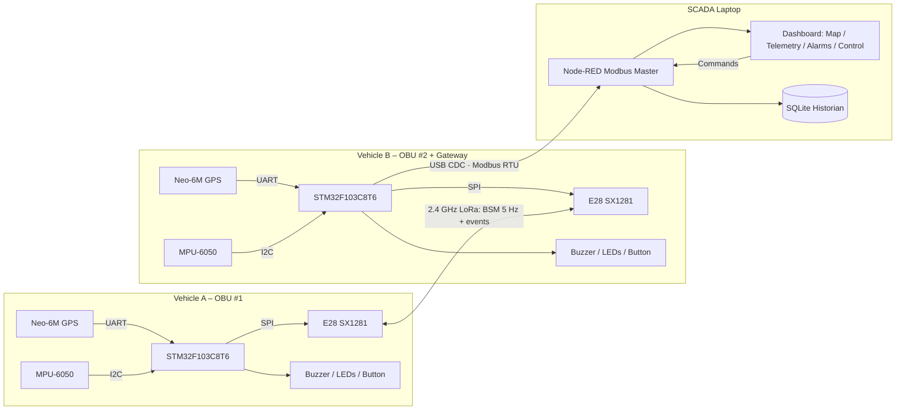
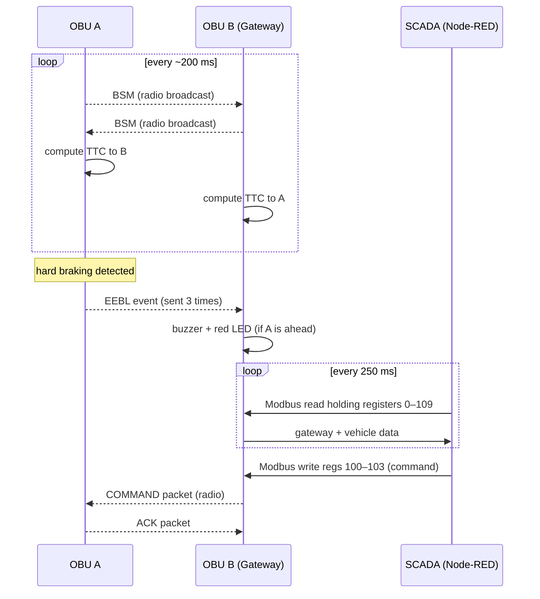

# V2V (Vehicle-to-Vehicle) Communication System with SCADA Monitoring

**Final Year Project — Complete Build Specification**

> **Purpose of this document:** a complete, self-contained specification. A student, an engineer or an AI assistant with **no other context** should be able to read it and build the full system: hardware, firmware and SCADA software. Every value, pin, message byte and threshold is defined here. Anything not yet verified is marked **⚠️ VERIFY**.

---

## Table of Contents

0. [How to Use This Document](#0-how-to-use-this-document)
1. [Project Summary](#1-project-summary)
2. [Problem Statements & Solutions](#2-problem-statements--solutions)
3. [Feature Levels & Definition of Done](#3-feature-levels--definition-of-done)
4. [System Architecture](#4-system-architecture)
5. [Components](#5-components)
6. [Hardware Build — Step by Step](#6-hardware-build--step-by-step)
7. [Radio Communication Specification](#7-radio-communication-specification)
8. [V2V Packet Specification](#8-v2v-packet-specification)
9. [Safety Algorithms Specification](#9-safety-algorithms-specification)
10. [Firmware Specification](#10-firmware-specification)
11. [Modbus Gateway Specification](#11-modbus-gateway-specification)
12. [SCADA Software — Step by Step](#12-scada-software--step-by-step)
13. [Calibration Procedures](#13-calibration-procedures)
14. [Testing & Acceptance](#14-testing--acceptance)
15. [Troubleshooting](#15-troubleshooting)
16. [Project Timeline](#16-project-timeline)
17. [Risks & Mitigations](#17-risks--mitigations)
18. [Future Scope](#18-future-scope)
19. [Repository Structure](#19-repository-structure)
20. [Glossary](#20-glossary)
21. [Items to Verify Before Building](#21-items-to-verify-before-building)

---

## 0. How to Use This Document

### 0.1 For human builders
Follow the sections in order: **5 → 6 → 10 → 11 → 12 → 13 → 14**. Do not skip the power checks in Section 6. A wrong voltage can destroy the radio module.

### 0.2 For an AI assistant asked to help build this
- Treat this document as the **single source of truth**. Do not change pin numbers, packet layout, register addresses or thresholds unless the user asks.
- Generate firmware for **Arduino IDE + STM32duino core** (Section 10.1) unless the user asks for STM32CubeIDE.
- Every module in Section 10.3 maps to one source file. Generate them one at a time and keep the function names given here.
- For anything marked **⚠️ VERIFY**, tell the user to check the datasheet. Do not guess.
- The packet struct, CRC function and geometry functions in Sections 8 and 9 are **reference implementations**. Use them as given.

### 0.3 Conventions used everywhere

| Item | Convention |
|---|---|
| Units | SI units (metres, m/s, m/s², degrees, ms) unless stated |
| Heading | Degrees clockwise from true North, 0–359.99 |
| Coordinates | WGS-84 latitude/longitude, stored as integer degrees × 10⁷ |
| Byte order (radio packet) | **Little-endian** (native STM32 order), struct packed with no padding |
| Byte order (Modbus) | Big-endian per Modbus standard. 32-bit values sent as **high word first**. |
| Modbus addresses | **0-based protocol addresses** (address 0 = "40001" in old notation) |
| Signed 16-bit in Modbus | Two's complement (e.g. 65535 = −1) |
| "Vehicle" | One On-Board Unit (OBU). In the demo, a vehicle can be an RC car, bicycle or hand-carried box. |
| Time "now" | `millis()` on the local MCU, unless stated |

---

## 1. Project Summary

### 1.1 What is being built
1. **Two On-Board Units (OBUs)**, one per vehicle. Each OBU contains:
   - **STM32F103C8T6 "Blue Pill"** microcontroller (the brain)
   - **Ublox Neo-6M GPS** (position, speed, heading, time)
   - **MPU-6050 IMU** (acceleration and rotation: braking, crash, rollover, potholes)
   - **Ebyte E28-2G4M20SX** radio (Semtech SX1281 chip, 2.4 GHz LoRa) for vehicle-to-vehicle messages
   - **Buzzer + 3 LEDs + 1 push button** for driver warnings
   - **18650 Li-ion battery power system**
2. Each OBU **broadcasts its state 5 times per second** and **listens** for other OBUs.
3. Each OBU **calculates collision risk** and **detects events** (hard braking, crash, rollover, pothole), then warns its driver and the other vehicles.
4. **OBU #2 is also the SCADA gateway.** It connects to a laptop by USB and acts as a **Modbus RTU slave**.
5. The **laptop runs SCADA software (Node-RED)**. It reads all vehicle data, shows a live map and dashboard, raises and logs alarms, stores history, and lets an operator **send commands** to vehicles.

### 1.2 Why this design
- **No infrastructure needed.** Vehicles talk directly over radio, with no cellular network or internet.
- **Low cost:** about ₹1,650 of parts per vehicle.
- **License-free radio:** 2.4–2.4835 GHz ISM band (delicensed in India).
- **SX1281 chip** offers long range, interference tolerance and optional built-in **time-of-flight distance measurement**.
- **SCADA layer** adds the industrial idea of central supervision, alarms, history and remote commands.

> **Real-world context:** commercial V2V uses DSRC (IEEE 802.11p) or C-V2X at 5.9 GHz, and the SAE J2735 "Basic Safety Message". This project copies their *concepts* on low-cost hardware. It is a prototype, **not** a certified safety device.

---

## 2. Problem Statements & Solutions

| # | Problem Statement | Proposed Solution | Components Used | Feature |
|---|---|---|---|---|
| **P1** | **Rear-end collisions** happen because drivers react late or misjudge the gap to the vehicle ahead. | **Forward Collision Warning (FCW):** vehicles share position, speed and heading. Each OBU calculates distance and **Time-To-Collision (TTC)** to the vehicle ahead and warns in two levels (Caution / Critical). | GPS, Radio, STM32 | F1 |
| **P2** | **Sudden braking is not seen** by vehicles further back, or in fog or darkness. Brake lights only help the vehicle directly behind. | **Emergency Electronic Brake Light (EEBL):** the IMU detects hard deceleration (worse than −0.4 g) and an event is broadcast **at once** to all vehicles in range, even vehicles hidden behind others. | IMU, Radio | F2 |
| **P3** | **Accidents are reported late**, especially on isolated roads, losing the "golden hour". | **Crash & Rollover Detection:** an impact over 4 g or a tilt over 60° triggers an **SOS broadcast with GPS location**. The SCADA raises a **critical alarm** and shows it on the map. | IMU, GPS, Radio, SCADA | F3, F4 |
| **P4** | **Blind spots, curves and intersections** block line of sight. | Radio warnings reach **beyond line of sight** (hundreds of metres), so vehicles become "aware" of each other before they are visible. | Radio | F1, F2 |
| **P5** | **Network dead zones:** cellular/IoT systems fail on ghats, rural roads and in tunnels. | **Direct peer-to-peer radio.** No mobile network or internet needed. | Radio | All |
| **P6** | **No central visibility** for fleet operators or authorities. | **SCADA system:** live map, telemetry, alarm console, history, and operator commands (hazard alert, speed advisory, clear SOS). | Gateway, Modbus, Node-RED | F6, F7 |
| **P7** | **Road hazards** such as potholes are not shared between drivers. | **Pothole detection** from vertical acceleration spikes, tagged with GPS and shared with vehicles behind and with the SCADA. | IMU, GPS | F5 |
| **P8** | **GPS is coarse:** ±2.5–10 m error, 1 update per second by default. | GPS raised to **5 updates per second** (setting saved in the module's EEPROM). Optional IMU **dead-reckoning** and SX1281 **radio ranging** as a second distance source. | GPS, IMU, Radio | F1, L3 |
| **P9** | **Wireless data can be corrupted, lost or replayed.** | **CRC-16** check, **sequence numbers** (detect loss and duplicates), **freshness check** (reject old data). Optional encryption at Level 3. | Firmware | All |
| **P10** | **Commercial V2V hardware is expensive.** | Complete OBU for about **₹1,650** using off-the-shelf modules. | All | — |

---

## 3. Feature Levels & Definition of Done

Build in this order. **Level 1 is the minimum for a working project.**

| Level | ID | Feature | Section |
|---|---|---|---|
| **L1 – Must** | F0 | Two OBUs exchange BSM packets at 5 Hz with CRC validation | 7, 8 |
| | F1 | Forward Collision Warning (TTC, distance, headway) | 9.3 |
| | F2 | Hard-braking event (EEBL) broadcast + warning | 9.4 |
| | F3 | Crash detection → SOS | 9.5 |
| | F6 | Gateway Modbus slave + Node-RED dashboard with live map and alarms | 11, 12 |
| | F8 | Simulation mode for indoor demonstration | 10.6 |
| **L2 – Should** | F4 | Rollover detection | 9.6 |
| | F5 | Pothole / road-hazard detection | 9.7 |
| | F7 | SCADA → vehicle commands (hazard alert, speed advisory, clear SOS, buzzer test, ping) | 11.4 |
| | F9 | SQLite historian + alarm history | 12.6 |
| | F10 | Battery monitoring + low-battery alarm | 6.6 |
| **L3 – Could** | — | IMU dead-reckoning between GPS fixes | 9.8 |
| | — | SX1281 ranging (time-of-flight distance) | 7.4 |
| | — | OLED display on each OBU | 18 |
| | — | Packet encryption / authentication | 18 |

### Definition of Done (demo-ready)
1. Both OBUs power from batteries. GPS fix achieved outdoors.
2. SCADA map shows **both vehicles moving** with correct headings, updated at least every 0.5 s.
3. Vehicle B approaching stationary Vehicle A triggers **Caution** then **Critical** warnings on B (buzzer + LEDs). The warning appears on the SCADA.
4. A hard brake on A makes B beep within 200 ms (if B is behind A).
5. A simulated crash (Section 14) produces an **SOS alarm with location** on the SCADA within 2 s.
6. An operator "Hazard Alert" command from the SCADA reaches Vehicle A within 1 s.
7. All acceptance tests in Section 14 pass.

---

## 4. System Architecture

> Diagrams are given in **Mermaid** (renders on GitHub, Obsidian, VS Code) **and** plain ASCII (renders anywhere).

### 4.1 System block diagram (ASCII)

```
 ┌──────────────── VEHICLE A (OBU #1) ────────────────┐            ┌──────────── VEHICLE B (OBU #2 + GATEWAY) ───────────┐
 │                                                    │            │                                                      │
 │  [Neo-6M GPS] --UART--> ┌───────────────┐          │   2.4 GHz  │          ┌───────────────┐ <--UART-- [Neo-6M GPS]    │
 │                         │  STM32F103    │--SPI-->[E28 SX1281]~~~~~~~~[E28 SX1281]<--SPI--│  STM32F103    │                        │
 │  [MPU-6050]  --I2C----> │  (RTU)        │          │   LoRa     │          │  (RTU+Gateway)│ <--I2C--- [MPU-6050]      │
 │                         └───────────────┘          │  V2V link  │          └───────┬───────┘                           │
 │  [Buzzer][LEDs][Button]  <──┘                      │            │                  │   └──> [Buzzer][LEDs][Button]     │
 │  [18650 → TP4056 → MT3608 → AMS1117] → power       │            │                  │ USB (virtual COM port)            │
 └────────────────────────────────────────────────────┘            └──────────────────┼───────────────────────────────────┘
                                                                                      │ Modbus RTU
                                                                                      ▼
                                                     ┌──────────────── SCADA STATION (Laptop) ─────────────────┐
                                                     │  Node-RED:                                              │
                                                     │   Modbus Master (poll every 250 ms)                     │
                                                     │   → Decode → Dashboard (map, gauges, alarms, controls)  │
                                                     │   → Alarm logic → SQLite historian                      │
                                                     │   ← Operator commands (write registers)                 │
                                                     └─────────────────────────────────────────────────────────┘
```

### 4.2 System block diagram (Mermaid)



### 4.3 SCADA layers

| Level | Name | In this project |
|---|---|---|
| 0 | Field devices | GPS, IMU, buzzer, LEDs, button, battery sensing |
| 1 | Control (RTU) | STM32 OBUs running safety logic; V2V radio network |
| 2 | Communication / server | Modbus RTU over USB; Node-RED Modbus master |
| 3 | Supervisory / HMI | Node-RED dashboard, alarm manager, SQLite historian |

### 4.4 Message flow



### 4.5 OBU operating states

| State | Entered when | Behaviour | Exit when |
|---|---|---|---|
| `BOOT` | Power on | Init hardware, self-test, IMU calibration (2 s, keep still) | Init done |
| `NORMAL` | After boot | BSM at 5 Hz, receive, compute risk | Warning / event |
| `WARNING` | FCW Caution/Critical, or received EEBL/hazard alert | Buzzer/LED pattern (Section 10.5); flags set in BSM | Condition clear for 1 s |
| `SOS` | Crash or rollover detected | CRASH packet every 1 s; red LED fast blink; flags bit 1 or 2 held | Button held 3 s, or CLEAR_SOS command |

---

## 5. Components

### 5.1 Purchased (already ordered)

**Hubtronics Order (#129029)**

| # | Item | Qty | Unit (₹) | Amount (₹) |
|---|---|---|---|---|
| 1 | Ebyte E28-2G4M20SX SX1281 2.4 GHz LoRa Module | 2 | 648.31 | 1,296.61 |
| | **Subtotal + Shipping/Tax** | | | **1,605.00** |

**Robocraze Order (#392296)**

| # | Item | Qty | Unit (₹) | Amount (₹) |
|---|---|---|---|---|
| 2 | 18650 Single Battery Cell Case Holder | 2 | 29 | 58 |
| 3 | MT3608 DC-DC Boost Module (2 V–24 V) | 2 | 47 | 94 |
| 4 | AMS1117 5 V Step-Down Power Supply Module | 2 | 21 | 42 |
| 5 | 3.7 V 2000 mAh 18650 Li-Ion Battery | 2 | 69 | 138 |
| 6 | TP4056 Battery Charger Type-C Module | 2 | 23 | 46 |
| 7 | MPU-6050 Accelerometer & Gyroscope Module | 2 | 154 | 308 |
| 8 | Ublox Neo-6M GPS Module with EEPROM | 2 | 339 | 678 |
| 9 | STM32F103C8T6 ARM Development Board | 2 | 174 | 348 |
| | **Estimated Total** | | | **1,712.00** |

**Combined total: ₹3,317.00 → about ₹1,658 per vehicle**

### 5.2 What each part does

| Part | Job in the system | Interface | Key facts |
|---|---|---|---|
| STM32F103C8T6 (Blue Pill) | Runs all firmware; gateway node also runs Modbus over USB | — | 72 MHz Cortex-M3, 64 KB flash (often 128 KB), 20 KB RAM, **3.3 V logic**, native USB, **no hardware floating-point** (software float is fast enough here) |
| E28-2G4M20SX (SX1281) | Sends and receives V2V packets | SPI + control pins | 2.4 GHz; chip supports LoRa/FLRC/GFSK and ranging; module adds a power amplifier (~20 dBm); **3.3 V only** |
| Neo-6M GPS | Latitude, longitude, speed, heading, UTC time | UART | Default 9600 baud, 1 Hz NMEA; configurable to 5 Hz; EEPROM keeps settings; 3.3–5 V supply (module has its own regulator) |
| MPU-6050 | Acceleration (3 axes) + rotation rate (3 axes) | I2C, address 0x68 | Module has pull-up resistors; WHO_AM_I register (0x75) returns 0x68 |
| 18650 cell | Energy | — | 3.0 V (empty) – 4.2 V (full), 2000 mAh |
| TP4056 Type-C | Charges the cell (1 A, CC/CV to 4.2 V) | USB-C | Some versions include DW01 protection with OUT+/OUT− pads; others only have B+/B− (Section 6.2) |
| MT3608 | Boosts 3.0–4.2 V up to **7.0 V** | — | Adjustable via trimmer potentiometer; output is noisy |
| AMS1117-5.0 | Regulates 7.0 V down to clean **5.0 V** | — | Linear regulator; needs input ≥ ~6.5 V |

### 5.3 Additional items you must buy (not in the orders)

Prices are approximate.

| Item | Qty | ≈ ₹ | Why | Priority |
|---|---|---|---|---|
| ST-Link V2 programmer (clone) | 1 | 250–350 | Programs the STM32 over SWD | **Essential** |
| 2.4 GHz antenna matching the E28 connector (IPEX/u.FL pigtail or SMA) | 2 | 100–200 each | **⚠️ Never transmit without an antenna, or the amplifier can be damaged.** Check whether antennas came with the modules. | **Essential** |
| Active buzzer, 5 V | 2 | 15 each | Driver warning | **Essential** |
| LEDs: red, yellow, green (5 mm) | 2 sets | 15 | Warning lights | **Essential** |
| Resistors: 330 Ω ×6, 1 kΩ ×2, 100 kΩ ×4 | — | 20 | LEDs, buzzer transistor, battery sensing | **Essential** |
| BC547 NPN transistor | 2 | 10 | Drives the buzzer | **Essential** |
| Tactile push button | 2 | 10 | Cancel SOS / acknowledge | **Essential** |
| Capacitors: 470 µF/10 V electrolytic ×2, 100 nF ceramic ×4 | — | 20 | Radio power decoupling | **Essential** |
| Perfboard (zero PCB), male/female headers, jumper wires, solder | — | 200 | Assembly | **Essential** |
| SPST slide switch | 2 | 20 | Power on/off | Recommended |
| Micro-USB data cable | 1 | 50 | Gateway → laptop | Recommended |
| USB-TTL adapter (CP2102/CH340) | 1 | 120 | Debug serial + configuring the GPS in u-center | Recommended |
| AMS1117-3.3 module | 2 | 20 each | Separate 3.3 V supply for the radio (extra current margin) | Recommended |
| RC car chassis / small trolleys | 2 | 500–1,000 each | Moving demo platforms | Optional |
| Enclosure boxes | 2 | 100 each | Neat mounting | Optional |

---

## 6. Hardware Build — Step by Step

> Build and test **one OBU completely first**, then copy it. Keep the radio module **disconnected** until Step 6.4 passes.

### 6.1 Power chain overview

```
USB-C 5 V ─► TP4056 ─(B+/B−)─► 18650 cell
                 │
             OUT+/OUT−  (or B+/B− if module has no OUT pads)
                 │
            [Slide switch]
                 │
                 ▼
        MT3608 boost  ── set to 7.0 V
                 │
                 ▼
        AMS1117-5.0   ── 5.0 V rail ──┬──► Blue Pill "5V" pin
                                      ├──► Neo-6M VCC
                                      └──► Buzzer (+)
        Blue Pill onboard regulator ── 3.3 V rail ──┬──► MPU-6050 VCC
                                                    └──► E28 VCC (+470 µF +100 nF at the pin)

All GND pins connected together (common ground).
```

### 6.2 Step 1 — Battery and charger
1. Put the 18650 in the holder. **Check polarity** with a multimeter.
2. Connect holder **+ → TP4056 B+** and **− → TP4056 B−**.
3. Plug in USB-C. The red LED means charging; blue/green means full (4.2 V).
4. If your TP4056 has **OUT+/OUT−** pads (protected version), take the load from them. If it has **only B+/B−**, take the load from B+/B−. In that case firmware must shut down below 3.2 V (Section 6.6) to protect the cell.
5. **Do not charge while the OBU is running** (switch it off). The TP4056 cannot charge correctly while a load is drawing current.

### 6.3 Step 2 — Boost converter (MT3608)
1. Connect TP4056 OUT+ → switch → **MT3608 VIN+**, and OUT− → **MT3608 VIN−**.
2. **With nothing connected to the output**, switch on and measure VOUT.
3. Turn the trimmer potentiometer (many turns may be needed) until **VOUT = 7.0 V ± 0.1 V**.
4. ✅ **Check:** 7.0 V steady with the battery between 3.3 V and 4.2 V.

### 6.4 Step 3 — 5 V regulator (AMS1117-5.0)
1. MT3608 VOUT+ → AMS1117 **IN**, VOUT− → AMS1117 **GND**.
2. ✅ **Check:** AMS1117 **OUT = 5.0 V ± 0.1 V**.

### 6.5 Step 4 — Microcontroller, GPS, IMU, indicators
1. AMS1117 OUT → **Blue Pill "5V" pin**, GND → Blue Pill **G**.
2. ✅ **Check:** Blue Pill **3.3 pin = 3.3 V ± 0.1 V**; the red power LED is on.
3. Wire the GPS, IMU, buzzer, LEDs, button and battery divider exactly as in **Section 6.7**.
4. Program a test sketch (Section 10.7 "bring-up tests") and confirm each part works.

### 6.6 Step 5 — Battery voltage sensing
- Battery + (TP4056 OUT+ or B+) → **100 kΩ** → **PA0** → **100 kΩ** → GND.
- Firmware: `Vbat = adc_raw / 4095.0 × 3.3 × 2`.
- Battery % (linear approximation): `pct = clamp((Vbat − 3.30) / (4.20 − 3.30) × 100, 0, 100)`.
- Low-battery flag below **3.40 V**. Firmware shuts down the radio below **3.20 V**.

### 6.7 Step 6 — Radio module (E28-2G4M20SX)
1. **⚠️ VERIFY** the pin labels and order in the Ebyte E28-2G4M20SX datasheet. Wire **by signal name**, using the table below.
2. The module has small castellated (stamp-hole) pads. Solder it onto perfboard or a breakout adapter using short thin wires.
3. Solder **470 µF + 100 nF** capacitors between E28 VCC and GND, as close to the module as possible.
4. **Connect the antenna BEFORE powering the radio.**
5. ✅ **Check:** the firmware radio init returns success (Section 10.7, test T4).

### 6.8 Complete wiring table (identical for both OBUs)

| From (module pin) | To (Blue Pill pin) | Wire purpose |
|---|---|---|
| **E28 VCC** | 3.3 V | Radio power (+470 µF +100 nF) |
| **E28 GND** | GND | |
| **E28 SCK** | **PA5** | SPI1 clock |
| **E28 MISO** | **PA6** | SPI1 data in (to MCU) |
| **E28 MOSI** | **PA7** | SPI1 data out (from MCU) |
| **E28 NSS** | **PA4** | SPI chip select |
| **E28 BUSY** | **PB0** | Radio busy signal (input) |
| **E28 DIO1** | **PB1** | Radio interrupt (input) |
| **E28 NRESET** | **PA1** | Radio reset (output) |
| **E28 TXEN** | **PB12** | High while transmitting ⚠️ VERIFY that your module exposes TXEN |
| **E28 RXEN** | **PB13** | High while receiving ⚠️ VERIFY that your module exposes RXEN |
| **GPS VCC** | 5 V | |
| **GPS GND** | GND | |
| **GPS TX** | **PA3** (USART2 RX) | GPS → MCU data |
| **GPS RX** | **PA2** (USART2 TX) | MCU → GPS config commands |
| **MPU VCC** | 3.3 V | |
| **MPU GND** | GND | |
| **MPU SCL** | **PB6** | I2C1 clock |
| **MPU SDA** | **PB7** | I2C1 data |
| **MPU INT** | **PB5** | Optional data-ready interrupt |
| **MPU AD0** | GND | Sets I2C address 0x68 |
| **Buzzer +** | 5 V | |
| **Buzzer −** | BC547 **collector** | |
| BC547 **emitter** | GND | |
| BC547 **base** | **PB8** via 1 kΩ | Buzzer control (HIGH = on) |
| **Red LED** anode | **PB14** via 330 Ω; cathode → GND | Critical / SOS |
| **Yellow LED** anode | **PB15** via 330 Ω; cathode → GND | Caution |
| **Green LED** anode | **PA8** via 330 Ω; cathode → GND | Normal / GPS fix |
| **Push button** | **PB9** ↔ GND | Input with internal pull-up (pressed = LOW) |
| **Battery divider midpoint** | **PA0** | ADC |
| **USB port** (on Blue Pill) | Laptop (gateway only) | Modbus RTU over USB CDC (PA11/PA12) |
| **Debug serial** | PA9 (TX) / PA10 (RX) → USB-TTL RX/TX | Optional debug log at 115200 baud |
| **ST-Link** | SWDIO→PA13, SWCLK→PA14, GND, 3.3 V | Programming (DIO/CLK header on the Blue Pill) |

**Pins left free:** PB3, PB4, PB10, PB11, PA15, PC14, PC15 (for future use: OLED on I2C1 shares PB6/PB7).

### 6.9 Mounting the IMU (important for the algorithms)
- Mount the MPU-6050 **flat and rigid** (screw or hot glue, no foam).
- Point the board's **X-axis arrow to the vehicle's front**, Y-axis to the **left**, Z **up**.
- If it must be mounted differently, change `IMU_AXIS_MAP` in `config.h` (Section 10.4) so that firmware variable `ax` = forward, `ay` = left, `az` = up.
- Mount the **GPS antenna facing the sky**, away from the radio antenna (≥ 10 cm).

### 6.10 Power budget

| Load | Average | Peak |
|---|---|---|
| STM32 @ 72 MHz | 30 mA | 30 mA |
| Neo-6M | 45 mA | 50 mA |
| MPU-6050 | 4 mA | 4 mA |
| E28 receive | 18 mA | — |
| E28 transmit (~12 ms × 5/s) | ~8 mA | ~130 mA ⚠️ VERIFY in datasheet |
| LEDs + buzzer | 5 mA | 40 mA |
| **Total on 5 V rail** | **~110 mA** | **~260 mA** |

- Battery power ≈ 7 V × 0.11 A ÷ 0.85 boost efficiency ≈ 0.9 W → ≈ 245 mA from the cell.
- Usable capacity ≈ 2000 mAh × 0.8 = 1600 mAh → **≈ 6.5 hours** runtime.
- ⚠️ The Blue Pill's onboard 3.3 V regulator is about 300 mA, so the peak is close to its limit. If you see resets during transmit, power the E28 from a separate **AMS1117-3.3** fed from the 5 V rail.

---

## 7. Radio Communication Specification

### 7.1 Radio settings (both OBUs must match exactly)

| Parameter | Value | Note |
|---|---|---|
| Frequency | **2445.0 MHz** | Inside 2400–2483.5 MHz ISM band |
| Modulation | LoRa | |
| Spreading factor | **SF7** | Short airtime → low latency |
| Bandwidth | **812.5 kHz** | |
| Coding rate | **4/5** | |
| Preamble | **12 symbols** | |
| Sync word | Private network (RadioLib default `RADIOLIB_SX128X_SYNC_WORD_PRIVATE`) | |
| Header | Explicit | |
| Hardware CRC | ON | Plus software CRC-16 in the packet |
| Payload length | **32 bytes** (all packet types) | |
| Chip output power | Start at **0 dBm** | ⚠️ VERIFY: the E28 amplifies the chip output. The datasheet gives the maximum chip power to set. Raise only if range is too short. |
| Airtime per packet | **≈ 12 ms** (computed for SF7/812.5 kHz/32 bytes) | Check with RadioLib `getTimeOnAir(32)` |

### 7.2 When to transmit

| Packet | Schedule |
|---|---|
| **BSM** | Every **200 ms + random 0–40 ms** (the random part stops two vehicles staying in sync and colliding every time) |
| **Event** (EEBL, CRASH, HAZARD) | **Immediately**, then 2 more copies at random **20–50 ms** gaps (3 copies total, **same sequence number**) |
| **SOS** | CRASH packet every **1000 ms** while in SOS state (in addition to BSMs) |
| **COMMAND** (gateway only) | When the SCADA triggers it; 3 copies, same sequence number |
| **ACK** | Once, immediately after receiving a COMMAND addressed to this vehicle (or broadcast) |
| **PING / PONG** | PING on SCADA request; PONG immediately on receiving PING |

**Listen-before-talk (optional, Level 2):** before transmitting, run Channel Activity Detection (`radio.scanChannel()`). If the channel is busy, wait a random 5–20 ms and retry (maximum 3 times, then transmit anyway).

**Channel load:** 12 ms × 5 per second = 6% airtime per vehicle. The scheme works for about 8–10 vehicles before collisions become frequent.

### 7.3 Radio state handling
- The radio is **always in receive mode** except while transmitting.
- After every transmit, **immediately return to receive** (`startReceive()`).
- The DIO1 interrupt only sets a flag; the main loop reads the packet (never read SPI inside the interrupt).

### 7.4 Optional: SX1281 ranging (Level 3)
The SX1281 can measure distance by **time of flight**: one module acts as initiator, the other as responder. Use once per second as a cross-check on GPS distance at close range (< 50 m). It needs a calibration offset measured at a known distance (Section 13.4) and pauses normal reception for each measurement. RadioLib provides `SX1281::range()`.

---

## 8. V2V Packet Specification

### 8.1 Packet types

| Code | Name | Sent by | Meaning |
|---|---|---|---|
| 0x01 | `BSM` | All | Periodic Basic Safety Message (current state) |
| 0x02 | `EEBL` | All | Hard braking just happened |
| 0x03 | `CRASH` | All | Crash or rollover; SOS |
| 0x04 | `HAZARD` | All | Pothole / road hazard at this location |
| 0x05 | `COMMAND` | Gateway | Operator command from the SCADA |
| 0x06 | `ACK` | All | Acknowledges a COMMAND |
| 0x07 | `PING` | Gateway | Latency test request |
| 0x08 | `PONG` | All | Latency test reply |

### 8.2 Packet layout (32 bytes, little-endian, packed)

| Byte | Field | Type | Unit / encoding |
|---|---|---|---|
| 0 | `start` | uint8 | Always **0xA5** |
| 1 | `type` | uint8 | Table 8.1 |
| 2 | `vehicle_id` | uint8 | Sender ID, 1–254 |
| 3 | `seq` | uint8 | Sender's sequence number, +1 per new packet, wraps 255→0 |
| 4–7 | `timestamp` | uint32 | UTC time of day of the GPS fix used, in ms (0–86,399,999). **0xFFFFFFFF** = no GPS. For PING/PONG: sender's `millis()`. |
| 8–11 | `lat_e7` | int32 | Latitude × 10⁷ |
| 12–15 | `lon_e7` | int32 | Longitude × 10⁷ |
| 16–17 | `speed_cms` | uint16 | Speed in cm/s. COMMAND: **command code**. |
| 18–19 | `heading_cdeg` | uint16 | Heading × 100 (0–35999). COMMAND: **command parameter**. |
| 20–21 | `accel_long_cms2` | int16 | Forward acceleration, cm/s² (negative = braking) |
| 22 | `roll_deg` | int8 | Roll angle, whole degrees |
| 23 | `pitch_deg` | int8 | Pitch angle, whole degrees |
| 24–25 | `yaw_rate_cdps` | int16 | Yaw rate × 100 (°/s) |
| 26 | `flags` | uint8 | Bitfield, see 8.3 |
| 27 | `battery_pct` | uint8 | 0–100 |
| 28 | `gps_quality` | uint8 | High 4 bits = satellites (capped 15); low 4 bits = HDOP rounded (capped 15) |
| 29 | `target_id` | uint8 | 0 = everyone; otherwise the target vehicle ID (COMMAND, ACK, PING, PONG) |
| 30–31 | `crc` | uint16 | CRC-16/CCITT-FALSE over bytes 0–29 |

### 8.3 Flags byte

| Bit | Name | Set when |
|---|---|---|
| 0 | `HARD_BRAKE` | EEBL condition active (held 2 s after trigger) |
| 1 | `CRASH` | In SOS state due to crash |
| 2 | `ROLLOVER` | In SOS state due to rollover |
| 3 | `HAZARD` | Pothole detected in last 2 s |
| 4 | `WARN_CAUTION` | This vehicle's FCW level = Caution |
| 5 | `WARN_CRITICAL` | This vehicle's FCW level = Critical |
| 6 | `GPS_VALID` | GPS has a valid fix (≥ 4 satellites) |
| 7 | `LOW_BATTERY` | Battery < 3.40 V |

### 8.4 Reference C definitions (`v2v_packet.h`)

```c
#include <stdint.h>
#include <stddef.h>

#define V2V_START       0xA5
#define PKT_BSM         0x01
#define PKT_EEBL        0x02
#define PKT_CRASH       0x03
#define PKT_HAZARD      0x04
#define PKT_COMMAND     0x05
#define PKT_ACK         0x06
#define PKT_PING        0x07
#define PKT_PONG        0x08

#define FLAG_HARD_BRAKE     (1u << 0)
#define FLAG_CRASH          (1u << 1)
#define FLAG_ROLLOVER       (1u << 2)
#define FLAG_HAZARD         (1u << 3)
#define FLAG_WARN_CAUTION   (1u << 4)
#define FLAG_WARN_CRITICAL  (1u << 5)
#define FLAG_GPS_VALID      (1u << 6)
#define FLAG_LOW_BATTERY    (1u << 7)

#define TIMESTAMP_NONE  0xFFFFFFFFUL

#pragma pack(push, 1)
typedef struct {
    uint8_t  start;
    uint8_t  type;
    uint8_t  vehicle_id;
    uint8_t  seq;
    uint32_t timestamp;
    int32_t  lat_e7;
    int32_t  lon_e7;
    uint16_t speed_cms;        // COMMAND: command code
    uint16_t heading_cdeg;     // COMMAND: parameter
    int16_t  accel_long_cms2;
    int8_t   roll_deg;
    int8_t   pitch_deg;
    int16_t  yaw_rate_cdps;
    uint8_t  flags;
    uint8_t  battery_pct;
    uint8_t  gps_quality;
    uint8_t  target_id;
    uint16_t crc;
} v2v_packet_t;
#pragma pack(pop)

_Static_assert(sizeof(v2v_packet_t) == 32, "v2v_packet_t must be 32 bytes");
```

### 8.5 Reference CRC (CRC-16/CCITT-FALSE)

```c
// Polynomial 0x1021, initial value 0xFFFF, no reflection, no final XOR.
// Test vector: ASCII "123456789" -> 0x29B1
uint16_t crc16_ccitt(const uint8_t *data, size_t len) {
    uint16_t crc = 0xFFFF;
    while (len--) {
        crc ^= (uint16_t)(*data++) << 8;
        for (int i = 0; i < 8; i++)
            crc = (crc & 0x8000) ? (uint16_t)((crc << 1) ^ 0x1021) : (uint16_t)(crc << 1);
    }
    return crc;
}
// Sender:   pkt.crc = crc16_ccitt((uint8_t*)&pkt, 30);
// Receiver: valid if crc16_ccitt((uint8_t*)&pkt, 30) == pkt.crc
```

### 8.6 Receiver validation (in this order; drop the packet at the first failure)

1. Length is exactly 32 bytes.
2. `start == 0xA5`.
3. CRC matches.
4. `vehicle_id != MY_VEHICLE_ID` (ignore own echoes).
5. **Sequence check:** let `d = (uint8_t)(seq − last_seq[sender])`. Accept only if `1 ≤ d ≤ 127` (newer), or if this is the first packet from this sender, or if the sender has not been heard for > 5 s (it rebooted). If `d == 0`, it is a duplicate copy (event repeats): drop it.
6. **Freshness** (only if both sides have GPS): `age = local_utc_ms_now − timestamp` (handle midnight wrap by adding 86,400,000 if negative). Drop if `age > 500 ms`.
7. `target_id` is 0 or equals `MY_VEHICLE_ID` (for COMMAND/PING/ACK/PONG).

`local_utc_ms_now = last_fix_utc_ms + (millis() − millis_at_last_fix)`

### 8.7 Neighbour table

```c
#define MAX_NEIGHBORS 4
typedef struct {
    bool          used;
    uint8_t       id;
    v2v_packet_t  last;          // last accepted packet (BSM or event)
    uint32_t      last_seen_ms;  // millis() when received
    int16_t       rssi_dbm;
    int16_t       snr_cdb;       // SNR × 10
    uint8_t       last_seq;
    uint16_t      rx_count;      // for PDR, reset every 10 s
    uint16_t      expected_count;
    uint16_t      pdr_permille;  // packet delivery ratio × 1000 over last window
} neighbor_t;
```
- Entry expires if `millis() − last_seen_ms > 1500 ms` (V2V link considered lost).
- **PDR:** on each accepted packet, `expected_count += d` (from step 5) and `rx_count += 1`. Every 10 s: `pdr = rx_count × 1000 / expected_count`, then reset both counts.

---

## 9. Safety Algorithms Specification

### 9.1 Own-vehicle state (updated continuously)

| Variable | Source | Notes |
|---|---|---|
| `lat_e7`, `lon_e7` | GPS (or dead-reckoning) | |
| `speed_ms` | GPS speed over ground (knots × 0.514444) | |
| `heading_deg` | GPS course over ground | **Keep the last valid heading when speed < 1.0 m/s** (GPS heading is noise when stopped) |
| `gps_valid` | GPS fix and satellites ≥ 4 | |
| `ax, ay, az` (m/s²) | IMU after calibration and axis map | ax forward, ay left, az up |
| `gx, gy, gz` (°/s) | IMU after calibration | gz = yaw rate |
| `a_long` | Low-pass filtered `ax` (α = 0.2 at 100 Hz) | `a_long = a_long + 0.2 × (ax − a_long)` |
| `roll_deg`, `pitch_deg` | Complementary filter (9.6) | |

### 9.2 Geometry functions (reference implementation)

```c
#include <math.h>
#define EARTH_R   6371000.0
#define DEG2RAD   0.017453292519943295
#define RAD2DEG   57.29577951308232

// Offset of point 2 relative to point 1 in metres (east, north).
// Equirectangular approximation: accurate to <0.1% for distances < 10 km.
void geo_offset(int32_t lat1_e7, int32_t lon1_e7, int32_t lat2_e7, int32_t lon2_e7,
                double *east_m, double *north_m) {
    double lat1 = lat1_e7 * 1e-7 * DEG2RAD;
    double lat2 = lat2_e7 * 1e-7 * DEG2RAD;
    double dlat = (double)(lat2_e7 - lat1_e7) * 1e-7 * DEG2RAD;
    double dlon = (double)(lon2_e7 - lon1_e7) * 1e-7 * DEG2RAD;
    *east_m  = EARTH_R * dlon * cos((lat1 + lat2) / 2.0);
    *north_m = EARTH_R * dlat;
}

double geo_distance(double east_m, double north_m) { return sqrt(east_m*east_m + north_m*north_m); }

// Bearing from point 1 to point 2, degrees 0..360 clockwise from North.
double geo_bearing(double east_m, double north_m) {
    double b = atan2(east_m, north_m) * RAD2DEG;
    return (b < 0) ? b + 360.0 : b;
}

// Smallest signed difference a - b, result in (-180, 180].
double angle_diff(double a, double b) {
    double d = fmod(a - b + 540.0, 360.0) - 180.0;
    return d;
}
```

### 9.3 F1 — Forward Collision Warning (run at 20 Hz, for each neighbour)

**Inputs:** own state (Section 9.1) and the neighbour's last BSM.

```
if not own.gps_valid or not nb.GPS_VALID flag:  level = NONE (cannot judge); continue
(east, north) = geo_offset(own.lat, own.lon, nb.lat, nb.lon)
d       = geo_distance(east, north)                 // metres
bearing = geo_bearing(east, north)

ahead     = |angle_diff(bearing, own.heading)| <= AHEAD_ANGLE_DEG        (20°)
same_dir  = |angle_diff(nb.heading, own.heading)| <= SAME_DIR_ANGLE_DEG  (30°)
if not ahead or not same_dir or own.speed < MIN_SPEED_FCW (1.0 m/s):  level = SAFE; continue

v_close  = own.speed − nb.speed × cos(angle_diff(nb.heading, own.heading) × DEG2RAD)
ttc      = (v_close > 0.1) ? d / v_close : INFINITY
headway  = d / own.speed                             // seconds of gap

if ttc <= TTC_CRITICAL_S (2.0)                         → level = CRITICAL
else if ttc <= TTC_CAUTION_S (4.0) or headway < HEADWAY_MIN_S (1.0)  → level = CAUTION
else                                                   → level = SAFE
```

- The vehicle's overall FCW level = the **highest** level over all neighbours. Its TTC = the **lowest** TTC.
- **Hysteresis:** a level may go *up* immediately, but goes *down* only after the lower level has held for **1.0 s**.
- Set flags bit 4/5 to match the level.

**Worked example:** Own speed 15 m/s heading 90°. Neighbour 40 m due east (bearing 90°), speed 10 m/s, heading 90°.
→ ahead ✔, same direction ✔, v_close = 15 − 10 = 5 m/s, TTC = 40/5 = **8 s**, headway = 40/15 = 2.7 s → **SAFE**.
At d = 15 m: TTC = 3 s → **CAUTION**. At d = 9 m: TTC = 1.8 s → **CRITICAL**.

### 9.4 F2 — Hard braking (EEBL)

**Sender side** (100 Hz):
```
if a_long < HARD_BRAKE_MS2 (−3.9 m/s² = −0.4 g) continuously for ≥ HARD_BRAKE_TIME_MS (200 ms)
   and speed_ms > 2.0 (or no GPS fix):
       send EEBL event (3 copies)
       set FLAG_HARD_BRAKE for 2 s
       ignore new triggers for 2 s
```

**Receiver side** (on receiving EEBL from a neighbour):
```
if both have GPS:
    alert only if the sender is ahead (|angle_diff(bearing_to_sender, own.heading)| ≤ 45°)
    and distance ≤ 300 m
else:
    alert anyway (cannot judge position)
alert = pattern "EEBL" for 2 s (Section 10.5)
```

### 9.5 F3 — Crash detection

```
a_total = sqrt(ax² + ay² + az²) / 9.81          // in g (stationary ≈ 1.0)
if a_total > CRASH_G (4.0):
    mark crash_candidate, record time t0
if crash_candidate and within 3 s after t0:
    if (GPS valid and speed_ms < 1.0) or (no GPS):
        enter SOS state with FLAG_CRASH
        send CRASH packet immediately, then every 1 s
if crash_candidate and 3 s passed without confirmation: clear candidate
```
- SOS ends when the **button is held for 3 s** or a **CLEAR_SOS** command arrives.
- **Receivers** of a CRASH packet: always alert (pattern "SOS_REMOTE") for 5 s. The gateway passes it to the SCADA as a critical alarm.

### 9.6 F4 — Rollover detection

**Complementary filter** (100 Hz, dt = 0.01 s):
```
roll_acc  = atan2(ay, az) × RAD2DEG
pitch_acc = atan2(−ax, sqrt(ay² + az²)) × RAD2DEG
roll  = 0.98 × (roll  + gx × dt) + 0.02 × roll_acc
pitch = 0.98 × (pitch + gy × dt) + 0.02 × pitch_acc
```
```
if |roll| > ROLLOVER_DEG (60°) or |pitch| > ROLLOVER_DEG for ≥ 1000 ms:
    enter SOS state with FLAG_ROLLOVER (same handling as crash)
```

### 9.7 F5 — Pothole / road hazard

```
az_hp = high-pass filtered az (remove gravity):
    az_lp = az_lp + 0.02 × (az − az_lp);  az_hp = az − az_lp
if |az_hp| > POTHOLE_G (1.5 g = 14.7 m/s²) and speed_ms > 3.0 and GPS valid:
    send HAZARD event (3 copies) with current lat/lon
    set FLAG_HAZARD for 2 s; ignore new triggers for 3 s
```
**Receiver:** alert (pattern "HAZARD", 2 s) only if the hazard location is **ahead** (≤ 30°) and **≤ 200 m** away. The SCADA plots a hazard marker; reports within 10 m of an existing marker increase its count.

### 9.8 Dead reckoning (Level 3)
Between GPS fixes (every 50 ms):
```
v      = v + a_long × dt
θ      = θ + gz × dt
north += v × cos(θ) × dt ;  east += v × sin(θ) × dt   → convert back to lat/lon
```
Reset to the GPS values at every new fix.

---

## 10. Firmware Specification

### 10.1 Toolchain (chosen)

| Item | Choice |
|---|---|
| IDE | **Arduino IDE 2.x** |
| Board package | **STM32duino** ("STM32 MCU based boards" by STMicroelectronics). Board manager URL: `https://github.com/stm32duino/BoardManagerFiles/raw/main/package_stmicroelectronics_index.json` |
| Board settings | Board: *Generic STM32F1 series* · Part: *BluePill F103C8* · USB support: *CDC (generic "Serial" supersede U(S)ART)* · Upload method: *STM32CubeProgrammer (SWD)* |
| Extra software | **STM32CubeProgrammer** (needed for SWD upload with the ST-Link) |
| Libraries | **RadioLib** (jgromes) – SX1281 driver · **TinyGPSPlus** (mikalhart) – NMEA parser · MPU-6050: write direct register code (Section 10.4) · Modbus: **ModbusRTUSlave** (CMB27) or a minimal own implementation (FC03, FC06, FC16) |
| Watchdog | Built-in `IWatchdog` library, 2 s timeout |

**Serial ports with these settings:**
- `Serial` = USB CDC (Modbus to SCADA, gateway only)
- `Serial1` = USART1 on PA9/PA10 (debug log, 115200)
- GPS: `HardwareSerial GPSSerial(PA3, PA2);` (RX, TX) = USART2

*Alternative:* STM32CubeIDE + HAL + Semtech SX1280 driver. The specification is the same; only the driver calls change.

### 10.2 `config.h` (complete)

```c
#pragma once
// ===== Identity =====
#define MY_VEHICLE_ID          1        // 1 for OBU #1, 2 for OBU #2
#define IS_GATEWAY             0        // 1 on the OBU connected to the SCADA laptop
#define SIM_MODE               0        // 1 = simulated GPS for indoor demo (Section 10.6)
#define FW_VERSION             100      // 1.00

// ===== Pins =====
#define PIN_RF_NSS    PA4
#define PIN_RF_DIO1   PB1
#define PIN_RF_NRST   PA1
#define PIN_RF_BUSY   PB0
#define PIN_RF_TXEN   PB12
#define PIN_RF_RXEN   PB13
#define PIN_GPS_RX    PA3
#define PIN_GPS_TX    PA2
#define PIN_I2C_SCL   PB6
#define PIN_I2C_SDA   PB7
#define PIN_IMU_INT   PB5
#define PIN_BUZZER    PB8
#define PIN_LED_RED   PB14
#define PIN_LED_YEL   PB15
#define PIN_LED_GRN   PA8
#define PIN_BUTTON    PB9
#define PIN_VBAT      PA0
#define PIN_LED_BOARD PC13   // onboard LED, active LOW

// ===== Radio =====
#define RF_FREQ_MHZ        2445.0
#define RF_BW_KHZ          812.5
#define RF_SF              7
#define RF_CR              5        // 4/5  (check RadioLib's cr argument convention)
#define RF_PREAMBLE        12
#define RF_CHIP_POWER_DBM  0        // chip output BEFORE the module's amplifier – see Section 7.1
#define BSM_PERIOD_MS      200
#define BSM_JITTER_MS      40
#define EVENT_COPIES       3
#define EVENT_GAP_MIN_MS   20
#define EVENT_GAP_MAX_MS   50
#define SOS_PERIOD_MS      1000

// ===== GPS =====
#define GPS_BAUD_DEFAULT   9600
#define GPS_BAUD           38400
#define GPS_RATE_MS        200      // 5 Hz
#define GPS_MIN_SATS       4

// ===== IMU =====
#define IMU_ADDR           0x68
#define IMU_RATE_HZ        100
#define IMU_ACC_LSB_PER_G  4096.0   // ±8 g range
#define IMU_GYR_LSB_PER_DPS 65.5    // ±500 °/s range
// Axis map: which raw axis is forward/left/up, and sign. Default = board X forward, Y left, Z up.
#define IMU_AXIS_MAP  { {0, +1}, {1, +1}, {2, +1} }

// ===== Safety thresholds =====
#define TTC_CAUTION_S        4.0
#define TTC_CRITICAL_S       2.0
#define HEADWAY_MIN_S        1.0
#define AHEAD_ANGLE_DEG      20.0
#define SAME_DIR_ANGLE_DEG   30.0
#define MIN_SPEED_FCW        1.0
#define WARN_HOLD_MS         1000
#define HARD_BRAKE_MS2      -3.9
#define HARD_BRAKE_TIME_MS   200
#define EEBL_RANGE_M         300
#define CRASH_G              4.0
#define CRASH_CONFIRM_MS     3000
#define ROLLOVER_DEG         60.0
#define ROLLOVER_TIME_MS     1000
#define POTHOLE_G            1.5
#define HAZARD_RANGE_M       200
#define NEIGHBOR_TIMEOUT_MS  1500
#define PACKET_MAX_AGE_MS    500
#define SOS_CANCEL_HOLD_MS   3000

// ===== Battery =====
#define VBAT_DIVIDER         2.0
#define VBAT_FULL            4.20
#define VBAT_EMPTY           3.30
#define VBAT_LOW             3.40
#define VBAT_CUTOFF          3.20

// ===== Modbus (gateway) =====
#define MODBUS_SLAVE_ID      1
#define MODBUS_BAUD          115200   // nominal; USB CDC ignores it
```

### 10.3 Source files and responsibilities

| File | Functions (names to keep) | Responsibility |
|---|---|---|
| `main.ino` | `setup()`, `loop()` | Initialisation order and cooperative scheduler (10.5) |
| `config.h` | — | All constants (10.2) |
| `v2v_packet.h/.cpp` | `crc16_ccitt()`, `pkt_build()`, `pkt_validate()` | Packet format (Section 8) |
| `radio.h/.cpp` | `radio_init()`, `radio_send(pkt)`, `radio_service()`, `radio_isr()` | RadioLib SX1281 wrapper, TX queue, RX flag |
| `gps.h/.cpp` | `gps_init()`, `gps_poll()`, `gps_configure()`, `gps_utc_now_ms()` | UBX config + NMEA parsing → own state |
| `imu.h/.cpp` | `imu_init()`, `imu_calibrate()`, `imu_update()` | MPU-6050 driver, filters, roll/pitch |
| `neighbors.h/.cpp` | `nb_update(pkt, rssi, snr)`, `nb_expire()`, `nb_get(i)` | Neighbour table + PDR (8.7) |
| `geo.h/.cpp` | `geo_offset()`, `geo_distance()`, `geo_bearing()`, `angle_diff()` | Geometry (9.2) |
| `safety.h/.cpp` | `safety_update()`, `detect_brake()`, `detect_crash()`, `detect_rollover()`, `detect_pothole()`, `handle_event_rx(pkt)` | Section 9 |
| `alerts.h/.cpp` | `alert_set(pattern, duration_ms)`, `alert_update()` | Buzzer/LED patterns (10.5) |
| `power.h/.cpp` | `power_read()` | Battery voltage and % |
| `gateway.h/.cpp` | `gw_init()`, `gw_poll()`, `gw_update_registers()`, `gw_run_command()` | Modbus slave (Section 11) — compiled only if `IS_GATEWAY` |
| `sim.h/.cpp` | `sim_update()` | Simulated GPS (10.6) |

### 10.4 Driver details

**MPU-6050 initialisation (I2C 400 kHz):**

| Register | Address | Value | Meaning |
|---|---|---|---|
| WHO_AM_I | 0x75 | read → expect 0x68 | Presence check |
| PWR_MGMT_1 | 0x6B | 0x01 | Wake up, clock = gyro X PLL |
| SMPLRT_DIV | 0x19 | 0x09 | 1 kHz / (1+9) = 100 Hz |
| CONFIG | 0x1A | 0x03 | Digital low-pass filter ≈ 44 Hz |
| GYRO_CONFIG | 0x1B | 0x08 | ±500 °/s (65.5 LSB per °/s) |
| ACCEL_CONFIG | 0x1C | 0x10 | ±8 g (4096 LSB per g) |

Reading: burst-read **14 bytes from 0x3B**: AX, AY, AZ, TEMP, GX, GY, GZ, each a big-endian int16.
Conversion: `a [m/s²] = raw / 4096.0 × 9.81`, `g [°/s] = raw / 65.5`. Subtract the calibration offsets (Section 13.2), then apply `IMU_AXIS_MAP`.

**Neo-6M configuration (UBX binary protocol):**

UBX frame: `0xB5 0x62 | class | id | length (2 bytes LE) | payload | CK_A CK_B`.
Checksum (8-bit Fletcher over class, id, length and payload):
```c
void ubx_checksum(const uint8_t *buf, size_t len, uint8_t *ck_a, uint8_t *ck_b) {
    *ck_a = 0; *ck_b = 0;
    for (size_t i = 0; i < len; i++) { *ck_a += buf[i]; *ck_b += *ck_a; }
}
```

| Step | Message | Class/ID | Payload |
|---|---|---|---|
| 1 | Disable GSV, GSA, GLL, VTG | 0x06 0x01 (CFG-MSG) | 3 bytes each: `F0 03 00`, `F0 02 00`, `F0 01 00`, `F0 05 00` |
| 2 | Automotive dynamic model | 0x06 0x24 (CFG-NAV5) | 36 bytes: mask = `01 00`, dynModel = `04`, rest 0 |
| 3 | 5 Hz update rate | 0x06 0x08 (CFG-RATE) | `C8 00 01 00 01 00` (200 ms, 1 cycle, UTC time) |
| 4 | UART 38400 baud | 0x06 0x00 (CFG-PRT) | 20 bytes: portID `01`, reserved `00`, txReady `00 00`, mode `D0 08 00 00` (8N1), baud `00 96 00 00` (38400), inProto `07 00`, outProto `03 00`, flags `00 00`, reserved `00 00` |
| 5 | Reopen MCU UART at 38400, then save | 0x06 0x09 (CFG-CFG) | 13 bytes: clear `00 00 00 00`, save `FF FF 00 00`, load `00 00 00 00`, deviceMask `17` |

**Boot procedure:** open the GPS port at 38400. If no valid NMEA sentence arrives within 2 s, reopen at 9600, send steps 1–4, wait 100 ms, reopen at 38400, send step 5. Because of the EEPROM, this runs only on the first boot. *(Or configure once with the u-center PC software through a USB-TTL adapter.)*

**Parsing:** feed every byte to TinyGPSPlus. Use only **RMC** (time, position, speed, course, valid) and **GGA** (satellites, HDOP). On each new RMC: update own state, set `last_fix_utc_ms` and `millis_at_last_fix`.

**SX1281 with RadioLib (sketch):**
```cpp
#include <RadioLib.h>
SX1281 radio = new Module(PIN_RF_NSS, PIN_RF_DIO1, PIN_RF_NRST, PIN_RF_BUSY);
volatile bool rf_flag = false;
void radio_isr() { rf_flag = true; }

bool radio_init() {
    radio.setRfSwitchPins(PIN_RF_RXEN, PIN_RF_TXEN);      // RadioLib drives RXEN/TXEN
    int st = radio.begin(RF_FREQ_MHZ, RF_BW_KHZ, RF_SF, RF_CR,
                         RADIOLIB_SX128X_SYNC_WORD_PRIVATE, RF_CHIP_POWER_DBM, RF_PREAMBLE);
    if (st != RADIOLIB_ERR_NONE) return false;
    radio.setPacketReceivedAction(radio_isr);              // name differs in older RadioLib: setDio1Action
    radio.startReceive();
    return true;
}
```
⚠️ VERIFY the argument order of `begin()` and the `cr` convention against the installed RadioLib version's documentation.

**Transmit:** `radio.transmit((uint8_t*)&pkt, 32)` (blocking ≈ 12 ms), then `radio.startReceive()`.
**Receive:** when `rf_flag` is set: clear it, `radio.readData(buf, 32)`, read `radio.getRSSI()` and `radio.getSNR()`, validate (8.6), dispatch, then `radio.startReceive()`.

### 10.5 Main loop (cooperative scheduler, no RTOS)

```
setup():
    init debug Serial1, LEDs (all on 0.5 s = lamp test), buzzer beep 100 ms
    power_read(); gps_init(); imu_init(); imu_calibrate()  // keep still 2 s
    radio_init()   → if it fails: red LED blinks 5 Hz forever (fault)
    if IS_GATEWAY: gw_init()
    watchdog begin (2 s)
    next_bsm = millis() + random(0, BSM_PERIOD_MS)

loop():
    now = millis()
    gps_poll()                                   // every loop (non-blocking), or sim_update() if SIM_MODE
    if now − t_imu ≥ 10:     imu_update(); detect_brake(); detect_crash(); detect_rollover(); detect_pothole()
    if now − t_safety ≥ 50:  nb_expire(); safety_update()          // FCW
    if now ≥ next_bsm:       radio_send(BSM); next_bsm = now + BSM_PERIOD_MS + random(0, BSM_JITTER_MS+1)
    if sos and now − t_sos ≥ 1000: radio_send(CRASH)
    radio_service()                              // pending event copies + received packets
    button_update()                              // 3 s hold cancels SOS
    alert_update()
    if IS_GATEWAY: gw_poll(); if now − t_gw ≥ 100: gw_update_registers()
    if now − t_power ≥ 1000: power_read()
    watchdog reload
```

**Event TX queue:** a small queue of `{packet, copies_left, next_time}`. `radio_service()` sends one copy when `now ≥ next_time`, then sets `next_time = now + random(20, 51)`.

**Alert patterns** (highest priority wins):

| Priority | Pattern | Buzzer | LEDs |
|---|---|---|---|
| 1 | `SOS_LOCAL` (own SOS) | 1 s on / 1 s off | Red blinks 5 Hz |
| 2 | `SOS_REMOTE` (CRASH received) | 3 short beeps every 1 s | Red blinks 2 Hz |
| 3 | `FCW_CRITICAL` | Continuous | Red solid |
| 4 | `EEBL` (received) | 100 ms on / 100 ms off | Red blinks 5 Hz |
| 5 | `FCW_CAUTION` | 100 ms beep every 500 ms | Yellow solid |
| 6 | `HAZARD` / `COMMAND` alert | 2 beeps | Yellow blinks 2 Hz |
| 7 | `NORMAL` | Off | Green solid with GPS fix; green blinks 1 Hz without fix |

### 10.6 Simulation mode (`SIM_MODE = 1`) for indoor demos
GPS does not work indoors, so the firmware generates its own position:
- **Vehicle 1:** stationary at the reference point `SIM_LAT0, SIM_LON0` (for example your college campus coordinates), heading 90°.
- **Vehicle 2:** starts 120 m west of the reference point, heading 90° (east), speed 8 m/s. It approaches vehicle 1, stops 3 m behind it, waits 10 s, then the cycle repeats.
- `GPS_VALID` is set, the timestamp uses `millis()`-based fake UTC, and the freshness check is disabled.
- Radio, IMU, alerts and SCADA all run for real. Only the position is simulated.

### 10.7 Bring-up tests (one sketch per test, before the full firmware)

| Test | Pass when |
|---|---|
| T1 Blink | PC13 LED blinks; upload via ST-Link works |
| T2 I/O | All 3 LEDs and the buzzer work; button press read correctly |
| T3 IMU | WHO_AM_I = 0x68; flat and still: az ≈ +9.8 m/s², ax and ay ≈ 0 |
| T4 Radio | `radio_init()` returns OK; two boards exchange a "hello" packet with RSSI printed |
| T5 GPS | Outdoors: valid NMEA, fix within 60 s, 5 Hz after configuration |
| T6 USB | Laptop sees a COM port (Windows `COMx`, Linux `/dev/ttyACM0`) |
| T7 Battery | Printed Vbat within ±0.05 V of a multimeter reading |

---

## 11. Modbus Gateway Specification

### 11.1 Link settings
- **Physical:** Blue Pill USB port → laptop (virtual COM port)
- **Protocol:** Modbus RTU, **slave ID 1**, 115200 8N1 (nominal), response timeout on master **500 ms**
- **Function codes supported:** 03 (read holding registers), 06 (write single register), 16 (write multiple registers)
- **Register count:** 0–109 (110 holding registers). Reading unused addresses returns 0.

### 11.2 Gateway registers (0–9)

| Addr | Name | Unit / meaning |
|---|---|---|
| 0 | `FW_VERSION` | 100 = v1.00 |
| 1 | `STATUS` | bit0 radio OK, bit1 GPS fix, bit2 IMU OK, bit3 SIM_MODE |
| 2 | `NEIGHBOR_COUNT` | Active neighbours |
| 3 | `LAST_RTT_MS` | Last PING round-trip time, ms |
| 4 | `CMD_ACK_COUNT` | ACKs received for commands (increments) |
| 5 | `RX_TOTAL` | Valid packets received (lower 16 bits) |
| 6 | `TX_TOTAL` | Packets transmitted (lower 16 bits) |
| 7 | `CRC_ERRORS` | Packets dropped for bad CRC |
| 8 | `GATEWAY_ID` | The gateway's own vehicle ID |
| 9 | `UPTIME_S` | Seconds since boot (lower 16 bits) |

### 11.3 Vehicle blocks (slots)

- **Slot 0** = the gateway's own vehicle. **Slots 1–4** = neighbours from the neighbour table.
- **Block base address = 10 + 20 × slot** → slot 0: 10–29, slot 1: 30–49, slot 2: 50–69, slot 3: 70–89, slot 4: 90–109.

| Offset | Name | Type | Unit |
|---|---|---|---|
| +0 | `VEHICLE_ID` | u16 | 0 = slot empty |
| +1 | `LAT_HI` | s32 high word | lat × 10⁷ |
| +2 | `LAT_LO` | s32 low word | |
| +3 | `LON_HI` | s32 high word | lon × 10⁷ |
| +4 | `LON_LO` | s32 low word | |
| +5 | `SPEED` | u16 | cm/s |
| +6 | `HEADING` | u16 | 0.01° |
| +7 | `ACCEL_LONG` | s16 | cm/s² |
| +8 | `ROLL` | s16 | degrees |
| +9 | `PITCH` | s16 | degrees |
| +10 | `FLAGS` | u16 | Section 8.3 bits |
| +11 | `BATTERY` | u16 | % |
| +12 | `RSSI` | s16 | dBm (slot 0: 0) |
| +13 | `SNR` | s16 | 0.1 dB (slot 0: 0) |
| +14 | `PDR` | u16 | 0.1 % (slot 0: 1000) |
| +15 | `DISTANCE` | u16 | 0.1 m from the gateway vehicle (slot 0 or unknown: 65535) |
| +16 | `TTC` | u16 | 0.1 s. Slot 0: the gateway's lowest TTC. Others: gateway's TTC to that vehicle. 65535 = none. |
| +17 | `WARN_LEVEL` | u16 | 0 safe, 1 caution, 2 critical (from flags bits 4/5) |
| +18 | `GPS_QUALITY` | u16 | Same encoding as the packet |
| +19 | `AGE_MS` | u16 | ms since the last packet (slot 0: 0; capped at 65535) |

### 11.4 Command registers (100–103) — operator → vehicles

| Addr | Name | Meaning |
|---|---|---|
| 100 | `CMD_CODE` | 1 HAZARD_ALERT · 2 SPEED_ADVISORY · 3 CLEAR_SOS · 4 BUZZER_TEST · 5 PING |
| 101 | `CMD_PARAM` | SPEED_ADVISORY: limit in km/h. Others: 0. |
| 102 | `CMD_TARGET` | Vehicle ID, or 0 = all vehicles |
| 103 | `CMD_TRIGGER` | Master writes **1** to execute; gateway sets it back to **0** when sent |

⚠️ Note: slot 4 (addresses 90–109) overlaps with the command registers 100–103. **Limit neighbours to slots 1–3 when commands are used** (MAX_NEIGHBORS = 3 for the gateway) — for a 2-vehicle project only slot 1 is used anyway.

**Gateway behaviour:** when `CMD_TRIGGER == 1`, build a `COMMAND` packet (`speed_cms` = code, `heading_cdeg` = param, `target_id` = target), send 3 copies, set register 103 = 0. For PING, send a PING packet with `timestamp = millis()`; when the PONG returns, store `millis() − pong.timestamp` in register 3. If the target is the gateway itself (or 0), also execute the command locally.

**Vehicle behaviour on COMMAND:**

| Code | Action | Then |
|---|---|---|
| 1 HAZARD_ALERT | Alert pattern `HAZARD` for 3 s | send ACK |
| 2 SPEED_ADVISORY | If own speed > param km/h: `FCW_CAUTION` pattern for 3 s; else 1 short beep | send ACK |
| 3 CLEAR_SOS | Leave SOS state | send ACK |
| 4 BUZZER_TEST | Buzzer on for 2 s | send ACK |

---

## 12. SCADA Software — Step by Step

### 12.1 Install
1. Install **Node.js LTS** from nodejs.org.
2. In a terminal: `npm install -g --unsafe-perm node-red`
3. Start with `node-red` and open **http://localhost:1880**.
4. Menu → *Manage palette* → *Install*:
   - `node-red-contrib-modbus` (Modbus master)
   - `@flowfuse/node-red-dashboard` (Dashboard 2.0 — the UI is at http://localhost:1880/dashboard)
   - `node-red-contrib-web-worldmap` (live map — at http://localhost:1880/worldmap)
   - `node-red-node-sqlite` (historian)
5. Before Node-RED, test the gateway with a free Modbus tool (**QModMaster** or **Modbus Poll**): read holding registers 0–109 from slave 1. Values should change live.

### 12.2 Flow overview

```
[modbus-read FC3 addr 0 qty 110 every 250 ms]
        │
        ▼
[function: decode]──► [dashboard widgets: gauges, text, LEDs]
        │        └──► [worldmap]
        │        └──► [function: alarm logic] ──► [dashboard notification + alarm table]
        │                                    └──► [sqlite: INSERT alarms]
        └──► [delay: rate limit 1 msg/s] ──► [function: telemetry SQL] ──► [sqlite: INSERT telemetry]

[dashboard buttons / inputs] ──► [function: build command] ──► [modbus-write FC16 addr 100 qty 4]
```

### 12.3 Modbus client configuration
- Type: **Serial**, port `COMx` (Windows) or `/dev/ttyACM0` (Linux), baud 115200, 8N1, **RTU**, unit ID 1, timeout 500 ms.
- Read node: FC3, address **0**, quantity **110**, poll rate **250 ms**.

### 12.4 Decode function (Node-RED function node)

```javascript
// Input: msg.payload = array of 110 unsigned 16-bit register values
const r = msg.payload;
const s16 = v => (v > 32767 ? v - 65536 : v);
const s32 = (hi, lo) => (hi << 16) | lo;          // JS bit ops give a signed 32-bit result

const gateway = {
    fw: r[0], status: r[1], neighbors: r[2], rttMs: r[3], acks: r[4],
    rx: r[5], tx: r[6], crcErr: r[7], gatewayId: r[8], uptime: r[9]
};

const vehicles = [];
for (let slot = 0; slot < 4; slot++) {
    const b = 10 + 20 * slot;
    if (r[b] === 0) continue;                          // empty slot
    const flags = r[b + 10];
    vehicles.push({
        slot,
        id: r[b],
        lat: s32(r[b + 1], r[b + 2]) / 1e7,
        lon: s32(r[b + 3], r[b + 4]) / 1e7,
        speedKmh: r[b + 5] / 100 * 3.6,
        heading: r[b + 6] / 100,
        accel: s16(r[b + 7]) / 100,
        roll: s16(r[b + 8]),
        pitch: s16(r[b + 9]),
        flags,
        hardBrake: !!(flags & 1), crash: !!(flags & 2), rollover: !!(flags & 4),
        hazard: !!(flags & 8), gpsValid: !!(flags & 64), lowBattery: !!(flags & 128),
        battery: r[b + 11],
        rssi: s16(r[b + 12]),
        snr: s16(r[b + 13]) / 10,
        pdr: r[b + 14] / 10,
        distance: r[b + 15] === 65535 ? null : r[b + 15] / 10,
        ttc: r[b + 16] === 65535 ? null : r[b + 16] / 10,
        warn: r[b + 17],
        sats: r[b + 18] >> 4, hdop: r[b + 18] & 15,
        ageMs: r[b + 19]
    });
}
msg.payload = { ts: Date.now(), gateway, vehicles };
return msg;
```

### 12.5 Dashboard pages

| Page | Widgets |
|---|---|
| **Map** | Worldmap (embed it in a template iframe, or open it in a separate tab). For each vehicle send `{name: "V"+id, lat, lon, bearing: heading, icon: "fa-car", iconColor: green / orange / red by warn level, label: speed}`. SOS = red marker with "SOS" label; hazard = yellow warning marker. |
| **Telemetry** | Per vehicle: speed gauge (0–60 km/h), heading text, acceleration chart (last 60 s), roll/pitch text, battery gauge, satellites/HDOP, RSSI/SNR, PDR, packet age |
| **V2V Link** | Distance between vehicles, TTC, warning level indicator, RTT (latency = RTT/2), RX/TX/CRC-error counters |
| **Alarms** | Table of active alarms with *Acknowledge* buttons; alarm history from SQLite |
| **Control** | Buttons: Hazard Alert, Clear SOS, Buzzer Test, Ping. Numeric input + button: Speed Advisory (km/h). Dropdown: target vehicle (All / 1 / 2). |

**Command function (button → Modbus write):**
```javascript
// msg.topic = command code (1..5), msg.param = parameter, msg.target = vehicle id or 0
msg.payload = { value: [msg.topic, msg.param || 0, msg.target || 0, 1], fc: 16, unitid: 1, address: 100, quantity: 4 };
return msg;
```
*(Use with a `modbus-flex-write` node, or configure a `modbus-write` node with FC16, address 100, quantity 4 and pass the array as `msg.payload`.)*

### 12.6 Alarm logic and historian

**Alarm definitions** (raise on the rising edge, clear when the condition goes false; critical alarms stay until acknowledged):

| Alarm | Severity | Condition (per vehicle) |
|---|---|---|
| Crash / SOS | CRITICAL | `crash` flag |
| Rollover | CRITICAL | `rollover` flag |
| Collision risk | HIGH | `warn == 2` |
| Hard braking | MEDIUM | `hardBrake` flag |
| Road hazard | MEDIUM | `hazard` flag (also add a map marker) |
| V2V link lost | MEDIUM | `ageMs > 2000`, or the vehicle disappears from the slots |
| GPS fix lost | LOW | `!gpsValid` for > 5 s |
| Low battery | LOW | `lowBattery` flag |
| Gateway offline | CRITICAL | Modbus read errors for > 2 s |

Keep the previous state of each alarm in `context` (`context.get/set`) to detect rising edges.

**SQLite schema** (create once with the sqlite node):
```sql
CREATE TABLE IF NOT EXISTS telemetry (
  ts INTEGER, vehicle_id INTEGER, lat REAL, lon REAL, speed_kmh REAL, heading REAL,
  accel REAL, roll INTEGER, pitch INTEGER, flags INTEGER, battery INTEGER,
  rssi INTEGER, pdr REAL, distance REAL, ttc REAL, warn INTEGER);

CREATE TABLE IF NOT EXISTS alarms (
  id INTEGER PRIMARY KEY AUTOINCREMENT, ts INTEGER, vehicle_id INTEGER,
  type TEXT, severity TEXT, lat REAL, lon REAL,
  acked INTEGER DEFAULT 0, ack_ts INTEGER, cleared_ts INTEGER);
```
Log telemetry at **1 Hz per vehicle** (not every poll) to keep the database small. Provide a "Export CSV" button that runs `SELECT * FROM telemetry WHERE ts > ?` and saves the result as a file.

### 12.7 Alternative: FUXA
FUXA (open-source web SCADA) can replace Node-RED. Add a Modbus RTU device with the same register map, create tags from Section 11, and use its HMI editor and alarm module. The register map does not change.

---

## 13. Calibration Procedures

### 13.1 Power
Set MT3608 to 7.0 V (Section 6.3). Check AMS1117 = 5.0 V.

### 13.2 IMU offsets (automatic at every boot)
1. Keep the OBU **still and level** for 2 s after power-on (green LED blinks fast during this).
2. Firmware averages 200 samples: `gyro_offset = average(g)`, `acc_offset_x = average(ax)`, `acc_offset_y = average(ay)`, `acc_offset_z = average(az) − 9.81`.
3. If the vehicle is moving at boot, the gyro offset will be wrong: reboot while stationary.

### 13.3 Thresholds from real data
Log `a_long`, `a_total` and `az_hp` to the debug serial port during 10 minutes of normal driving. Set thresholds safely above the maximums seen in normal driving (keep the defaults if normal values stay below 60% of them).

### 13.4 Ranging offset (Level 3 only)
Place the two radios exactly 10.0 m apart in the open. Average 50 range readings. `offset = average − 10.0`. Store it in `config.h`.

---

## 14. Testing & Acceptance

### 14.1 Integration and field tests

| ID | Test | Method | Pass criterion |
|---|---|---|---|
| A1 | Packet exchange | Both OBUs on; watch SCADA counters for 5 min | RX increases ~5/s per neighbour; CRC errors < 1% |
| A2 | Range | One OBU fixed, carry the other away in 50 m steps (open ground) | PDR ≥ 90% at ≥ 200 m line of sight (record the maximum range achieved) |
| A3 | Latency | SCADA PING 100 times | Average RTT/2 < 50 ms; maximum < 100 ms |
| A4 | PDR | 1000 BSMs at 50 m | ≥ 95% |
| A5 | Distance accuracy | Measuring tape at 10, 25, 50, 100 m; compare SCADA distance | Error ≤ 5 m (GPS limit); record all values |
| A6 | FCW | A stationary; B walks/rides toward A at steady speed | B shows Caution when TTC ≈ 4 s and Critical when TTC ≈ 2 s (±0.5 s); visible on SCADA |
| A7 | EEBL | A moving ahead of B; A brakes hard | B alerts within 200 ms |
| A8 | Crash | Drop the OBU (in a padded box) onto foam from ~50 cm, then keep it still | SOS on SCADA within 2 s with the correct location |
| A9 | Rollover | Turn the OBU on its side for 2 s | Rollover alarm |
| A10 | Commands | Send each command from the SCADA | Target reacts within 1 s; ACK counter increases |
| A11 | Link loss | Switch off OBU #1 | "V2V link lost" alarm within 2.5 s |
| A12 | False alarms | 30 min normal use | 0 crash/rollover false alarms; FCW false alarms counted and reported |
| A13 | Battery life | Full charge, run continuously | ≥ 5 hours |
| A14 | Simulation demo | `SIM_MODE = 1` indoors | Full demo sequence of Definition of Done items 2–6 works |

### 14.2 Results to record for the report
PDR vs distance (graph), RSSI vs distance (graph), latency histogram, GPS distance error table, TTC warning timing table, false-alarm count, battery runtime.

---

## 15. Troubleshooting

| Symptom | Likely cause | Fix |
|---|---|---|
| Upload fails: "no STM32 target found" | ST-Link wiring, clone chip, or BOOT jumpers | Check SWDIO/SWCLK/GND/3.3V; both BOOT jumpers at 0; for CKS32 clones use "Connect under reset" in STM32CubeProgrammer |
| No COM port on laptop | Wrong USB setting or bad pull-up resistor | Select *CDC (generic Serial)* in board settings; many Blue Pills have R10 = 10 kΩ — replace with 1.5 kΩ or add 1.8 kΩ from PA12 to 3.3 V |
| Radio init fails | Wiring, BUSY pin, power | Check SPI pins and BUSY; check 3.3 V at the module; check the `begin()` arguments |
| Packets sent but never received | Settings differ between nodes; TXEN/RXEN not driven | Same frequency/SF/BW/CR/sync word on both; check `setRfSwitchPins` |
| Very short range | Antenna missing or wrong; chip power too low | Fit a 2.4 GHz antenna; raise `RF_CHIP_POWER_DBM` within the datasheet limit |
| Board resets when transmitting | 3.3 V supply drops | Add 470 µF at the radio; use a separate AMS1117-3.3 |
| GPS no fix | Indoors, or antenna facing down | Go outdoors with clear sky; first fix can take 1–5 min |
| GPS data garbled | Baud mismatch | Re-run the configuration; try 9600 |
| IMU reads 0 or −1 | I2C wiring, address | Check SDA/SCL, AD0 to GND, WHO_AM_I |
| Warnings point the wrong way | IMU axis mapping, or heading used while stopped | Fix `IMU_AXIS_MAP`; keep last heading below 1 m/s |
| SCADA timeouts | Wrong port, or another program has the port open | Close the Arduino serial monitor/QModMaster; check the slave ID is 1 |
| Map shows vehicle at 0,0 | No GPS fix or wrong signed decode | Check the GPS_VALID flag; use `s32()` decoding |

---

## 16. Project Timeline

| Phase | Weeks | Work | Deliverable |
|---|---|---|---|
| 1. Research & design | 1–2 | Literature survey (DSRC, C-V2X, SAE J2735, LoRa, SCADA, Modbus); finalise this spec | Synopsis, block diagram |
| 2. Hardware bring-up | 3–4 | Power chain, wiring, tests T1–T7 | Two assembled OBUs |
| 3. Core firmware | 5–7 | Packet, radio, GPS, IMU, neighbour table | A1 passes |
| 4. Safety features | 8–9 | FCW, EEBL, crash, rollover, pothole, alerts, simulation mode | A6–A9 pass |
| 5. SCADA | 10–11 | Gateway Modbus, Node-RED dashboard, alarms, historian, commands | A10–A11 pass |
| 6. Testing & tuning | 12–13 | All acceptance tests, threshold tuning, data collection | Test report with graphs |
| 7. Documentation | 14–15 | Report, paper, presentation, demo video | Final submission |

---

## 17. Risks & Mitigations

| Risk | Mitigation |
|---|---|
| Difficult soldering of the E28 stamp-hole pads | Use an adapter board, flux and a fine tip; check continuity before power-on |
| Power drops during transmission | Bulk capacitor; separate 3.3 V regulator |
| GPS unavailable indoors at the viva | Simulation mode (10.6) + recorded outdoor demo video |
| GPS error causes false FCW warnings | 5 Hz updates, hysteresis, HDOP gating (ignore if HDOP > 5), optional ranging |
| 2.4 GHz Wi-Fi interference | Event repeats, listen-before-talk, change frequency within the band |
| False crash detection from bumps | Requires both high-g impact and stop within 3 s; tune with real data |
| Clone Blue Pill / USB problems | R10 fix; keep USB-TTL on USART1 as a backup SCADA link |
| Li-ion battery safety | Protected TP4056 where possible; do not charge unattended; low-voltage cutoff in firmware |

---

## 18. Future Scope

- More vehicles and **Roadside Units (V2I):** traffic signal timing, intersection warnings.
- **Cloud SCADA:** forward gateway data via MQTT over 4G/Wi-Fi (ESP32 or SIM7600) to a cloud dashboard.
- **Security:** encrypted and signed messages (as in IEEE 1609.2).
- **OLED display** on each OBU showing distance, TTC and alerts.
- **Platooning / cooperative cruise control** on RC cars.
- **CAN bus** (MCP2515) to read real vehicle speed and brake status.
- Driver-behaviour scoring from historian data.
- Migration to DSRC / C-V2X for real deployment.

---

## 19. Repository Structure

```
v2v-scada/
├── README.md                     # Short intro + link to this spec
├── docs/
│   ├── V2V_SCADA_Project_Plan.md # This document
│   ├── datasheets/               # SX1281, E28, Neo-6M (u-blox 6 protocol spec), MPU-6050, STM32F103
│   ├── diagrams/
│   └── test-reports/
├── hardware/
│   └── schematic/                # KiCad / EasyEDA
├── firmware/
│   └── v2v_obu/
│       ├── v2v_obu.ino           # main (setup/loop)
│       ├── config.h
│       ├── v2v_packet.h / .cpp
│       ├── radio.h / .cpp
│       ├── gps.h / .cpp
│       ├── imu.h / .cpp
│       ├── neighbors.h / .cpp
│       ├── geo.h / .cpp
│       ├── safety.h / .cpp
│       ├── alerts.h / .cpp
│       ├── power.h / .cpp
│       ├── gateway.h / .cpp
│       └── sim.h / .cpp
├── scada/
│   ├── node-red/flows.json
│   └── historian/schema.sql
└── tools/
    └── log_analyzer.py           # PDR / RSSI / latency graphs from CSV exports
```

---

## 20. Glossary

| Term | Meaning |
|---|---|
| **V2V** | Vehicle-to-Vehicle communication |
| **V2I** | Vehicle-to-Infrastructure communication |
| **OBU** | On-Board Unit: the electronics box in each vehicle |
| **RSU** | Roadside Unit |
| **SCADA** | Supervisory Control and Data Acquisition: central monitoring and control software |
| **RTU** | Remote Terminal Unit: a field controller that the SCADA talks to (here, the OBU) |
| **HMI** | Human-Machine Interface: the operator's screen |
| **Historian** | Database storing time-stamped process data |
| **Modbus RTU** | Simple industrial serial protocol; a master reads/writes numbered 16-bit registers on a slave |
| **BSM** | Basic Safety Message: periodic vehicle state broadcast (from SAE J2735) |
| **FCW** | Forward Collision Warning |
| **EEBL** | Emergency Electronic Brake Light |
| **TTC** | Time-To-Collision = distance ÷ closing speed |
| **Headway** | Time gap to the vehicle ahead = distance ÷ own speed |
| **LoRa** | Long-Range chirp spread-spectrum radio modulation by Semtech |
| **SF / BW / CR** | LoRa spreading factor / bandwidth / coding rate |
| **RSSI / SNR** | Received signal strength / signal-to-noise ratio |
| **PDR** | Packet Delivery Ratio = packets received ÷ packets sent |
| **CAD** | Channel Activity Detection (radio checks whether someone is transmitting) |
| **NMEA** | Text sentence format output by GPS receivers ($GPRMC, $GPGGA) |
| **UBX** | u-blox binary protocol used to configure the GPS |
| **HDOP** | Horizontal Dilution of Precision (lower = more accurate GPS) |
| **IMU** | Inertial Measurement Unit (accelerometer + gyroscope) |
| **CDC** | USB Communications Device Class (makes the board appear as a COM port) |
| **SWD** | Serial Wire Debug: the programming interface used by the ST-Link |
| **ISM band** | Licence-free radio band (2.4 GHz here) |

---

## 21. Items to Verify Before Building

These depend on the exact module versions received. Check each one and note the answer in your project log.

| # | Item | Where to check |
|---|---|---|
| 1 | E28-2G4M20SX pin order and names (VCC, GND, NSS, SCK, MOSI, MISO, BUSY, DIO1, NRESET, TXEN, RXEN) | Ebyte E28 datasheet / module silkscreen |
| 2 | Whether TXEN/RXEN must be driven externally on this variant | Ebyte datasheet |
| 3 | Maximum SX1281 chip output power to set before the module's amplifier, and peak TX current | Ebyte datasheet |
| 4 | Antenna connector type on your module (IPEX/u.FL, stamp pad) and whether antennas were included | Physical module |
| 5 | TP4056 version: with protection (OUT+/OUT−) or without (B+/B− only) | Physical module |
| 6 | Blue Pill chip: genuine STM32 or clone (CKS32/CS32); flash size; R10 value | STM32CubeProgrammer / board inspection |
| 7 | RadioLib `SX1281::begin()` argument order and coding-rate convention in your installed version | RadioLib documentation |
| 8 | Neo-6M GPS module accepts 5 V on VCC (most GY-NEO6MV2 boards do) | Module silkscreen / seller page |

---

*Final Year Project — "V2V Communication using SCADA". All thresholds and ranges are design targets to be confirmed in testing. This is an educational prototype, not a certified road-safety device.*
