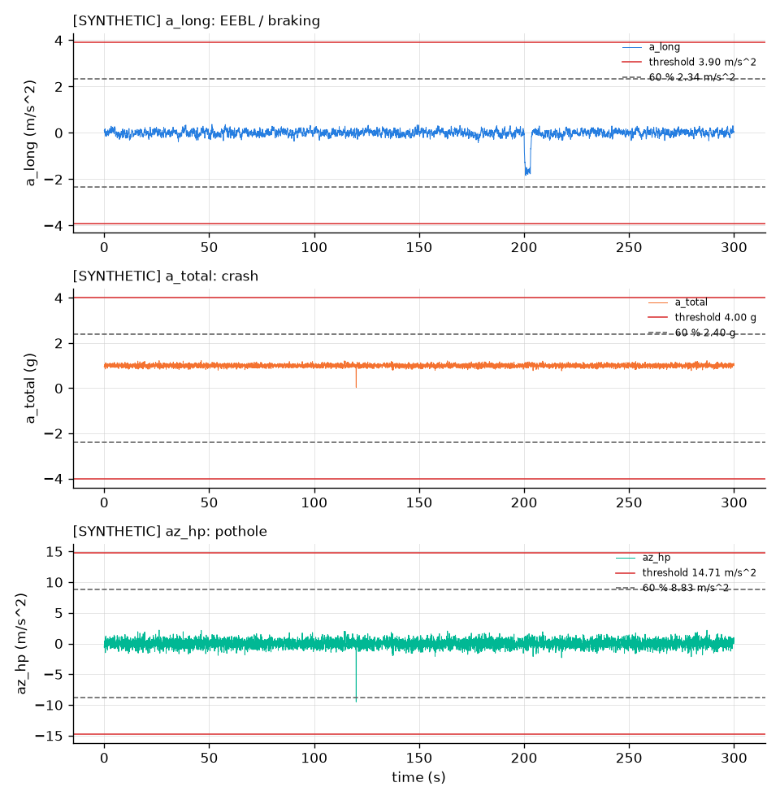
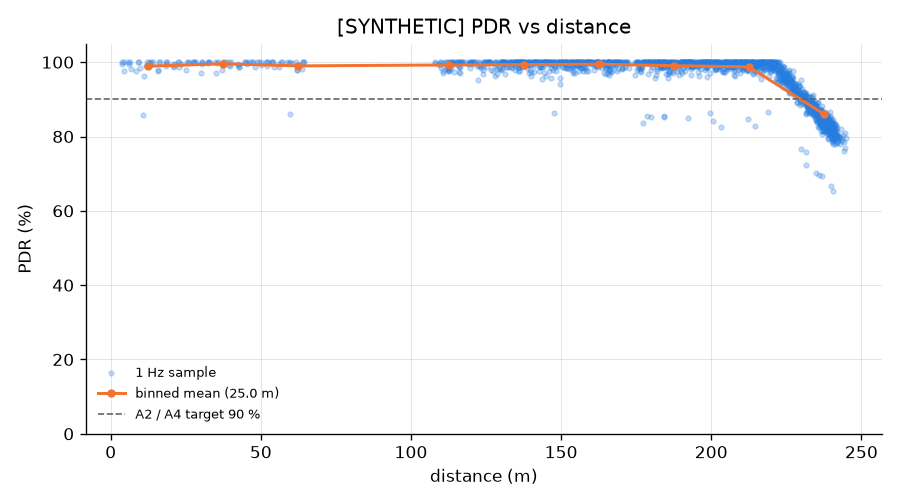
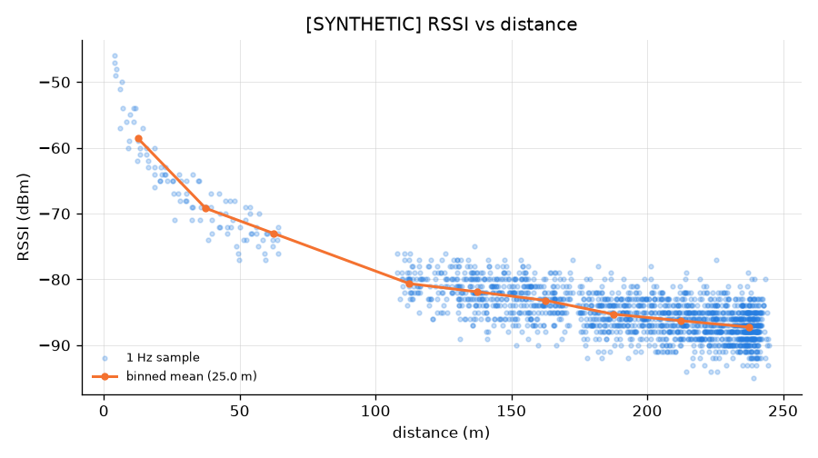
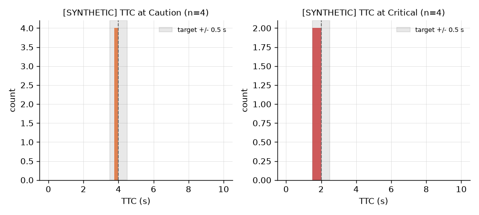
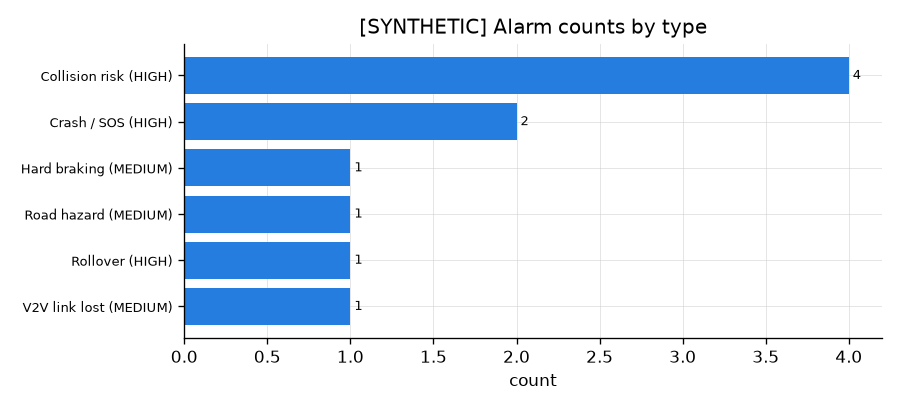
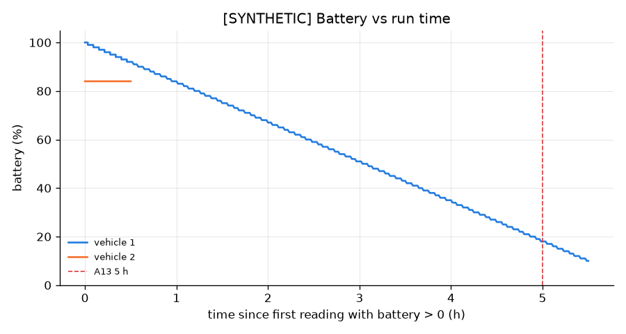
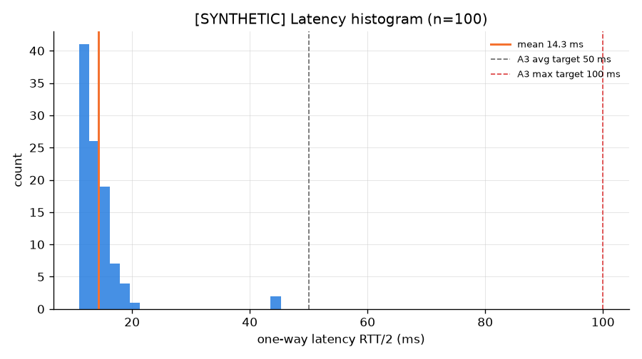
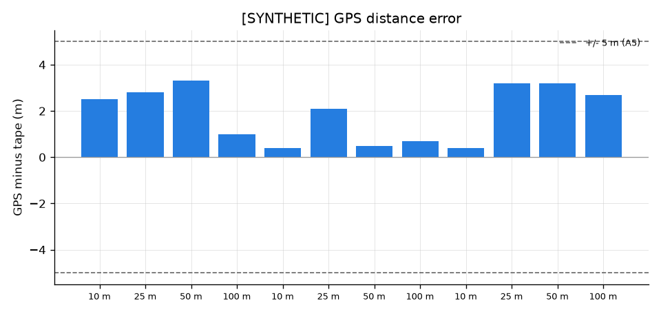

# V2V field-test results summary

> **SYNTHETIC - NOT REAL MEASUREMENTS.** These results were generated by `tools/make_sample_data.py` to test the analyzer. Do not quote them in the report.

Generated by `tools/log_analyzer.py` on 2026-11-25 14:06. Sections are replaced by id on each run; images are in this folder.

<!-- section:inputs -->
## Inputs of the latest run

- `--db`: `sample_v2v.db` analysed, images: pdr_vs_distance.png, rssi_vs_distance.png, ttc_at_warning.png, alarm_counts.png, battery_runtime.png
- `--rtt`: `sample_rtt.csv` analysed, images: latency_sample_rtt.png
- `--distance-error`: `sample_distance_tape.csv` analysed, images: distance_error.png
- `--imu-log`: `sample_imu_normal_drive.csv` analysed, images: imu_thresholds_sample_imu_normal_drive.png

Thresholds from config.h: a_long 3.90, a_total 4.00, az_hp 14.71, roll 60.00.
<!-- /section:inputs -->

<!-- section:imu-sample_imu_normal_drive -->
## --imu-log sample_imu_normal_drive.csv

Source: `sample_imu_normal_drive.csv`: 6000 data rows over 5.0 min (2 non-data lines skipped). Thresholds read from `firmware/v2v_obu/config.h`.

**Note:** the log is 5.0 min. S13.3 asks for 10 min of normal use.

| channel | max |value| | threshold | 60 % line | % of threshold | S13.3 verdict |
|---|---|---|---|---|---|
| a_long | 1.84 m/s^2 | 3.90 m/s^2 | 2.34 m/s^2 | 47 % | below 60 %: keep default |
| a_total | 1.22 g | 4.00 g | 2.40 g | 30 % | below 60 %: keep default |
| az_hp | 9.50 m/s^2 | 14.71 m/s^2 | 8.83 m/s^2 | 65 % | above 60 %: raise only with evidence |
| roll/pitch | 5.95 deg | 60.00 deg | 36.00 deg | 10 % | below 60 %: keep default |

S13.3 rule: keep the default if the normal-use maximum stays below 60 % of each threshold. Above that, a threshold may be raised, but only with this evidence and your approval.

### TTC at FCW transitions in this log

No level transitions in this log (expected for normal driving).
<!-- /section:imu-sample_imu_normal_drive -->

<!-- section:db -->
## --db sample_v2v.db

Source: `sample_v2v.db`, telemetry rows: 3901, alarm rows: 10. Window: all rows. Telemetry is 1 row per vehicle per second; PDR is stored in %.

### PDR vs distance
1800 samples with distance and PDR.

Highest distance bin with mean PDR >= 90 %: 200-225 m (mean 98.7 %).

| distance bin (m) | n | mean PDR % | min % | max % |
|---|---|---|---|---|
| 0-25 | 36 | 98.9 | 85.7 | 100.0 |
| 25-50 | 43 | 99.6 | 97.0 | 100.0 |
| 50-75 | 25 | 99.0 | 86.0 | 100.0 |
| 100-125 | 78 | 99.3 | 95.2 | 100.0 |
| 125-150 | 217 | 99.3 | 86.2 | 100.0 |
| 150-175 | 220 | 99.5 | 96.5 | 100.0 |
| 175-200 | 283 | 99.1 | 83.7 | 100.0 |
| 200-225 | 377 | 98.7 | 82.5 | 100.0 |
| 225-250 | 521 | 86.0 | 65.3 | 97.9 |

### RSSI vs distance

| distance bin (m) | n | mean RSSI dBm | min | max |
|---|---|---|---|---|
| 0-25 | 36 | -58.5 | -66 | -46 |
| 25-50 | 43 | -69.2 | -77 | -64 |
| 50-75 | 25 | -73.0 | -77 | -69 |
| 100-125 | 78 | -80.6 | -86 | -76 |
| 125-150 | 217 | -81.9 | -89 | -75 |
| 150-175 | 220 | -83.2 | -90 | -77 |
| 175-200 | 283 | -85.3 | -92 | -78 |
| 200-225 | 377 | -86.3 | -94 | -78 |
| 225-250 | 521 | -87.2 | -95 | -77 |

### TTC at warning moments

| warning | n | mean TTC s | min s | max s | inside target +/-0.5 s | A6 target |
|---|---|---|---|---|---|---|
| Caution | 4 | 3.79 | 3.8 | 3.8 | 4/4 | 4.0 +/- 0.5 s |
| Critical | 4 | 1.81 | 1.6 | 2.0 | 4/4 | 2.0 +/- 0.5 s |

Each row: vehicle, time, transition, TTC: first 30 shown.

| time | vehicle | transition | TTC s |
|---|---|---|---|
| 2026-11-18 16:40:14 | 2 | Caution | 3.8 |
| 2026-11-18 16:40:21 | 2 | Critical | 1.7 |
| 2026-11-18 16:47:14 | 2 | Caution | 3.8 |
| 2026-11-18 16:47:20 | 2 | Critical | 2.0 |
| 2026-11-18 16:54:14 | 2 | Caution | 3.8 |
| 2026-11-18 16:54:20 | 2 | Critical | 2.0 |
| 2026-11-18 17:01:14 | 2 | Caution | 3.8 |
| 2026-11-18 17:01:21 | 2 | Critical | 1.6 |

### Alarms

| type | severity | count |
|---|---|---|
| Collision risk | HIGH | 4 |
| Crash / SOS | HIGH | 2 |
| Hard braking | MEDIUM | 1 |
| Road hazard | MEDIUM | 1 |
| Rollover | HIGH | 1 |
| V2V link lost | MEDIUM | 1 |

### False-alarm summary

The database cannot tell a false alarm from a real one. Review each row by hand (list below) and record the verdict in docs/test_plan.md.

- Crash / SOS and Rollover alarms: **3** (A12 pass = 0 in normal use; each one needs a manual check).

- Collision risk: 4 (count as false alarms after review).

- Hard braking: 1 (count as false alarms after review).

- Road hazard: 1 (count as false alarms after review).

| time | vehicle | type | severity |
|---|---|---|---|
| 2026-11-18 16:40:21 | 2 | Collision risk | HIGH |
| 2026-11-18 16:46:51 | 2 | Hard braking | MEDIUM |
| 2026-11-18 16:47:20 | 2 | Collision risk | HIGH |
| 2026-11-18 16:51:40 | 1 | Crash / SOS | HIGH |
| 2026-11-18 16:54:20 | 2 | Collision risk | HIGH |
| 2026-11-18 16:56:43 | 2 | Road hazard | MEDIUM |
| 2026-11-18 16:58:20 | 1 | Rollover | HIGH |
| 2026-11-18 17:01:21 | 2 | Collision risk | HIGH |
| 2026-11-18 17:04:10 | 1 | Crash / SOS | HIGH |

### A13 battery runtime

Duration = first row to last row with battery > 0. Low battery = first row with the LOW_BATTERY flag (bit 7). Cut-off = a row with battery 0 %. Without a cut-off reading the run is incomplete and gets no verdict.

| vehicle | start % | end % | duration h | time to low battery h | cut-off reached | A13 (>= 5 h) |
|---|---|---|---|---|---|---|
| 1 | 100 | 10 | 5.50 | 4.87 | no | incomplete (no cut-off reading, 5.50 h so far) |
| 2 | 84 | 84 | 0.50 | not seen | no | incomplete (no cut-off reading, 0.50 h so far) |

### A8 / A9 alarm position vs reference

Reference (`--sos-ref`): lat 51.500000, lon -0.120000. Each Crash / SOS or Rollover alarm must be within 5 m of it (same tolerance as A5).

| time | vehicle | type | lat | lon | distance m | <= 5 m |
|---|---|---|---|---|---|---|
| 2026-11-18 16:51:40 | 1 | Crash / SOS | 51.500018 | -0.119978 | 2.50 | PASS |
| 2026-11-18 16:58:20 | 1 | Rollover | 51.499973 | -0.120000 | 3.00 | PASS |
| 2026-11-18 17:04:10 | 1 | Crash / SOS | 51.500081 | -0.120000 | 8.99 | FAIL |
<!-- /section:db -->

<!-- section:rtt-sample_rtt -->
## --rtt sample_rtt.csv

Source: `sample_rtt.csv`, format: CSV (ts,rtt_ms). One-way = RTT/2.

| samples | mean ms | p95 ms | max ms | min ms | A3 (mean<50, max<100) |
|---|---|---|---|---|---|
| 100 | 14.3 | 19.2 | 45.2 | 11.1 | PASS |

<!-- /section:rtt-sample_rtt -->

<!-- section:distance-sample_distance_tape -->
## --distance-error sample_distance_tape.csv

Source: `sample_distance_tape.csv`. Error = GPS - tape. Criterion: |error| <= 5 m.

| tape (m) | GPS avg (m) | error (m) | |error| (m) | A5 |
|---|---|---|---|---|
| 10.0 | 12.5 | +2.5 | 2.5 | PASS |
| 25.0 | 27.8 | +2.8 | 2.8 | PASS |
| 50.0 | 53.3 | +3.3 | 3.3 | PASS |
| 100.0 | 101.0 | +1.0 | 1.0 | PASS |
| 10.0 | 10.4 | +0.4 | 0.4 | PASS |
| 25.0 | 27.1 | +2.1 | 2.1 | PASS |
| 50.0 | 50.5 | +0.5 | 0.5 | PASS |
| 100.0 | 100.7 | +0.7 | 0.7 | PASS |
| 10.0 | 10.4 | +0.4 | 0.4 | PASS |
| 25.0 | 28.2 | +3.2 | 3.2 | PASS |
| 50.0 | 53.2 | +3.2 | 3.2 | PASS |
| 100.0 | 102.7 | +2.7 | 2.7 | PASS |

Max |error|: **3.3 m**, mean error +1.90 m. Overall: **PASS**.

All A5 distances (10/25/50/100 m) are present.

<!-- /section:distance-sample_distance_tape -->
